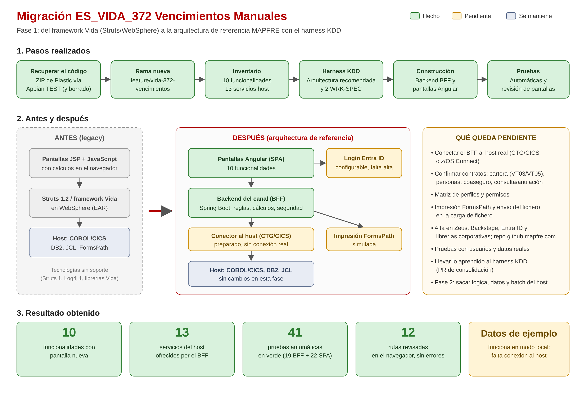

# Migración de ES_VIDA_372 Vencimientos Manuales — Fase 1

**Qué es:** el aplicativo de Vida para registrar y pagar manualmente los vencimientos (expedientes, impuestos, coaseguro, finiquitos). Era una aplicación web antigua del framework de Vida (Struts 1.2 sobre WebSphere) que trabaja contra el host (COBOL, DB2 y JCL).

**Objetivo:** modernizarlo a la arquitectura de referencia MAPFRE usando el harness KDD, que es el que decide la arquitectura y las reglas que se aplican.

**Dónde está:** rama `feature/vida-372-vencimientos` del repositorio `mapfre-pilot/spring-boot-realworld-example-app`.

## 1. Pasos realizados

| Paso | Qué se hizo | Resultado |
|---|---|---|
| 1. Recuperar el código | El ZIP de Plastic se dejó en ADM Administración (Appian TEST); se descargó, se comprobó que estaba completo y se borró de Appian. | Código disponible; el documento ya no existe en Appian. |
| 2. Rama nueva | Se creó una rama aislada y se subió el código original tal cual, en `legacy/`. | Copia del original para consultarla durante la migración. |
| 3. Inventario | Se analizó qué hace la aplicación: pantallas, operaciones, servicios del host, datos, cálculos y riesgos. | `docs/inventario-vida372.md`: 10 funcionalidades, 13 servicios del host. |
| 4. Harness KDD | Se buscó el producto en el grafo (`PROD-PPV-VENCIMIENTOS-MANUALES-001`, plataforma PPV) y se aplicó lo que el harness recomienda para PPV: pantallas Angular + backend de canal (BFF) en Spring Boot, y el host se mantiene. Se crearon las dos fichas de trabajo (WRK-SPEC), con las reglas que hay que cumplir y las dudas abiertas. | `.kdd/WRK-SPEC-NEW-BFF-001.md` y `.kdd/WRK-SPEC-NEW-SPA-001.md`. |
| 5. Backend del canal (BFF) | Nuevo backend Spring Boot que sustituye a Struts: ofrece las operaciones a las pantallas, aplica validaciones y seguridad, y hace los cálculos de importes que antes estaban en el navegador. La conexión con el host está aislada en un conector. | `vencimientos-manuales-bff/` |
| 6. Pantallas nuevas (SPA) | Nueva aplicación Angular con las 10 funcionalidades y un menú lateral. Solo habla con el BFF; no hace cálculos de negocio. | `vencimientos-manuales-web/` |
| 7. Pruebas | Pruebas automáticas, arranque en local con datos de ejemplo y revisión de todas las pantallas en el navegador. | Todo en verde (detalle en el punto 3). |

## 2. Funcionalidades migradas

| Funcionalidad | Antes (pantalla legacy) | Ahora |
|---|---|---|
| Búsqueda de expedientes | Búsqueda por expediente, póliza o NIF | Pantalla de búsqueda con listado y acceso al detalle |
| Alta, consulta, modificación y anulación | Gestión de expedientes | Pantalla de expediente con cuadro de coaseguro (hasta 6 entidades), datos fiscales y botón «Calcular» |
| Gestión de variables | Variables del expediente | Pantalla de variables |
| Emisión de finiquitos | Emisión de finiquitos | Pantalla de emisión (impresión simulada) |
| Impresión de informes | Impresión de informes | Pantalla de informes (impresión simulada) |
| Petición BDGI | Petición BDGI | Pantalla de petición BDGI |
| Reaseguro | Reaseguro | Pantalla de reaseguro |
| Cartera de póliza | Consulta de cartera | Pantalla de cartera de póliza |
| Gestión de carteras | Gestión de carteras | Pantalla marcada como **provisional** (falta el código del host en el ZIP) |
| Carga de fichero | Carga de fichero | Pantalla de carga (falta definir cómo se envía el fichero) |

## 3. Resultado obtenido

- **10 funcionalidades** con pantalla nueva y **13 servicios del host** disponibles a través del BFF.
- **Cálculos de importes** (bruto, neto, retención, líquido y reparto del coaseguro): se han pasado del JavaScript al BFF y se ha comprobado que dan el mismo resultado que el JavaScript original.
- **41 pruebas automáticas en verde** (19 del BFF y 22 de las pantallas). Compilación, revisión de estilo y formato sin errores.
- **12 rutas revisadas en el navegador** sin errores, incluida una búsqueda real contra el BFF y la apertura del detalle de un expediente.
- **Seguridad:** login con Entra ID preparado, con permisos de consulta y de gestión. Sin el modo local, nada responde sin identificarse.
- **Monitorización:** salud y métricas del servicio disponibles, y registros sin datos personales (NIF e IBAN enmascarados).
- **Importante:** hoy funciona en **modo local con datos de ejemplo**. Todavía **no está conectado al host real**: sin el modo local, las operaciones responden «integración pendiente».

## 4. Qué queda pendiente

| Pendiente | Quién lo tiene que resolver |
|---|---|
| Conectar el BFF al host real (CTG/CICS o z/OS Connect) y probar con datos reales | Arquitectura + equipo host |
| Confirmar contratos de servicios: cartera (VT03/VT05), personas por NIF (VT11), alta de coaseguro (VT12) y códigos de consulta/anulación (VT01) | Equipo host / funcional |
| Matriz de perfiles: quién puede consultar y quién puede modificar | Funcional / seguridad |
| Impresión de finiquitos e informes con FormsPath | Equipo de impresión |
| Cómo se envía el contenido del fichero en la carga de fichero | Funcional + equipo host |
| Alta del producto en Zeus OneTeam y Backstage, repositorio en `github.mapfre.com`, aplicación en Entra ID y librerías corporativas MAPFRE (desde aquí no son accesibles; se han usado equivalentes públicos) | SRE / DevOps |
| Pruebas con usuarios de negocio | Funcional |
| Llevar lo aprendido al harness KDD: stack del producto, patrón de integración con mainframe y que el BFF active las reglas de la plataforma PPV (PR al repo KDD, pendiente de tu confirmación) | Arquitectura |
| Fase 2: sacar del host la lógica, los datos y los procesos batch | Decisión de Arquitectura y del responsable funcional |

## 5. Dónde está cada cosa (rama `feature/vida-372-vencimientos`)

- `legacy/ES_VIDA_372VENCIMIENTOSMANUALES/` — código original.
- `docs/inventario-vida372.md` — inventario funcional y técnico.
- `.kdd/` — fichas de trabajo del harness (WRK-SPEC).
- `vencimientos-manuales-bff/` — backend del canal (Spring Boot).
- `vencimientos-manuales-web/` — pantallas (Angular).
- `docs/migracion-vida372/` — este documento y el diagrama.
