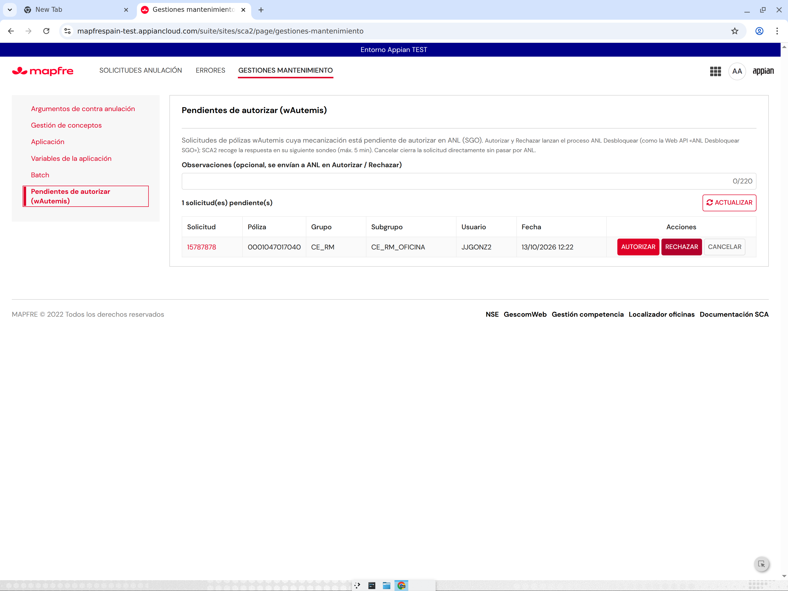
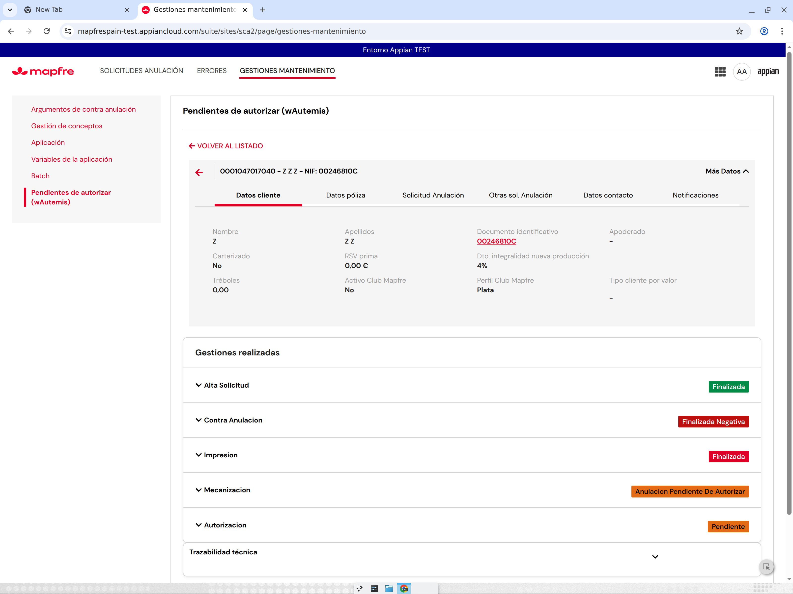
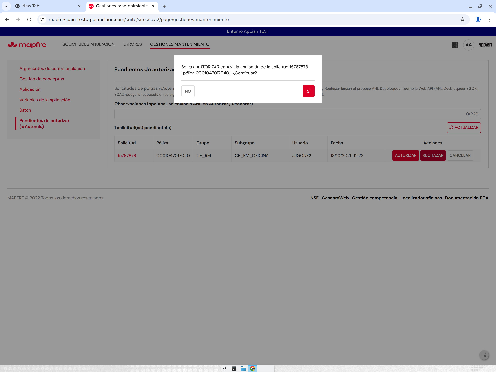

# Ronda 19 — Mantenimiento «Pendientes de autorizar (wAutemis)»

**Petición:** nueva página en *Gestiones mantenimiento* (`SCA2_GestionMantenimientoMenu`) que liste las pólizas wAutemis cuya mecanización está pendiente de autorizar, con enlace al Detalle, póliza, grupo/subgrupo SCA, fecha y acciones AUTORIZAR / RECHAZAR (vía proceso `ANL Desbloquear`, misma lógica de parámetros que la Web API `ANL Desbloquear SGO`) y CANCELAR (cancelación directa sin ANL). Objetivo: probar Autemis sin esperar a los sistemas externos. **La lógica de SCA2 no cambia**: sólo se añaden objetos de mantenimiento.

## 1. Cómo funciona la espera real (lo que no se toca)

`SCA2 CMD Mecanizar`: tras `guardarMecanizacion`, si la póliza es wAutemis y Emisión responde `00000005/00000006` («¿wAutemis pdte. aceptar?», nodo 324), el proceso marca la solicitud `procesoActivo = "ANL"` y entra en el bucle «Esperar ANL» (timer 5 min, nodo 302) → «Consultar ANL» (`ANL_getAnulacionByFilter_qr(idSolicitud)`, nodo 303) → «¿ANL desbloqueada?» (nodo 304: hay respuesta si `DESBLOQUEO_ANULACION` o `ESTADO` no están vacíos) → «Preparar actualización» (nodo 308, `SCA2_polizaVigente` decide autorizada/rechazada). Tras 24 h sin respuesta: error `ANL_TIMEOUT` relanzable.

En producción esa respuesta la escribe SGO llamando a la Web API **`ANL Desbloquear SGO`** (`POST /desbloquearsgo`, uuid `02a69820-0ce8-4e54-a106-93861810ae6a`), cuyo cuerpo (leído en Designer con el usuario devin, anexo `webapi_ANL_Desbloquear_SGO_pantalla.txt`) es un *passthrough*:

```sail
local!json: a!fromJson(http!request.body),
a!startProcess_24r3(
  processModel: cons!ANL_DESBLOQUEARSGO,          /* PM «ANL Desbloquear» 0002eab3-dea6-8000-b85c-7f0000014e7a */
  processParameters: {
    estado: json.estado, idOperacion: json.idOperacion, idSolicitud: json.idSolicitud,
    nivelGestion: json.nivelGestion, nuumaNew: json.nuuma, observacionesNew: json.observaciones,
    sistema: json.sistema, desbloqueoAnulacion: json.desbloqueoAnulacion },
  onSuccess: 200 toJson(fv!processInfo), onError: 500)
```

PM `ANL Desbloquear`: `getAnulacion` → `Update Anulacion` (`ANL_updateAnulacion` con estado/observacionesNew ≤220/nuumaNew/sistema/nivelGestion/desbloqueoAnulacion) → «Desbloquear Poliza en Central» → `¿Estado Autorizado?` (`estado = "1"`) → **sí**: «Anular Poliza NEW» → «Cierre SGO y STCAT» → desbloquear el proceso principal de **SCA** (`SCA_obtenerIdMecanizacionDesbloqueo`; para SCA2 no hace nada: SCA2 lo detecta por el sondeo) · **no**: evento `ESTADO_NO_AUTORIZADO` → «Cierre SGO y STCAT». Los *valores* (p. ej. `desbloqueoAnulacion`) los fija SGO, no están en Appian; en TEST no hay ninguna fila ANL con `ESTADO`/`DESBLOQUEO_ANULACION` informados (la Web API nunca ha corrido).

## 2. Objetos (SCA2 TEST)

| Objeto | UUID | Versión | Cambio |
|---|---|---|---|
| `SCA2_MantenimientoPendientesAutorizar` (interfaz, **nueva**) | `_a-0000f090-b70c-8000-9d35-011c48011c48_5582354` | 1 → 2 | Listado + acciones (anexo `.sail`). v2: color de AUTORIZAR |
| `SCA2_PM_ANL_DESBLOQUEAR` (constante PM, **nueva**) | `_a-0000f090-b70c-8000-9d35-011c48011c48_5582037` | 1 | Apunta a `ANL Desbloquear` |
| `SCA2_GestionMantenimientoMenu` | `_a-0000f069-4f37-8000-9cc8-011c48011c48_20060073` | 2 → 3 | Opción 6 «Pendientes de autorizar (wAutemis)» → `rule!SCA2_MantenimientoPendientesAutorizar()` |

Backups/relecturas: `sca2work/r19/before_menu.json`, `after_menu.json`, `after_ifc_v2.json`, `test_*.json` (testInterface sin errores).

### Listado
`a!queryRecordType(SCA2 Solicitud, procesoActivo = "ANL" AND origenPoliza = "wAutemis")`, orden `modifiedAt` desc, refresco cada minuto y botón ACTUALIZAR. Columnas: **Solicitud** (enlace que abre inline `rule!SCA2_DetalleSolicitud` — el mismo Detalle del buscador — con «VOLVER AL LISTADO»), **Póliza**, **Grupo**/**Subgrupo** (`SCA2 Datos Perfiles Pca.codperfil/codsubperfil` del usuario que dejó la solicitud; si no hay, `grupoAsignacion`), **Usuario** (nuuma), **Fecha** (`modifiedAt`, última transición = entrada en espera ANL) y **Acciones**. Un campo «Observaciones» (≤220) se envía a ANL en Autorizar/Rechazar.

### Acciones (todas con confirmación Sí/No)
| Acción | Qué hace | Efecto en SCA2 |
|---|---|---|
| AUTORIZAR | `a!startProcess(cons!SCA2_PM_ANL_DESBLOQUEAR, {idSolicitud, estado: "1", desbloqueoAnulacion: "S", nuumaNew: nuuma del usuario logado, observacionesNew, sistema: "SGO", nivelGestion: nivelIntervencion})` | ANL actualiza la fila; Mecanizar lo ve en ≤5 min y sigue por «Preparar actualización» (`polizaVigente` → autorizada) |
| RECHAZAR | igual con `estado: "2"` (cualquier valor ≠ "1" va por «no autorizado») | ídem; `polizaVigente` → rechazada |
| CANCELAR | igual que el CANCELAR de la pantalla de Autorización: `SCA2_guardarAutorizacion` en CORE (`codEstado "5"`, `mcaAutorizada "N"`, infoUsuario del logado, codGestion/tipoAutorizacion de `SCA2_consultarAutorizacion`) y, si CORE responde bien, `SCA2 CMD Finalizar(idSolicitud, estadoFinal: "CANCELADA")`. **No llama a ANL** | La solicitud queda CANCELADA en SCA2 y cancelada en CORE |

Límites documentados: (1) `desbloqueoAnulacion = "S"` y `estado = "2"` para rechazo son valores supuestos (la Web API los recibe de SGO); Mecanizar sólo necesita que `ESTADO`/`DESBLOQUEO_ANULACION` dejen de estar vacíos, así que el flujo SCA2 se reanuda igual. (2) Tras CANCELAR, el `CMD Mecanizar` que estuviera esperando sigue sondeando hasta las 24 h y acabará en `ANL_TIMEOUT` (fila en Errores) — no se puede abortar desde SAIL sin cambiar el PM, y la lógica no debe cambiar. (3) El PM ANL llama a integraciones externas (central, NEW, SGO/STCAT): en TEST pueden fallar; el PM registra el error y Mecanizar se reanuda igual porque la fila ANL ya se ha actualizado antes.

## 3. Pruebas
- `testInterface` de la interfaz nueva y del menú: sin errores; lista 15787878 (0001047017040, CE_RM/CE_RM_OFICINA, JJGONZ2, 13/10/2026 12:22).
- UI (testing agent, usuario administrador devin, vídeo `sca2-pendientes-autorizar-ui-edited.mp4`): opción 6 visible; listado completo; enlace → Detalle inline y VOLVER; confirmaciones de las 3 acciones (canceladas con NO, tabla intacta); ACTUALIZAR; regresión de «Argumentos» y «Gestión de conceptos». Hallazgo corregido: AUTORIZAR salía rojo (`ACCENT` = rojo del tema) → verde `#2E7D32` (v2). JJGONZ2 no ve la página (sólo SCA2 Administradores, como el resto del mantenimiento).
- **No ejecutadas** las acciones reales: la única solicitud listada, 15787878, es un dato antiguo (H4, ronda 8) cuyo `CMD Mecanizar` ya no está vivo (0 instancias activas), y no hay forma de forzar que Emisión devuelva `00000005` para crear un caso nuevo. Pendiente de decisión (§4).






## 5. Pruebas reales (19/10, segunda fase, OK del usuario)

| Caso | Solicitud / póliza | Resultado |
|---|---|---|
| Diagnóstico | 15788100 / 0001047017041 | **Defecto SCA2 encontrado**: el nivel de Emisión «00000005» viaja en `pv!observaciones` de `CMD Mecanizar` y se perdía al pasar por la tarea Verti (la pantalla Verti relanzaba el comando con su texto libre) → ninguna wAutemis con inducción entraba en espera ANL. |
| Fix 1 | `SCA2 CMD Mecanizar` nodo «Write Tarea VERTI» + `SCA2_VertiVencimientoPrincipal` v9→v11 | La tarea VERTI guarda `tokenTarea = MEC:<nivel>|<rolNse>|<mcaReservaPrima>|<importeRsvPrima>` (columna de 64 car.; el primer intento en JSON superó el límite → 15788101 en ERROR; `split()` descarta el último campo vacío → 15788102 sin espera) y la pantalla lo devuelve al comando al CONTINUAR. |
| AUTORIZAR | 15788103 / 0001047017092, 17:34 | Página → PM `ANL Desbloquear` (13 s): fila ANL `ESTADO=1`, `DESBLOQUEO_ANULACION=S`, `NUUMA_NEW`, `OBSERVACIONES_NEW`. `CMD Mecanizar` lo detecta en el 1.er sondeo (17:36) y continúa. «Desbloquear Póliza en Central» (RecubrirNew PRE) devuelve 500 / «No se ha encontrado ninguna Póliza en Central» → póliza sigue vigente → `actualizarMecanizacion(4, V)` → **«Cerrada sin mecanizar» / «Finalizada. Rechazada anulación»** (misma regla que SCA). Fallo externo, no de Appian. |
| RECHAZAR | 15788105 / 0001047017002, 18:08 | Igual con `ESTADO=2`; detectado a los 2 min; cierre «Sin mecanizar» + CA nivel 2 (rama normal post-ANL). |
| CANCELAR | pendiente | Sin póliza apta antes del corte de la sesión (criterio apto: A EFECTO con fecha fija de CORE anterior a hoy, sin solicitud CORE; 00000004 no aplica). Se repite en la ronda 20. |

Conclusión: la herramienta permite probar Autemis sin esperar a SGO (ANL recibe la respuesta y SCA2 reanuda en ≤5 min). El desenlace funcional (anulada / rechazada) depende de Central/NEW de PRE, que en TEST no encuentra estas pólizas.

## 4. Pendiente / decisiones
1. ¿Probar AUTORIZAR/RECHAZAR sobre 15787878 (dato antiguo; el PM ANL escribiría en su fila ANL 2101 y llamaría a central/NEW/SGO) o esperar a una póliza wAutemis que Emisión deje «pendiente de aceptar» (00000005/06) para probar el ciclo completo con dato nuevo?
2. Confirmar con SGO/ANL los valores reales de `desbloqueoAnulacion` y del `estado` de rechazo para igualarlos.
3. Si se quiere que CANCELAR también detenga el sondeo del Mecanizar, habría que tocar el PM (fuera del alcance: «la lógica no cambia»).
