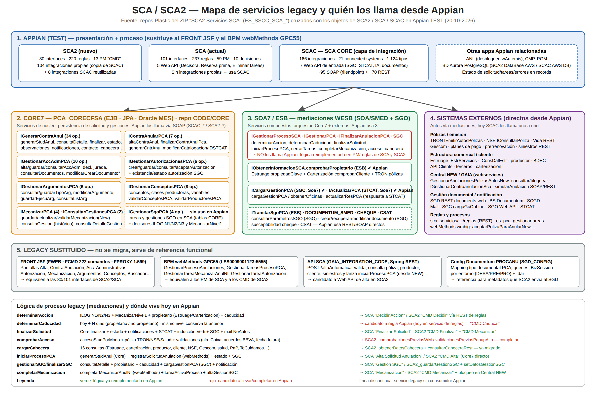
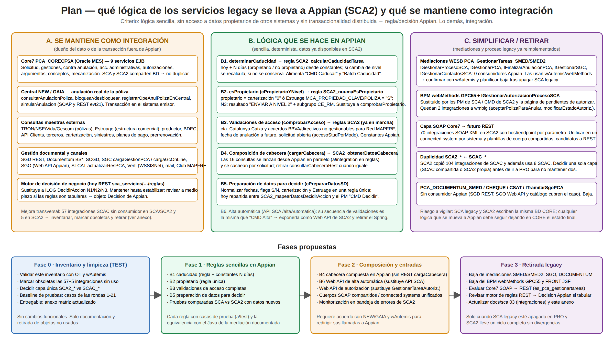

# 40. Servicios legacy de SCA (repos Plastic): inventario, lógica, relación con Appian y plan para llevar lógica a Appian

**Fecha:** 20-10-2026 · **Entorno Appian analizado:** TEST (`mapfrespain-test`) · **Fuente:** documento Appian «SCA2 Servicios SCA» (id `567933`, uuid `_a-0000f093-2064-8000-9d36-011c48011c48_5590387`, ZIP de 94,5 MB) que contiene la exportación de los repositorios Plastic del SCA legacy (`ES_SSCC_SCA_*`).

Documento de análisis: **no se ha modificado ningún objeto Appian ni código**. Anexo con la matriz completa: [anexos/40-matriz-servicios-appian.md](anexos/40-matriz-servicios-appian.md). Diagramas: [img/40-mapa-servicios-sca.svg](img/40-mapa-servicios-sca.svg) (mapa de servicios y lógicas) y [img/40-plan-logica-appian.svg](img/40-plan-logica-appian.svg) (plan); ambos con versión PNG para presentaciones.

## 1. Resumen ejecutivo

- El ZIP contiene **9 repositorios Plastic** del SCA/PCA legacy (código Java del FRONT, SOA y CORE, diseño con WSDL y fichas de servicio, código de la API GAIA, configuración Documentum, estructura de implantación y módulo SGO).
- Se han identificado **19 servicios publicados (RAS)** con **137 operaciones WSDL**, repartidos en cuatro familias:
  1. **Core7 EJB** (`PCA_CORECFSA_HTTPRouter`, 9 servicios, 81 operaciones): persistencia de la solicitud y sus gestiones en Oracle (esquema MES, tablas `A2139xxx/D2139xxx`). **Es el "CORE" que hoy comparten SCA y SCA2.**
  2. **Mediaciones SOA7/ESB (WESB)** (6 servicios, 14 operaciones): servicios *compuestos* que orquestan Core7 + sistemas externos y contienen la lógica de proceso (`determinarAccion`, `determinarCaducidad`, `finalizarSolicitud`, `comprobarAcceso`, `cargarCabecera`, `iniciarProcesoPCA`, `gestionarSGC`…).
  3. **webMethods BPM** (1 servicio, 3 operaciones): la tarea manual de autorización del proceso GPC55.
  4. **webservices GAIA/NEW** (2 servicios, 6 operaciones): recubrimiento de la anulación en Central (MUTUA.NEW.ANULACION) y utilidades de STCAT/competencia.
- **Relación con Appian:** SCAC (SCA CORE) tiene 166 integraciones y SCA2 104 (copias de SCAC) → Appian ya llama **una a una** a las operaciones Core7 (26 de las 34 de `IGenerarContraAnul`, todas las de contra anulación, acciones administrativas, autorizaciones, argumentos, conceptos, mecanización y gestiones) y a los sistemas externos directamente. **Ninguna de las mediaciones de proceso (`IGestionarProcesoSCA`, `IGestionarPCA`, `IFinalizarAnulacionPCA`, `IGestionarSGC`, `ITramitarSgoPCA`) ni el BPM webMethods tienen consumidor en Appian:** esa lógica ya fue reimplementada en los 59 PM de SCA y en los 13 `CMD` de SCA2, apoyándose en un servicio REST de reglas (`sca_servicios/…/reglas`) que sustituye a los decisores ILOG.
- **Dónde está la mejora:** (a) la lógica *sencilla* que aún se delega fuera (caducidad, condición de propietario, validaciones de acceso, composición de cabecera, preparación de datos para decidir, alta automática) puede hacerse en reglas Appian con constantes, más rápida y testeable; (b) hay **57 integraciones SCAC sin consumidor en reglas/PM/Web API de SCA ni en SCA2, y 5 en SCA2** que conviene revisar y retirar; (c) SCA2 duplica la capa de integración de SCAC (104 copias + 8 reutilizadas) y conviene decidir una capa única antes de PRO; (d) los 70 SOAP XML de SCA2 hacia Core7 reciben `host`/`endpoint` por parámetro y podrían unificarse.

## 2. Qué contiene el ZIP (repositorios Plastic)

| Repositorio | Contenido | Ficheros | Relevancia para SCA2 |
|---|---|---|---|
| `ES_SSCC_SCA_CODE` | Código Java del SCA legacy: `FRONT` (FWEB JSF, FCMD 222 comandos, FPROXY 1.599 clientes WS), `SOA` (SMED mediaciones WESB + SLIB librerías/WSDL), `CORE` (CFSA fachada EJB + SUBAPP lógica/JPA), `DOC` | 7.246 | Alta: aquí están la lógica de proceso (SMED) y la del CORE (SUBAPP) |
| `ES_SSCC_SCA_DESIGN` | Diseño técnico: `01 MDI` (modelos .efx), `02 MFD`, `03 PRB` (especificaciones de pruebas por comando), `04 MDE`, **`07 RAS`** (19 servicios: WSDL por entorno desa/ic/pre/pro + ficha `.doc/.docx`), tablas paramétricas | 248 | Alta: inventario oficial de servicios y sus operaciones |
| `ES_SSCC_SCA_GAIA_INTEGRATION_CODE` | API REST «Gaia Integration SCA» (Spring): `POST /altaAutomatica` + proxies WSDL (IConsultarPoliza, IEmitirAutosPolizas, IGestionarPCA, IGenerarContraAnul, Estruage, terceros, clientes, productor, siniestros) + ficha RAM y SoapUI | 97 | Media: alta automática desde NEW/GAIA; candidato a Web API de SCA2 |
| `ES_SSCC_SCA_SGO` | Mediación `PCA_GestionarSGO_SMED` (`ITramitarSgoPCA.consultarParametrosSGO`) + librerías SGO | 340 | Baja: Appian usa las Web API SGO propias |
| `ES_SSCC_SCA_MAPFAMI_PROCANU_SGD_CONFIG` | Configuración Documentum del proceso PROCANU por entorno (mapping tipo documental, queries, BizSession) | 12 | Media: referencia de metadatos SGD |
| `ES_SSCC_SCA_PCA` / `ES_SSCC_SCA_PCA006` | Estructura de implantación (Oracle PL, cargas, EAR, manual de operaciones, .dar Documentum) | 320 / 73 | Baja: operación legacy |
| `ES_SSCC_SCA_DOCUM` | Plantilla de proyecto (readmes); sin documentación funcional real | 43 | Nula |
| `ES_SSCC_SCA_GAIACORE_CODE` | Vacío en la exportación | 0 | — |

Capas del legacy y su equivalente actual:

| Capa legacy | Tecnología | Equivalente hoy |
|---|---|---|
| FRONT (FWEB/FCMD/FPROXY) | JSF + comandos + clientes WS | Interfaces y reglas de SCA (101/237) y SCA2 (80/220) |
| BPM GPC55 | webMethods (`GestionarProcesoAnulaciones`, `GestionarTareasProcesoPCA`, `GestionarTareaMecanizarAnulNI`, `GestionarTareaAutorizacion`) | PM de SCA (Alta, Decidir Accion, Mecanizacion, Autorización, Finalizar…) y `SCA2 CMD *` |
| SOA (SMED) | WESB mediation flows + Java custom | Reglas/PM Appian + servicio REST de reglas |
| CORE (CFSA/SUBAPP) | EJB + JPA Oracle | **Se mantiene**: Core7 `PCA_CORECFSA_HTTPRouter`, llamado por SCAC/SCA2 |
| Decisores | ILOG `IDecidirAccionNivel1/2/3`, `IMecanizarNivel1` (Core7 `PCAApp_CCFSA*_v3`) | REST `sca_servicios/api/1.0/compania/{cia}/poliza/{pol}/reglas` (`SCAC_scaServiciosReglas`) |

## 3. Inventario de servicios (07 RAS) y su funcionalidad

### 3.1 Core7 — servicios de núcleo (EJB `PCA_CORECFSA_HTTPRouter`, acceso Oracle por JPA)

| Servicio | Op. | Funcionalidad | Lógica relevante en CORE (SUBAPP) |
|---|---|---|---|
| `IGenerarContraAnul` | 34 | Ciclo de vida de la **solicitud**: `generarStudAnul` (alta), `consultaDetalleSolicitud`, `actualizarSolicitud`, `actualizarEstado`, `finalizarSolicitud`, `consultarSolicitudes` (buscador), `consultarAccesoStudPorModo` (¿hay solicitud abierta?), `consultarCabecera`, `consultarCausa/Motivo/Detalle` (catálogos), observaciones, notificaciones externas, contacto cliente, impresión (`consultaImpr/guardarImpr`), `monitorizarSolicitud`, `reasignarTareaNivelII`, bono/bonificación cliente, `altaSolicitudAltitude` | `SolicitudAnulacionCON` (42 métodos, 200 KB): validaciones de alta, existencia de solicitud, estados, grupo, datos Autemis |
| `IContraAnularPCA` | 7 | **Contra anulación**: alta, finalizar (`finalizarContraAnulPca`), `generarCntrAnu`, validar finalización, detalle de argumentos ejecutados, cambio de catalogación/compañía, id STCAT | `ContraAnularCON`: estados de contra anulación, argumentos, ofrecimiento de suplemento, contra anulación cedida |
| `IGestionarAccAdmPCA` | 10 | **Acciones administrativas** y declaración jurada; documentos administrativos (carta, DNI, admin) | `AccAdministrativaCON`, `DocumentoCON` |
| `IGestionarAutorizacionesPCA` | 6 | **Autorización** (anular fuera de fechas): crear/guardar/consultar/aceptar; existencia/estado de autorización SGO | `AutorizacionCON` |
| `IGestionarArgumentosPCA` | 6 | Tipos de argumento y ejecución de argumentos de contra anulación | `TipoArgumentoCON` |
| `IGestionarConceptosPCA` | 8 | Conceptos, clases productoras y **variables de aplicación** (`D2139018-021`), validaciones de concepto/productor | `ConceptosCON` |
| `IMecanizarPCA` | 4 | Guardar/actualizar/validar **mecanización** (`guardarMecanizacionNew`) | `MecanizacionCON` |
| `IConsultarGestionesPCA` | 2 | Histórico y detalle de **gestiones** de una solicitud | `GestionCON` (18 métodos) |
| `IGestionarSgoPCA` | 4 | Tareas y gestiones **SGO** registradas en SCA | `GestionarTareasSgoCON` |

### 3.2 SOA7 / ESB — mediaciones (lógica de proceso)

| Servicio · operación | Qué hace (según `.medflow` y ficha RAS) | Llama a |
|---|---|---|
| `IGestionarProcesoSCA.determinarAccion` | Decide la siguiente acción de la solicitud y el nivel/usuarios; calcula si el usuario es **propietario** (carterización = `0` ó Estruage `MCA_PROPIEDAD_CLAVE/POLIZA = S`; en N3 según resultado `ENVIAR A NIVEL 2` + subgrupo `CE_RM`) y prepara fechas/flags (`cPrepararDatosSD`) | ILOG `IDecidirAccionNivel1/2/3`, `IMecanizarNivel1`, `IGenerarContraAnul.visualizarDatosSolicitud`, carterización, `IEmitirAutosPolizas.consultarPolizas` (TRON), Estruage `consultaPropiedadClave`, `determinarCaducidad` |
| `IGestionarProcesoSCA.determinarCaducidad` | **Caducidad de la tarea** = hoy + N días (`caducidad.dias.propietario` / `…no.propietario`, configuración); si la tarea sigue en el mismo nivel conserva la caducidad anterior; formatos `dd/MM/yyyy` (CORE) y `yyyy-MM-dd` (TRON) | — (solo Java) |
| `IGestionarProcesoSCA.finalizarSolicitud` | Finaliza: Core `finalizarSolicitud` + `actualizarEstado`, notificaciones externas, respuesta a **STCAT** (`IActualizarPCA.ActualizarResPCA`), inducción **Verti**, gestión **SGC**, correo «no autos» | `IGenerarContraAnul.*`, `IActualizarPCA`, `IGestionarContactosSCA.induccionVerti/gestionarSGC/notificarNoAutos`, productor, TRON |
| `IGestionarPCA.iniciarProcesoPCA` | Alta de solicitud desde wAutemis/webMethods: `generarStudAnul` + registrar en BPM + `actualizarEstado` + SGC | Core7, webMethods `GestionarProcesoAnulaciones.registrarSolicitudAnulacion`, `gestionarSGC` |
| `IGestionarPCA.comprobarAcceso` | Validaciones previas al alta: solicitud abierta (`consultarAccesoStudPorModo`), póliza TRON/NSE/Salud, variable de aplicación; Java: compañía Catalunya Caixa y acuerdos BBVA/directivos **no gestionables para Red MAPFRE**, anulación a futuro (`acceso.anulaciones.futuro`), fecha futura válida | Core7, TRON, NSE `pObtenerPolizaFecha`, ESB Salud, `consultarVariable` |
| `IGestionarPCA.cargarCabecera` | **Cabecera** de la solicitud en una sola llamada: 16 consultas (Estruage agente/clave/propiedad, carterización, productor, terceros, ficha cliente, NSE, Gescom, Salud, importes aviso renovación, Puerta a Puerta, TeCuidamos, susceptibilidad cheque, CSAT) | ver anexo |
| `IGestionarPCA.cerrarTareasPCA` / `completarTareasMecanizacion` | Cierre de tarea y completar mecanización desde webMethods | `finalizarSolicitud`, `GestionarTareaMecanizarAnulNI`, `obtenerTareaActivaProceso`, `generarAltaGestionSGC` |
| `IFinalizarAnulacionPCA.finalizarAnulacion` / `finalizarSGC` | Finalizar solicitud y gestión SGC (desde webMethods) | `finalizarSolicitud`, `gestionarSGC` |
| `IGestionarSGC.generarAltaGestionSGC` · `IGestionarContactosSCA.gestionarSGC` | Alta de gestión en **SGC** (datos de solicitud, póliza, propietario, caducidad) | `ICargarGestionPCA.CargaGestionPCA`, Core7, TRON, `comprobarPropietario`, `determinarCaducidad` |
| `IObtenerInformacionSCA.comprobarPropietario` / `validarStudPropietaria` | ¿Es el usuario propietario de la póliza (clave de producción o carterizador)? ¿Ha intervenido en la solicitud? | Estruage, carterización, TRON, Core7 |
| `ITramitarSgoPCA.consultarParametrosSGO` (ESB) | Parámetros para crear gestiones en SGO desde SCA | SGO `ProcessesCatalog`, `IGestionarSgoPCA.consultarTareaSgo` |
| `PCA_DOCUMENTUM_SMED` (crear/recuperar/modificar documento), `PCA_CHEQUE_SMED`, `PCA_CSAT_SMED` | Documentum `MAPFRE_COMUN_SGD` (BSCreateDocument, BSAddDocumentBinaryContent, BSGetDocumentBinaryContent), susceptibilidad cheque, middleware CSAT | — |

### 3.3 webMethods y GAIA/NEW

| Servicio | Op. | Funcionalidad |
|---|---|---|
| `IGestionarAutorizacionProcesoSCA` (webMethods, proceso GPC55) | 3 | Tarea manual de autorización del BPM: `obtenerAutorizacion`, `guardarAutorizacion`, `completarAutorizacion` |
| `GestionarAnulacionesPolizasAutosNew` (webservices `RecubrirNew`) | 4 | Recubre MUTUA.NEW.ANULACION: `consultarAnulacionPoliza` (situación futura), `registrarOpeAnulPolizaEnCentral` (anulación en Central), `bloquearPolizaEnCentral`, `desbloquearPolizaEnCentral` |
| `IGestionarContraanulacionSca` | 2 | `consultarPrealtaStCat` (solicitudes en prealta para STCAT), `obtenerUrlGestionCompetencia` |
| API «Gaia Integration SCA» `POST /altaAutomatica` (Spring) | 1 | Alta automática: valida entrada → `consultarAccesoStudPorModo` (no duplicar) → póliza NSE/PCA → clasificación TC → productor → terceros/cliente → carterización → siniestros → estructura comercial → `IGestionarPCA.iniciarProcesoPCA` |

## 4. Relación con los servicios de SCA en Appian (quién llama a qué)

Resumen (detalle operación a operación y consumidores en el anexo):

| Familia legacy | Integraciones en SCAC | Copias en SCA2 | Cobertura de operaciones | Quién las usa |
|---|---|---|---|---|
| Core7 EJB (9 servicios) | 69 (connected system `SCAC SCA Core7`) | 50 | `IGenerarContraAnul` 26/34 (SCA2 18), `IContraAnularPCA` 6/7 (3), `IGestionarAccAdmPCA` 9/10 (7), `IGestionarAutorizacionesPCA` 4/6, `IGestionarArgumentosPCA` 5/6 (4), `IGestionarConceptosPCA` 6/8 (3), `IMecanizarPCA` 2/4, `IConsultarGestionesPCA` 2/2, `IGestionarSgoPCA` 0/4 | Reglas envoltorio `SCA_*`/`SCA2_*` llamadas desde interfaces (Alta, Detalle, Contra Anulación, Acciones Administrativas, Autorización, Mecanización, Buscador, mantenimiento de conceptos) y PM (`SCA Alta Solicitud`, `SCA2 CMD Alta/CrearAccion/CompletarAccion/Mecanizar/Caducar`) |
| Mediaciones SOA7/ESB | 3 (`comprobarPropietario`, `cargaGestionPCA`/`obtenerOficinas`, `actualizarResPCA`) | 2 | 0/14 de las operaciones de proceso | `SCA2_setDatosGestionSGC`, `SCA2_guardarGestionSGC`, `SCA_cerrarOperacion` |
| webMethods | 2 (`aceptarPolizaParaAnularNew`, `modificarEstadoAutorizacion` en `SCAC SCA Wmbig1is`) + 2 REST (`obtenerSolicitudesNuuma`, `obtenerTraduccionMotivosSca`) | 0 | `IGestionarAutorizacionProcesoSCA` 0/3 | sin consumidor en reglas/PM de SCA (revisar interfaces) |
| GAIA/NEW webservices | `consultarAnulacionPoliza`, `bloquearPolizaEnCentral`, `obtenerUrlGestionCompetencia`, `simularAnulacionPoliza` SOAP y REST | 4 | 2/4 + 1/2 | `SCA2 CMD Mecanizar`, `SCA2_consultarNewAlta`, `SCA2_MecanizacionPrincipal` |
| Sistemas externos directos (sin pasar por mediación) | ~90 (TRON, NSE, Vida, Gescom, Estruage, productor, BDEC, API Clients, terceros, SGD/Documentum, SGC, SGO, STCAT, Club MAPFRE, Retos, siniestros, planes de pago, reglas REST, `es_pca_gestionartareas_bbe-web`) | ~50 | — | `SCA2_obtenerDatosCabecera`, `SCA2_construirContextoAlta`, buscador, acciones |

Hechos relevantes del cruce:

1. **SCA (actual) no tiene integraciones propias:** todas están en SCAC. SCA2 copió 104 (`[SCA2] copia de SCAC_…`) y además usa 8 de SCAC (`asignarRetos`, `obtenerTokenRetos`, `borrarDocumentoSCA`, `consultaBBDDSCA`, `modificarMarcaEconomica`, `monitorizarSolicitud`, `obtenerOficinas`, `posibilidadReservaPrima`).
2. Las integraciones SOAP a Core7 reciben `host` y `endpoint` como *rule inputs* (`relativePathExpression: ri!endpoint`, cabecera `Host: ri!host`) y el cuerpo XML tipado desde un `Map`. Hay 119 SOAP en SCAC y 70 en SCA2.
3. **Sin consumidor:** 57 integraciones SCAC no las referencia ninguna regla, PM (incluidos nodos *Call Integration*) ni Web API de SCA, ni ningún objeto de SCA2 (las 101 interfaces de SCA no se han cargado en este cruce, por lo que algunas pueden usarse desde UI). En SCA2, con sus 80 interfaces incluidas, quedan 5 sin uso: `SCA2_APIClients_Login`, `SCA2_CargaGcOnLine`, `SCA2_ObtenerCredencialesConceptos`, `SCA2_ObtenerDocumentosArgumentos`, `SCA2_monitorizarSolicitud` (SCA2 usa en su lugar `SCAC_monitorizarSolicitud`). `SCAC_posibilidadReservaPrima` y `SCAC_modificarMarcaEconomica` solo las usa SCA2.
4. Los procesos de negocio que en el legacy vivían en mediaciones + webMethods están hoy en Appian: `SCA Decidir Accion` / `SCA2 CMD Decidir` (reglas REST + `SCA2_mapearDatosDecidirAccion`), `SCA Alta Solicitud Anulacion` / `SCA2 CMD Alta` (`generarStudAnul` directo), `SCA Finalizar Solicitud` / `SCA2 CMD Finalizar`, `SCA Mecanizacion` / `SCA2 CMD Mecanizar`, `SCA Gestion SGC` / `SCA2_guardarGestionSGC`, `SCA Batch Caducidad` / `SCA2 CMD Caducar`, `SCA Autorización` / página `SCA2_MantenimientoPendientesAutorizar` + ANL.
5. **Dependencias inversas ya conocidas** (doc 03): `SCAC_descargaDocumentoIntegracion` → `cons!SCA_WEBSERVICES_URL`, `SCAC_simularAnulacionPolizaIntegracion` → `rule!SCA_obtenerUserPassSimularPoliza`.

## 5. Qué se puede mejorar y qué lógica conviene hacer en Appian

Criterio aplicado: **se lleva a Appian** la lógica que es determinista, sencilla, usa datos que SCA2 ya tiene (o ya consulta) y no requiere transacción en otro sistema; **se mantiene como integración** lo que es propietario de otro sistema (persistencia CORE, anulación en Central, maestros) o transaccional.

### 5.1 Candidatos a implementar la lógica en Appian (SCA2)

| # | Lógica legacy | Dónde está hoy | Propuesta Appian | Por qué es sencilla | Riesgo |
|---|---|---|---|---|---|
| B1 | `determinarCaducidad` (`cDeterminarCaducidad`) | Mediación SMED2; en SCA2 la caducidad llega del servicio de reglas / `fechaDietario` | Regla `SCA2_calcularCaducidadTarea(propietario, mismoNivel, caducidadAnterior)` con constantes `SCA2_DIAS_CADUCIDAD_PROPIETARIO` / `_NO_PROPIETARIO`; usada por `CMD Decidir`, `CMD Caducar` y el barrido de caducidad | 30 líneas de Java: suma de días y comparación de fechas | Bajo; validar con OT los valores de configuración actuales (`caducidad.dias.*`) |
| B2 | Condición de **propietario** (`cPropietarioYNivel`) | Mediación + `IObtenerInformacionSCA.comprobarPropietario` (ESB) que SCA2 sigue llamando en `setDatosGestionSGC` | Ampliar `SCA2_nuumaEsPropietario`: propietario si carterización `pcodretorno = 0` **o** Estruage `MCA_PROPIEDAD_CLAVE = S` **o** `MCA_PROPIEDAD_POLIZA = S`; reglas N3/N4 por `resultadoSD` y subgrupo `CE_RM`. Los datos ya se consultan en `obtenerDatosCabecera` (Estruage, carterización) | Expresión booleana sobre datos ya disponibles; elimina una llamada ESB por gestión SGC | Medio: comprobar equivalencia con casos reales (SI24, CE_RM) antes de retirar la integración ESB |
| B3 | Validaciones de acceso al alta (`comprobarAcceso`: `cValidarPolizasGestionables`, `cValidarFechaFutura`, `cValidarPolizasNoRM`) | Parcialmente en `SCA2_comprobacionesPreviasWM` / `SCA2_validacionesPreviasPopupAlta` | Completar reglas con constantes: `CIA_CATALUNYA_CAIXA`, acuerdos `AC_BBVA_*`, `AC_DIRECTIVOS_*` no gestionables para Red MAPFRE; flag anulación a futuro; fecha de anulación futura válida solo si es anterior a hoy | Comparaciones de códigos y fechas | Bajo; confirmar lista vigente de acuerdos |
| B4 | Composición de **cabecera** (`cargarCabecera`, 16 consultas) | `SCA2_obtenerDatosCabecera` + REST `consultarCabeceraRest` (`es_pca_gestionartareas_bbe-web/cargaCabecera`) | Mantener solo la composición en Appian (ya existe) y retirar la dependencia del REST `cargaCabecera` cuando devuelva lo mismo; cachear por solicitud | Ya migrado en gran parte | Medio: rendimiento (ver doc 11); paralelizar las `a!integration` |
| B5 | Preparación de datos para decidir (`cPrepararDatosSD`: fechas CORE/TRON, flags S/N, carterización, Estruage, recibo impagado) | `SCA2_mapearDatosDecidirAccion` + nodo «Consultar reglas» del PM `CMD Decidir` | Una sola regla pura y testeable (`a!test`) que construya la entrada del motor de reglas, documentando la equivalencia campo a campo con el XSLT/Java | Transformación de datos | Bajo |
| B6 | **Alta automática** (API SCA `/altaAutomatica`) | Spring Boot en GAIA que acaba llamando a `iniciarProcesoPCA` (mediación) | Web API de SCA2 que reutilice `SCA2_construirContextoAlta` + `CMD Alta`; misma secuencia de validaciones | La secuencia es la misma que el alta manual | Medio: requiere que NEW/GAIA redirija su llamada; acordar contrato (OpenAPI del repo) |
| B7 | Decisores (`IDecidirAccionNivel1/2/3`, `IMecanizarNivel1`) | Hoy REST `scaServiciosReglas` | **No** migrar ahora. Revisar a medio plazo si las reglas son tabulares → objeto *Decision* de Appian (SCA ya tiene 10 decisiones de catálogo) | — | Alto si se hace sin tener las tablas de reglas; mantener el servicio |

### 5.2 Se mantiene como integración (no conviene duplicar en Appian)

- **Core7 `PCA_CORECFSA`**: SCA y SCA2 escriben la misma BD CORE (Oracle MES); duplicar su lógica en Appian rompería la convivencia. Mejora: unificar las 70 SOAP de SCA2 en plantillas de cuerpo compartidas y un único connected system por sistema, y pedir a OT la exposición REST (`es_pca_gestionartareas_bbe-web` ya cubre consultas optimizadas, cabecera, TTQ, marca económica, conceptos funcionales).
- **Central NEW/GAIA**: `consultarAnulacionPoliza`, `bloquear/desbloquearPolizaEnCentral`, `registrarOpeAnulPolizaEnCentral`, `simularAnulacionPoliza` — transacción en el emisor.
- **Maestros**: TRON, NSE, Vida, Gescom, Estruage, productor, BDEC, API Clients, terceros, carterización, siniestros, planes de pago, prerrenovación.
- **Documental y canales**: SGD REST, Documentum BS*, SCGD, SGC (`cargaGestionPCA`, `cargaGcOnLine`), SGO (Web API Appian), STCAT (`actualizarResPCA`, `cerrarOperacion`), Verti, mail, Club MAPFRE, Retos.

### 5.3 Simplificar / retirar

| Elemento | Situación | Acción |
|---|---|---|
| Mediaciones `PCA_GestionarTareas_SMED/SMED2` (`IGestionarProcesoSCA`, `IGestionarPCA`, `IFinalizarAnulacionPCA`, `IGestionarSGC`, `IGestionarContactosSCA`) | 0 consumidores en Appian; las usan wAutemis y webMethods | Confirmar con wAutemis/OT; planificar baja al apagar SCA legacy |
| `IGestionarAutorizacionProcesoSCA` + BPM GPC55 | Sustituidos por PM/CMD y por la página de pendientes de autorizar (doc 37) | Baja con el BPM |
| `ITramitarSgoPCA`, `PCA_DOCUMENTUM_SMED`, `PCA_CHEQUE_SMED`, `PCA_CSAT_SMED`, `IGestionarSgoPCA` | Sin consumidor Appian | Baja |
| 57 integraciones SCAC sin consumidor (reglas/PM/Web API de SCA y SCA2) y 5 en SCA2 | Ver anexo §2-3 | Verificar contra las interfaces de SCA, marcar obsoletas y retirar |
| Duplicidad `SCA2_*` ↔ `SCAC_*` | 104 copias + 8 reutilizadas | Decidir una capa única (SCAC compartida o SCA2 propia) antes de PRO |
| `host`/`endpoint` por parámetro en SOAP | Repetido en 70 integraciones | Connected system con `baseUrl` + constante por entorno |

## 6. Plan

| Fase | Contenido | Entregable / criterio de salida |
|---|---|---|
| **0. Inventario y limpieza (TEST)** | Validar este inventario con OT y wAutemis; marcar obsoletas las 57+5 integraciones sin uso (comprobando antes las 101 interfaces de SCA); decidir capa única `SCA2_*` vs `SCAC_*`; fijar la batería de pruebas de las rondas 1-21 como baseline | Anexo actualizado y lista de bajas aprobada. Sin cambios funcionales |
| **1. Reglas sencillas en Appian** | B1 caducidad, B2 propietario, B3 validaciones de acceso, B5 preparación de datos para decidir. Cada regla con casos `a!test` y tabla de equivalencia con el Java de la mediación. Pruebas comparadas SCA vs SCA2 con solicitudes nuevas | Reglas en SCA2 TEST; `comprobarPropietario` (ESB) sin uso en SCA2 |
| **2. Composición y entradas** | B4 cabecera compuesta sin REST `cargaCabecera`; B6 Web API de alta automática; Web API de autorización (sustituye `GestionarTareaAutorizacion`); plantillas SOAP y connected systems unificados; trazas en la bandeja de errores | Contratos acordados con NEW/GAIA y wAutemis; API SCA Spring retirable |
| **3. Retirada legacy** | Baja de mediaciones SMED/SMED2, SGO_SMED, DOCUMENTUM_SMED, BPM GPC55 y FRONT JSF; evaluar Core7 SOAP → REST; revisar motor de reglas → *Decision* si tabular; actualizar doc 03 y este anexo | Solo cuando SCA legacy esté apagado en PRO y SCA2 complete un ciclo sin divergencias |

Riesgos transversales: SCA legacy y SCA2 comparten la BD CORE (toda lógica movida a Appian debe seguir dejando el estado final en CORE); equivalencia exacta de fechas/formatos (`dd/MM/yyyy` CORE vs `yyyy-MM-dd` TRON); configuración legacy (`GenericSOAConfigurator`) que hay que trasladar a constantes Appian; coordinación con wAutemis/NEW para las entradas.

## 7. Evidencias, método y limitaciones

- Descarga del documento Appian por la página de diseño del documento (botón «Descargar archivo»); el endpoint LCP `/documents/{uuid}/content` no está implementado en TEST.
- Operaciones: parseadas de los WSDL de `07 RAS` (entorno `desa`; los demás entornos solo cambian el endpoint). Lógica de mediaciones: nodos `ServiceInvoke/Callout` y Java de `CustomMediation` de los `.medflow`. CORE: métodos de los `*CON.java` y entidades JPA (`@Table`). Fichas `.doc/.docx` de los servicios convertidas a texto.
- Appian: inventario de SCA2 (569 objetos), SCA (930) y SCAC (1.340) por LCP; definiciones de 104+166 integraciones, 21 connected systems, reglas, PM, Web API y las 80 interfaces de SCA2. **No se cargaron las 101 interfaces de SCA**, por lo que «sin consumidor» en SCAC es provisional.
- Las URL de connected systems de TEST apuntan a PRE (`*.pre.mapfre.net`); en el ZIP los WSDL traen desa/ic/pre/pro. No se incluyen credenciales.
- El ZIP no contiene el código del servicio REST `es_pca_gestionartareas_bbe-web` ni de `sca_servicios` (motor de reglas): su lógica no se ha podido analizar aquí.
