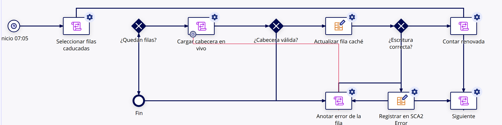

# 43-F — PM programado de refresco de la caché de cabecera (`SCA2 CMD RefrescarCacheCabecera`)

**Sesión F** de la fase 1 «lógica legacy en Appian» (doc 42 fila F; especificación en doc 43-D §10). Entorno: **Appian TEST** (`mapfrespain-test`), aplicación `SCA2 Sistema Comercial de Anulaciones SCA2` (`_a-0000f069-4f37-8000-9cc8-011c48011c48_20050128`). Estado: **construido, publicado (v3.0) y probado** con solicitudes nuevas. Ningún otro objeto de SCA2 se ha modificado.

> Método: el MCP `appian-dev-mcp-c90b` no arranca en la sesión (sin credenciales en su entorno). Lectura, creación de la constante y del PM, datos de prueba y arranques manuales por la API LCP REST (`/constants`, `POST /process-models`, `GET /process-models/{uuid}`, `GET|PUT|DELETE /record-types/{uuid}/data`, `POST /process-models/{uuid}/test`, `POST /expression-rules/{uuid}/test`). Lo que la API no expone (temporizador de inicio, excepción del nodo 4, flujo de excepción, valor inicial de una PV, publicación, seguridad) se hizo en **Appian Designer / Process Modeler** con el usuario de servicio. Las solicitudes de prueba se dieron de alta desde la UI de SCA2 (`/suite/sites/sca2`).

## 1. Objetos creados

| Objeto | Tipo | UUID | Versión | Detalle |
|---|---|---|---|---|
| `SCA2_CACHE_REFRESCO_BATCH` | Constante Integer | `_a-0000f093-2064-8000-9d36-011c48011c48_5605352` | **v3** = 50 | Máximo de filas renovadas por ejecución (§10). v2 = 1 solo durante la prueba F05; v3 vuelve a 50. Carpeta de constantes de SCA2. |
| `SCA2 CMD RefrescarCacheCabecera` | Process Model | `0000f095-81a8-8000-d613-7f0000014e7a` (id 4204) | **v3.0** publicada | Carpeta `SCA2 Process Models` (`_g-0000f069-4ee2-8000-64c6-7f0000014e7a_711`). Seguridad heredada de la carpeta, igual que los demás `SCA2 CMD *`: `SCA2 Administrators` administrador, `SCA2 Users` visor. Grupo de alertas: `SCA2 Administrators`. Limpieza automática: configuración del sistema (archivar a los 7 días de terminar), como el resto de CMD. Descripción en castellano. |

Versiones del PM: v1.0 creada por API (`POST /process-models`, que en TEST sí funciona si se informa `errorAlertGroupUuid`); v2.0 con temporizador, excepción y flujo de excepción (Designer); v3.0 con las dos correcciones de la prueba F01 (§4).

## 2. Diseño final del PM

Variables de proceso: `filas` (SCA2 Datos Cabecera, múltiple), `indice` (Integer, **0**), `cabecera` (Any Type), `ahora` (Date and Time), `errores` (Text, múltiple), `procesadas` (Integer, 0), `huboErrorEscritura` (Boolean), `errorEscritura` (Text). Ningún parámetro de inicio.

| # | Nodo | Tipo | Qué hace |
|---|---|---|---|
| 1 | `Inicio 07:05` | Start event + temporizador `Diario 07:05` | Recurrencia **diaria a las 07:05**, zona horaria `=pm!timezone` (la del proceso, que hereda la del usuario de servicio `Arquitectura Appian`: las ejecuciones se listan en CEST en Monitorización, así que el disparo es a las **07:05 Europe/Madrid**). El modeler obliga a elegir «Retrasar por» o «Retrasar hasta»: queda «Retrasar por 0 minutos», lo que hace que **cada publicación lance una ejecución inmediata** (observado en v2.0 y v3.0, §4). |
| 2 | `Seleccionar filas caducadas` | Script Task | `pv!filas` ← expresión A del §10: ids de `SCA2 Solicitud` con `estadoSolicitud not in {FINALIZADA, FINALIZADA_POSITIVO, CANCELADA, CADUCADA}` y filas de `SCA2 Datos Cabecera` con `origenCache = "CACHE"`, `validaHasta <= now()` e `idSolicitud` en esa lista; `batchSize: cons!SCA2_CACHE_REFRESCO_BATCH`, orden por `validaHasta` ascendente; campos `id`, `idSolicitud`, `polizaNumeropoliza`, `validaHasta`. |
| 8 | `Siguiente` | Script Task | `pv!indice` ← `pv!indice + 1`; `pv!cabecera` ← null; `pv!errorEscritura` ← null; `pv!huboErrorEscritura` ← false. Es el **punto de unión del bucle** (entra desde 2 y desde 11/12): por eso `indice` empieza en 0. |
| 3 | `¿Quedan filas?` | XOR | `and(a!isNotNullOrEmpty(pv!filas), pv!indice <= length(pv!filas))` → 4; si no → 9. Un único flujo entrante (ver §4, F01). |
| 4 | `Cargar cabecera en vivo` | Script Task con excepción | `pv!ahora` ← `now()`; `pv!cabecera` ← `rule!SCA2_obtenerDatosCabeceraLive(numPoliza: pv!filas[pv!indice][polizaNumeropoliza], idSolicitud: pv!filas[pv!indice][idSolicitud])`. Excepción: temporizador `Tiempo máximo carga` de **2 minutos** (el modeler solo admite minutos; el §10 proponía 90 s) con flujo de excepción → 7. |
| 5 | `¿Cabecera válida?` | XOR | `a!isNotNullOrEmpty(pv!cabecera)` → 6; si no → 7. |
| 6 | `Actualizar fila caché` | Write Records | Actualiza la **misma fila** (`id` de la fila seleccionada) con el mapeo completo del §10 (`SCAC_DS_datosCabecera` → columnas `cliente*`/`poliza*`/listas), `fechaCache = pv!ahora`, `validaHasta = rule!SCA2_calcularValidaHastaCache(fechaHoraCarga: pv!ahora, hora: cons!SCA2_HORA_CADUCIDAD_CACHE_CABECERA)`, `origenCache = "CACHE"`. `PauseOnError = false`; salidas `ErrorOccurred` → `pv!huboErrorEscritura`, `Error` → `pv!errorEscritura`. |
| 10 | `¿Escritura correcta?` | XOR | `not(a!defaultValue(pv!huboErrorEscritura, false))` → 11; si no → 7. |
| 11 | `Contar renovada` | Script Task | `pv!procesadas` ← `pv!procesadas + 1` → 8. |
| 7 | `Anotar error de la fila` | Script Task | `pv!errores` ← `append(pv!errores, "idSolicitud …: " & mensaje)` (mensaje: «la carga en vivo no devolvió cabecera (o superó el tiempo máximo)» o el texto de `pv!errorEscritura`). La fila de caché **no se toca** (sigue caducada → la regla sirve en vivo). |
| 12 | `Registrar en SCA2 Error` | Write Records | Inserta una fila en `SCA2 Error` como hace `SCA2 CMD Caducar`: `idSolicitud`, `comando = "SCA2 CMD RefrescarCacheCabecera"`, `nodo` (`Cargar cabecera en vivo` / `Actualizar fila caché`), `codigo = "REFRESCO_CACHE_ERROR"`, `mensaje`, `payload = "numPoliza=…; idFilaCache=…"`, `intentos = 1`, `estado = "PENDIENTE"`, `fechaCreacion = now()`. `PauseOnError = false` → 8. |
| 9 | `Fin` | End event | Termina la instancia (sin tareas, sin subprocesos: nunca queda colgada). |

Tolerancia a errores: cada fila pasa por 4 → 5 → 6 → 10; cualquier fallo (cabecera vacía, tiempo máximo, error de escritura) va a 7 → 12 → 8 y el bucle continúa con la siguiente. Una fila que falla no se modifica y volverá a seleccionarse al día siguiente.

## 3. Zona horaria y arranque

- `pm!timezone` del PM = zona del iniciador. Las ejecuciones por temporizador las inicia el usuario de servicio con el que se publicó (`Arquitectura Appian`), cuya zona muestra Monitorización como CEST → **07:05 Europe/Madrid**. Las `validaHasta` que escribe el PM se calculan con `now()` y `hour()` en la zona del proceso: las filas renovadas en las pruebas quedaron con `validaHasta = 2026-10-22 07:00:00` leído por API (GMT), igual que las que escribe el alta (`SCA2 CMD Alta`, usuario de servicio) y coherente con el §5 del 43-D.
- Arranque manual: `POST /process-models/{uuid}/test` (sin inputs) devuelve `processId`, `status` y las PV al terminar; también «Iniciar proceso para depuración» en el modeler.
- Al publicar una versión nueva el temporizador («Retrasar por 0 minutos» + recurrencia) arranca **una ejecución inmediata**; con 0 filas caducadas termina en ~1 s sin escribir.

## 4. Pruebas (21/10/2026, datos propios: solicitudes creadas en la UI de SCA2 con la constante `SCA2_USAR_CACHE_CABECERA` en true)

Solicitudes nuevas (Autos corredor, usuario de servicio, Alta → CA N1): **15788214** (póliza `2002600009079`, fila caché **237**), **15788215** (`2002600009081`, fila **238**), **15788216** (`2002600009089`, fila **240**). Las filas se caducaron a mano con `PUT /record-types/{Datos Cabecera}/data` (`validaHasta = 2026-10-21 06:00:00`). Reservas anotadas en `pruebas/coordinacion-fase1.md`.

| ID | Caso | Esperado | Real | OK/KO | Solicitud | Instancia | Pasos | Causa |
|---|---|---|---|---|---|---|---|---|
| F01 | Primera ejecución v2.0 con 3 filas caducadas (237, 238 y 240 con póliza `9999999999999`) | 2 renovadas, 1 error, instancia terminada | Fila 237 **sí** se actualizó (fechaCache 12:39:30, validaHasta 22/10 07:00) pero el PM la contó como error (`SCA2 Error` 122) y después **se quedó activa** en la segunda entrada a `¿Quedan filas?` (Historial: «Inicio» sin «Completar») | **KO → corregido en v3.0** | 15788214 | 9101640 (12:39 UTC, **cancelada a mano** 12:45) | `POST …/test`; lectura `/data`; Monitorización → Historial | (1) la condición `not(true(pv!huboErrorEscritura))` no evalúa como se esperaba con `false` → ahora `not(a!defaultValue(pv!huboErrorEscritura, false))`; (2) un XOR con **dos flujos entrantes** dentro de un bucle espera a los dos (es la recomendación del modeler «coloque una tarea de script delante»): ahora el bucle vuelve a `Siguiente` (Script Task), `Seleccionar` enlaza con `Siguiente` e `indice` empieza en 0. Fila `SCA2 Error` 122 (falso positivo) borrada. |
| F02 | Arranque automático al publicar v3.0 (filas 238 y 240 caducadas) | 238 renovada; 240 (póliza inexistente) tolerada | 238 renovada (fechaCache 12:47:21, validaHasta 22/10 07:00); 240 **sin tocar** y fila `SCA2 Error` 123 (`Actualizar fila caché`, «value too long for type character varying(255)»); instancia completada | OK | 15788215 / 15788216 | 14:47 CEST (v3.0) | publicar; lectura `/data` y `SCA2 Error` | La carga en vivo de una póliza inexistente no falla (devuelve una cabecera casi vacía) pero el Write Records sí: algún campo de la salida «vacía» supera 255 caracteres; el PM lo trata como error de fila y sigue. |
| F03 | Ejecución manual v3.0 con 237 caducada y 240 (póliza inexistente) | 237 renovada, 240 error, resto intacto, COMPLETED | `status COMPLETED` en 18,8 s; `procesadas 2`, `errores 1`; 237 renovada (12:48:21); 240 intacta + `SCA2 Error` 124; además renovó la fila **241** (solicitud 15788217, de otra sesión) que había nacido caducada (`validaHasta` 12:48:09 = su creación) | OK | 15788214 / 15788216 / 15788217 | 678999 | `POST …/test` | — |
| F04 | Campos de la caché = salida de `…Live` | sin diferencias | 0 diferencias en 13 campos comparados (nombre, apellidos, nif, carterizado, tréboles, perfil club, producto, vehículo, fechas efecto/vencimiento, forma de pago, clave de producción, prima) para las 3 filas tras F06 | OK | 15788214 / 15788215 / 15788216 | — | `POST /expression-rules/SCA2_obtenerDatosCabeceraLive/test` vs `/data` | — |
| F05 | Límite por lote: constante = **1** (v2) con 3 filas caducadas | solo 1 fila seleccionada y renovada | `filas = [237]`, `procesadas 1`, COMPLETED en 5,8 s; 238 y 240 siguen caducadas | OK | 15788214 | 537551255 | `PUT /constants` (1), caducar 237/238/240 (240 ya con su póliza real), `POST …/test`; constante devuelta a **50 (v3)** | — |
| F06 | Ejecución normal (constante 50) con las 2 filas restantes | 2 renovadas sin errores | `filas = [238, 240]`, `procesadas 2`, `errores {}`, COMPLETED en 11,1 s; `validaHasta` 2026-10-22 07:00:00 | OK | 15788215 / 15788216 | 10154240 | `POST …/test` | — |
| F07 | Sin filas caducadas | termina sin escribir | `filas = {}`, `procesadas 0`, COMPLETED en 1,4 s | OK | — | 17485006 | `POST …/test` | — |
| F08 | Temporizador programado y publicación | recurrencia diaria 07:05 visible; instancias terminan | Nodo de inicio con `Diario 07:05` (diaria, 07:05, `=pm!timezone`); las 4 instancias v2/v3 completadas (9101640 cancelada a mano) y ninguna en pausa | OK | — | — | Modeler + Monitorización | La primera ejecución programada real será el 22/10/2026 07:05 CEST; pendiente de comprobar (§5). |
| F09 | Carga en vivo con póliza inexistente / texto / vacía (regla, no PM) | según §10 | `XXXXXXXXXXXXX`, `9999999999999`, `ABC`, `1` → 200 con cabecera casi vacía (`nombreProducto " - "`); `numPoliza` vacío o nulo → `null` | informativo | — | — | `/expression-rules/{uuid}/test` | El criterio del nodo 5 (`a!isNotNullOrEmpty`) solo detecta el caso nulo; el caso «inexistente» lo detecta hoy el Write Records (F02/F03). |

Limpieza final: constante en 50 (v3); filas 237/238/240 renovadas con sus pólizas reales; filas `SCA2 Error` 122, 123 y 124 (generadas por las pruebas) borradas; las solicitudes 15788214/15/16 quedan abiertas (CA N1) como el resto de solicitudes de prueba de la fase 1. No se ha tocado ninguna fila de otras sesiones salvo la renovación legítima de la fila 241 (F03).

## 5. Pendientes y observaciones para el coordinador

1. **Arranque al publicar**: el temporizador con «Retrasar por 0 minutos» + recurrencia lanza una ejecución cada vez que se publica una versión. Es inocuo (renueva lo caducado) pero si se prefiere evitar, cambiar a «Retrasar hasta» con una expresión del siguiente 07:05.
2. **Póliza inexistente**: la regla `…Live` no falla; el PM lo detecta por el error de escritura (campo > 255 caracteres). Si se quiere un criterio explícito en el nodo 5 (p. ej. exigir `datosCliente.nif` o `datosPoliza.nombreProducto` ≠ " - "), es un cambio de una condición.
3. **Fila 241 (solicitud 15788217, otra sesión)** nació con `validaHasta` igual a su `fechaCache` (12:48:09 UTC) y el PM la renovó: revisar en la sesión que la creó si fue intencionado (prueba de «Actualizar datos») o un cálculo erróneo de `validaHasta` en su alta.
4. Comprobar el 22/10 a partir de las 07:05 CEST que la instancia programada arranca y termina (Monitorización → «SCA2 CMD RefrescarCacheCabecera»).
5. Excepción del nodo 4 a 2 minutos (no 90 s) por limitación del modeler.
6. No probado: fila CACHE de una solicitud finalizada (no hay solicitudes finalizadas propias); la exclusión está en la consulta (expresión A del §10) y se verificó por lectura.
