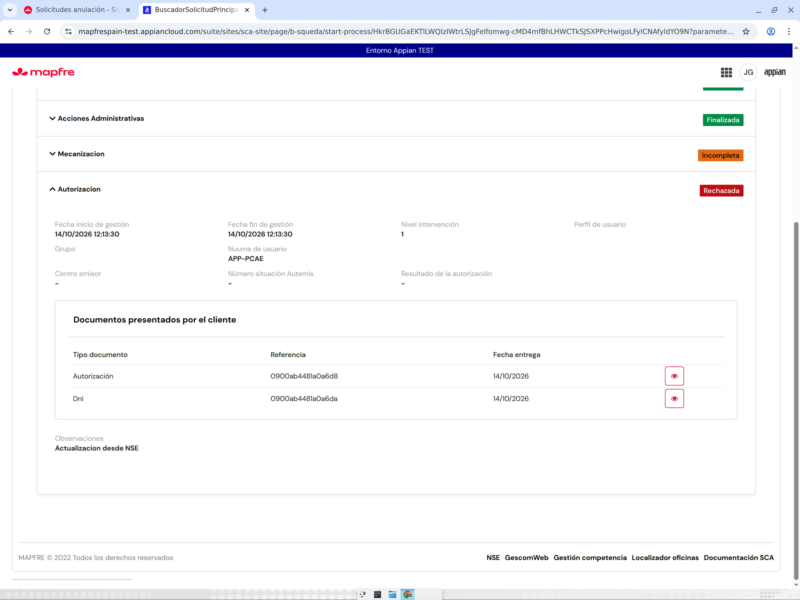
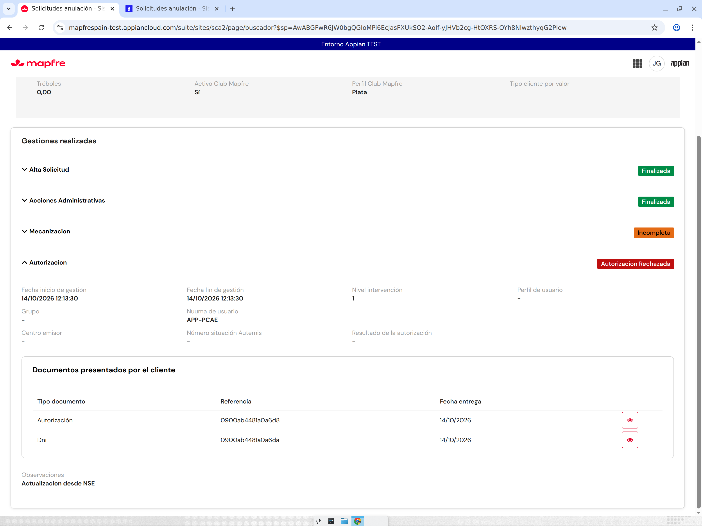

# Ronda 10 — PADRE: HU3980 (etiquetas del listado), Detalle tras actualización NSE y documentos de Acción Administrativa

Fecha: 2026-10-14. Entorno: Appian TEST. Usuario de pruebas UI: JJGONZ2 (sólo consulta). Pruebas de expresiones: LCP.

## 1. HU3980 — etiquetas y colores del listado por NUUMA (buscador SCA2)

Objetos modificados (backup, validación, PUT, relectura y prueba de render):

| Objeto | Versión | Cambio |
|---|---|---|
| `SCA2_calcularEstadoSolicitud` | 1 → 2 | Calcula la etiqueta HU3980 a partir del estado de solicitud CORE (`cod_tip_est_solic`), del estado de la última gestión de mecanización (acción 5) y de la última gestión 2/3/7 (pospuesta, autorización rechazada). |
| `SCA2_textoEstadoSolicitud` | 13 → 14 | Estados internos SCA2 → textos HU3980 («Solicitud Pendiente», «Mecanización Enviada», «Pendiente de Autorización», «Finalizado Contra Anulación Positiva», «Solicitud Finalizada sin anular», «Finalizada. Anulación realizada», «Solicitud Finalizada. Rechazada anulación», «Cancelada», «Solicitud Caducada», «Anulada Caducada»). |
| `SCA2_colorEstadoSolicitud` | 6 → 7 | Naranja `#E46B15` (pendientes), gris `#9F9F9F` (cancelada/caducadas), rojo `#BE0F0F` (finalizadas sin anular / rechazada), verde `#008C47` (CA positiva), azul `#0D82BD` (anulación realizada). |
| `SCA2_BuscadorTabla` | 11 → 12 | Si la solicitud existe en CORE («Últimas solicitudes»), la etiqueta se calcula con `SCA2_calcularEstadoSolicitud` (estado + gestiones CORE); si no, con el estado interno SCA2. |

Pruebas LCP de la regla: 15787950 estado 5 → «Solicitud Finalizada. Rechazada anulación»; estado 2 → «Solicitud Pendiente»; 14 → «Cancelada»; 3 → «Finalizado Contra Anulación Positiva»; sintético estado 5 + gestión «ANULACION PENDIENTE DE AUTORIZAR» → «Pendiente de Autorización»; estado 2 + «ANULACION REALIZADA» → «Póliza Anulada. Solicitud Pendiente Nivel 2».

Prueba UI (JJGONZ2, buscador por póliza):

| Solicitud | SCA TEST | SCA2 |
|---|---|---|
| 15787950 (rechazo NSE) | «Finalizada no requerida contraanulación» rojo | «Solicitud Finalizada. Rechazada anulación» rojo |
| 15787945 (NSE sin respuesta; gestión 5 INCOMPLETA) | «Finalizada no requerida contraanulación» rojo | «Solicitud Pendiente» naranja |
| 15787966 (gestión 5 INCOMPLETA) | «Finalizada no requerida contraanulación» rojo | «Solicitud Pendiente» naranja |

Lectura: **SCA TEST no implementa HU3980** (sigue mostrando los textos de la tabla antigua de estados de solicitud), así que en este punto la referencia es el documento HU3980 y no SCA. Para 15787945/15787966 CORE devuelve estado de solicitud 5 con la gestión de mecanización en `INCOMPLETA` (sin estado «ANULACION PENDIENTE DE AUTORIZAR» ni gestión 7): SCA2 lo pinta como «Solicitud Pendiente» (fila «estado 4/5, mecanización N/A» de HU3980).

**Pregunta para el analista (HU3980-1):** una solicitud finalizada en CORE (estado 5) cuya mecanización quedó `INCOMPLETA` porque NSE no ha respondido, ¿debe verse como «Solicitud Pendiente», «Pendiente de Autorización» o «Solicitud Finalizada sin anular»? CORE no informa el estado de mecanización 2 («pendiente de autorizar») en estos casos, por lo que SCA2 no puede distinguirlo sin otra fuente.

**Pregunta HU3980-2:** ¿se va a actualizar también SCA (TEST) con estas etiquetas? Mientras tanto, la comparación SCA/SCA2 en el buscador no puede ser literal.

## 2. Analisis SCA2 — el Detalle no reflejaba la actualización desde NSE (15787950)

Causa (propia de SCA2): en la tarjeta de Autorización de `SCA2_DetalleSolicitud`, cuando `consultarAutorizacion` de CORE devuelve `codEstado` vacío (es lo que ocurre tras un rechazo recibido de NSE: `mcaAutorizada = N`, `codEstado = null`, gestión 7 con `codEstGestion = AUTORIZACION RECHAZADA`), SCA2 asumía «Pendiente». SCA (`SCA_DetalleAnulacionAutorizacion`) no asume nada y muestra el estado de la gestión.

Corrección: `SCA2_DetalleSolicitud` 52 → 54: sin `codEstado` la tarjeta toma el `codEstGestion` de la gestión 7 y «AUTORIZACION RECHAZADA» se pinta en rojo.

Prueba UI (JJGONZ2, Detalle 15787950): SCA «Rechazada» rojo / SCA2 «Autorizacion Rechazada» rojo; observación «Actualizacion desde NSE» visible en ambas; Mecanización «Incompleta» en ambas; documentos Autorización + Dni en ambas; «Resultado de la autorización» `-` en ambas.

 

Diferencia menor pendiente de decisión: el texto exacto («Rechazada» en SCA porque usa la tabla de estados de autorización; «Autorizacion Rechazada» en SCA2 porque CORE no devuelve `codEstado`). Si se prefiere «Rechazada», se puede mapear `AUTORIZACION RECHAZADA` → «Rechazada» en la tarjeta.

15787945 (autorizada en NSE sin respuesta): CORE no tiene gestión 7 ni `codEstado`; SCA y SCA2 muestran lo mismo (Mecanización «Incompleta», sin tarjeta de Autorización). No es una diferencia de SCA2: depende de que NSE/CORE registren la respuesta.

## 3. Analisis SCA2 — documentos de venta (con/sin traspaso) en Acción Administrativa

Hechos:
- `SCA_calcularDocumentosASubir` y `SCA2_calcularDocumentosASubir` son idénticas: en Acción Administrativa (acción 1) sólo preparan documentos para póliza NSE Hogar, causas BAJA TEMPORAL / BAJA VEHICULO / SINIESTRO TOTAL y causas «NO VOY A COMPRARME OTRO COCHE» / «SEGURO REGALADO POR LA COMPRA DE COCHE»; para el resto de causas devuelven vacío.
- `SCA2_subirDocumentosGD` sube al gestor documental y registra en CORE los tipos 1–5 y 7 en AA (tipo 9 «Documento compra/venta sin traspaso del seguro» no se sube; CORE lo rechaza: «Los datos pasados como parametro no son los esperados»).
- En CORE, 15787945 y 15787966 sólo tienen el documento tipo 7 (DNI). En pantalla (SCA y SCA2, Detalle → Acciones Administrativas) se lista sólo «Dni» en ambas.

Conclusión provisional: SCA2 se comporta como SCA con la lógica actual (mismas reglas). Falta reproducir con un caso nuevo (lo hace R10-D) adjuntando «Contrato compra/venta» (tipo 1) para confirmar si SCA2 lo sube o si el documento se adjuntó como tipo 9.

**Pregunta para el analista (DOC-1):** en una Acción Administrativa por venta del vehículo, ¿qué documentos deben llegar al gestor documental y a CORE: sólo el DNI, también el contrato de compraventa (tipo 1) y, en la venta sin traspaso, el tipo 9? Hoy CORE no acepta el tipo 9.

## 4. Incidencia observada en SCA TEST (no SCA2)

Al volver desde el Detalle de 15787945 en SCA, error en `sca_datoscabecera` (`a!submitLink`: «The save target must be a local variable… but instead was: 2002100194827»). Se continuó por navegación directa al buscador.

## Evidencias

Grabación de la sesión de pruebas UI: `sca-hu3980-autorizacion-1410-edited.mp4` (adjunta en la sesión Devin). Capturas en `evidencias/r10-padre-*.png`.

## Anexo A — Alta Hogar NSE en SCA2 (hallazgo R10-A, corregido por el PADRE)

**Síntoma (R10-A, póliza 0732000028208, Hogar telemática NSE):** tras ACEPTAR en el popup de validaciones, SCA2 volvía al formulario sin ID ni mensaje a los ~58 s; CORE sin solicitud; bandeja de errores vacía. Reproducido dos veces.

**Causa (propia de SCA2):** `SCA2_construirContextoAlta` v10 devolvía `datosPolizaHogar: { tomador: {}, estructuraComercial: {} }` (listas vacías). `SCA2_PreGenerarStudAnul` (misma expresión que `SCA_PreGenerarStudAnul`) indexa `datosPolizaHogar.tomador.codCalificacion` cuando `origenPoliza = "NSE-Hogar"` y lanzaba «Cannot index property 'codCalificacion' of type String into type List of Variant» (LCP, `r14/diag_pre_hogar.json`). El nodo *PreGenerar* del PM `SCA2 CMD Alta` quedaba en pausa por excepción antes de llamar a CORE: ni `PDTE-`, ni registro `SCA2 Error`, ni mensaje en pantalla (el `a!startProcess` síncrono volvía sin `idSolicitud`). En SCA el contexto es un CDT tipado (campos nulos), por eso nunca falla.

**Corrección:** `SCA2_construirContextoAlta` v10 → v11: `datosPolizaHogar.tomador` (codCalificacion = COD_SCORE de NSE, fechaDeNacimiento = fecnac, tomadorEsConductor) y `estructuraComercial.codOficinaComercial` (nomelemnivel4) con las mismas fuentes NSE que `datosPolizaAutos`; para wAutemis quedan nulos. Backup/readback en `r14/backup/SCA2_construirContextoAlta_{before,after}.json`.

**Verificación:** LCP `construirContextoAlta` + `PreGenerarStudAnul` sin error para 0732000028208 (NSE-Hogar), 2002100194827 (NSE-Autos) y 0000253500329 (wAutemis). UI (testing agent, JJGONZ2): alta de 0732000028208 → solicitud **15788005** creada con un solo GUARDAR+ACEPTAR, navegación automática a Acciones Administrativas en ~50 s, buscador «Solicitud Pendiente» (naranja) con la observación. La cabecera muestra producto HOGAR FAMILIAR y productor por canal (INTERNET-TELEFO / Telemática); el vencimiento se ve 01/02/2027 porque CORE devuelve `2027-01-31 23:00 UTC` (hora de Madrid 01/02): no es divergencia.

**Pendiente de observación:** el fallo silencioso del PM `SCA2 CMD Alta` (excepción en *PreGenerar* sin `Write Error`) sigue siendo posible para otras excepciones de expresión; se propone al analista/mantenimiento que el alta muestre «Su solicitud se está generando…» con reintento/aviso cuando el proceso no devuelve `idSolicitud` en 60 s (hoy la pantalla ya lo contempla, pero la excepción deja el proceso en pausa, no en error).
