# R27-C — Orquestación Mecanizar → decidir contacto → CMP Inducir Cliente (Verti) → decidir acción (SCA vs SCA2, TEST)

> Ronda 27 (22/10/2026), sesión hija C. Entorno `mapfrespain-test`. Lectura de objetos por LCP (`/process-models`, `/interfaces`, `/expression-rules`, `/constants`), pruebas UI con JJGONZ2 (agente de pruebas, grabación anotada). Coordinación: `coordinacion-ronda27.md`. Esquema del analista: «Alta → decidir acción → Contra anular (finalizada negativa) → decidir mecanizar → mecanizar → decidir contacto (Verti y/o Vencimiento) → CMP inducir cliente → decidir acción (salto de nivel / tarea de nivel / finalizar)».

## 0. Resumen ejecutivo

- **Veredicto**: SCA2 orquesta mecanizar → contacto → CMP → decisión posterior igual que SCA (prueba: ambas terminan en Contra Anulación nivel 2 tras el componente completo). Una divergencia de orden respecto a SCA, **corregida en esta ronda**: SCA2 lanzaba el componente CMP *antes* de llamar a `guardarMecanizacion`/alta ANL; SCA (`SCA_Mecanizacion`) guarda primero la mecanización y después lanza inducción y ANL. Ahora `SCA2 CMD Mecanizar` hace: contacto → guardarMecanizacion → (bloqueo NEW/autorización) → alta ANL → **CMP** → espera ANL → fin gestión SGC → «IR A NIVEL n+1» → `CMD CrearAccion` → `CMD Decidir` (motor).
- La «decisión de contacto» (`SCA2_determinarContacto`) se evalúa al cargar `SCA2 CMD Mecanizar` (nodo 16), igual que `SCA_Mecanizacion` nodo 46. La inducción depende **sólo del contacto** (VERTI/VENCIMIENTO), no de la casilla de la pantalla previa (nodo 331).
- Tras la mecanización SCA2 **sí vuelve a preguntar al motor**: `CMD Mecanizar` (320) deja `procesoActivo = IR A NIVEL n+1` (o `FIN PROCESO` si nivel ≥ 3) y arranca `CMD CrearAccion`, que sube el nivel (`CMD CrearAccion` 10/11) y arranca `CMD Decidir` → `SCA2_consultarServiciosReglas` («decidir acción» con el nivel nuevo) → Contra Anulación nivel 2 / AA / MECANIZAR NIVEL 2 / FIN PROCESO. No existe una llamada separada «decidir mecanizar»: el motor devuelve `MECANIZAR` directamente y `CMD Decidir` 14 «Acción tras mecanizar?» la ejecuta (igual que `SCA Decidir Accion`, único PM de SCA que llama al servicio de reglas).
- **Punto 0 (requisito 22/10 19:05, componente Verti completo y encadenado):** en la prueba, **ambas** apps ejecutan el componente completo (consentimiento → firma RGPD → consulta Verti → resumen → «No asegurable» → ENTENDIDO) con todas las pantallas encadenadas y dentro del site. La diferencia está en la **primera** pantalla: en SCA se abre sola tras ANULAR PÓLIZA; en SCA2 hay que pulsar «COMPLETAR INDUCCIÓN» en el panel amarillo (D4). Causa: SCA2 pasa `aplicacion: "SCA"` y el CMP entra por **Fase 2**, que está **encadenada de principio a fin** (incluida la firma RGPD: `CMP Firma RGPD Completo → Main | OneTrust`), con un único corte interno ajeno (`CMP Servicios Firma RGPD OneTrust` 4→5 «Te lo Juro», canal manuscrito). El corte real está en la **entrada**: el botón ANULAR PÓLIZA usa `a!startProcess` (interfaz de site, no formulario de tarea) y el nodo 330 es un *Start Process*; el encadenamiento no atraviesa ninguno de los dos, por lo que la **primera** pantalla del CMP no se abre sola y se entra por el panel amarillo (`a!processTaskLink`, ronda 26). Desde esa primera pantalla el resto del componente viene encadenado. Convertir 330 en Sub-Process encadenado **no** resolvería la entrada (la cadena ya está rota en `a!startProcess`); la alternativa real es cambiar la UX de ANULAR PÓLIZA (ver §6, decisión funcional).

## 1. Pólizas y solicitudes usadas

Pólizas NSE Autos «recién emitidas» tomadas del final de `SCA2PolNSEPre.ods`; todas sin solicitud previa (`SCA2_consultarSolicitudes` → `null` el 22/10): 2002600060549, 2002600060547, 2002600060546, 2002600060544, 2002600060543, 2002600060542, 2002600060536, 2002600060533.

| App | Póliza | Solicitud | Usuario | Resultado |
|---|---|---|---|---|
| SCA2 | 2002600060549 | **15788292** | JJGONZ2 | Alta → CA N1 negativa → Verti previa → ANULAR PÓLIZA → CMP completo (RGPD simulada TEST) → **CONTRA ANULAR NIVEL 2** (gestión 43706580). |
| SCA | 2002600060543 | **15788295** | JJGONZ2 | Mismo recorrido → CMP completo encadenado → **CONTRA ANULAR NIVEL 2** (gestión 43706589). |

Ninguna solicitud protegida ni ajena ha sido abierta ni modificada. Las dos CA de nivel 2 se han dejado **pendientes** (no retomadas).

## 2. Orquestación real de SCA2 (leída de los PM vivos el 22/10)

Objetos: `SCA2 CMD Mecanizar` `0000f06f-4cfc-8000-66d3-7f0000014e7a` (42 nodos), `SCA2 CMD CrearAccion` `0000f06f-0eaa-8000-6594-…` (40), `SCA2 CMD Decidir` `0000f06f-0eab-8000-6595-…` (26), `SCA2 CMD CompletarAccion` `0000f06f-1307-8000-65b1-…` (39), `SCA2 CMD Finalizar` `0000f06f-1309-8000-65b3-…` (14), `SCA2 CMD CambiarNivel` `0000f06f-8a54-8000-6759-…` (13). Reglas del motor: `SCA2_mapearDatosDecidirAccion` + `SCA2_consultarServiciosReglas` (servicio de reglas de decisión), `SCA2_determinarContacto` (decisión de contacto), `SCA2_flagVerti`.

```mermaid
flowchart TD
  A[Alta solicitud<br/>SCA2 CMD CrearSolicitud] --> D1[CMD Decidir 5 «Consultar reglas»<br/>motor: decidir acción N1]
  D1 -->|CONTRAANULAR| CA[Tarea Contra Anulación N1<br/>CMD CrearAccion 17 alta gestión CORE]
  CA -->|resultado negativo| COMP[CMD CompletarAccion 300/301 Finalizar CA PCA → 350 ¿CA positiva?]
  COMP -->|negativa| D2[CMD Decidir<br/>motor: decidir acción]
  D2 -->|MECANIZAR| WDM[Decidir 13 Write Destino Mecanizar → 14 «Acción tras mecanizar?»] --> CRA[CMD CrearAccion 5 Accion? = MECANIZAR → 17 alta gestión CORE → tarea MECANIZACION]
  CRA --> PREV{CrearAccion 30 ¿Inducción VERTI previa?<br/>switch FLAG=S ∧ MECANIZAR ∧ última tarea CONTRA* ∧ contacto VERTI/VENC.}
  PREV -->|sí| TV[Tarea VERTI: pantalla «Verti / Vencimiento» (Suscripción Inteligente) → CONTINUAR] --> MEC
  PREV -->|no| MEC[Pantalla Mecanización SCA2_MecanizacionPrincipal → ANULAR PÓLIZA<br/>a!startProcess CMD Mecanizar]
  MEC --> N16[16 Cargar: SCA2_cargarSolicitud + SCA2_flagVerti + SCA2_determinarContacto → pv!contacto]
  N16 --> N3{3 ¿Ya ejecutado?} --> N4{4 ¿Caducada?} --> N6{6 Inducción VERTI? pv!verti}
  N6 -->|paso 1 pantalla| N7[7 Write Tarea VERTI] --> FIN0((End))
  N6 -->|no| N8[8 Guardar Mecanización<br/>CORE guardarMecanizacion]
  N8 --> N9{9 Success?}
  N9 -->|wAutemis pdte. aceptar| N340[340 Bloquear póliza Central NEW] --> N10[10 Crear Autorización] --> N13
  N9 -->|ok| N13[13 Write Éxito: MECANIZADA / procesoActivo ANL]
  N9 -->|error| N12[12 Write Error] --> FIN0
  N13 --> N300{300 ¿ANL ya creada?}
  N300 -->|no| N301[301 SUB ANL Alta] --> N331
  N300 -->|sí| N331{331 ¿Inducir Verti?<br/>contacto.listaContactos ∋ VERTI ∨ VENCIMIENTO}
  N331 -->|sí| N332[332 Write Tarea INDUCCION pendiente] --> N330[330 Start Process síncrono<br/>CMP Inducir Cliente Completo<br/>aplicacion SCA, tipoInduccion I, usuarioAppian = initiator] --> N333[333 Write cierre Tarea INDUCCION] --> N324
  N331 -->|no: contacto vacío u otro| N324{324 ¿wAutemis pdte. aceptar?}
  N324 -->|sí| N302[302 Esperar ANL 5 min] --> N303[303 Consultar ANL] --> N304{304 ¿ANL CONCLUIDA?}
  N304 -->|no, <288 sondeos| N302
  N304 -->|timeout| N312[312 Error timeout ANL] --> N12
  N304 -->|sí| N308[308/309/305 Actualizar Mecanización] --> N310{310 ok?} --> N306[306 Write Mecanización OK] --> N325
  N324 -->|no NSE| N325[325 Recargar solicitud] --> N326[326 Finalizar gestión SGC] --> N320[320 Write Cambio nivel<br/>mecanizacionRealizada=true<br/>procesoActivo = nivel≥3 ? FIN PROCESO : IR A NIVEL n+1]
  N320 --> N322[322 Start Process CMD CrearAccion]
  N322 --> CA5{CrearAccion 5 Accion?}
  CA5 -->|IR A NIVEL 2/3| CA10[10 Cambio de nivel → 11 Write Nivel EN_DECISION] --> CA12{12 Destino nivel?}
  CA12 -->|DECIDIR| D3[CMD Decidir 5 Consultar reglas<br/>motor: decidir acción nivel 2]
  CA12 -->|FIN nivel≥3| CA13[13 Write FIN] --> FZ[CMD Finalizar: Finalizar Solicitud CORE + SGC → FINALIZADA]
  CA5 -->|FIN PROCESO| CA13
  D3 -->|CONTRA ANULAR NIVEL 2 / AA N2| CA2[CrearAccion alta gestión CORE N2 + tarea de nivel 2]
  D3 -->|FIN PROCESO| FZ
```

Ramas comprobadas en el diseño:

| Rama | Comportamiento SCA2 |
|---|---|
| Contacto VERTI | 331 verdadero → tarea INDUCCION + CMP síncrono; al terminar el CMP sigue 333 → 324. |
| Contacto VENCIMIENTO | Igual que VERTI (331 acepta ambos). `tipoInduccion` siempre `"I"` (ver divergencia D2). |
| Contacto vacío / otro | 331 falso → directo a 324 (sin tarea INDUCCION ni CMP). |
| CMP terminado con/sin tareas | En ambos casos el Start Process síncrono devuelve el control a 333 (cierra la tarea INDUCCION) y se continúa; si el CMP no presenta pantallas termina en segundos. |
| ANL concluida (wAutemis) | 304 → 308/309/305 actualizar mecanización → 306 → 325. NSE no espera ANL (324 falso). |
| Timeout ANL | 304 tras 288 sondeos × 5 min con respuesta de autorización/rechazo → 312 → 12 Write Error (bandeja de errores). Sin respuesta espera indefinidamente, como SCA. |
| «Decidir Nivel 2 / Fin» | 320 fija IR A NIVEL n+1 / FIN PROCESO → CrearAccion 10-12 → CMD Decidir (motor) o CMD Finalizar. |

## 3. Comparación con SCA

PMs SCA leídos: `SCA Mecanizacion` `0002ec01-57f1-8000-612e-…` (45 nodos), `SCA Finalizar Mecanización` `0002eebd-9493-8000-2062-…` (40), `SCA_PB_buclesActualizarMecanizacion` `0002f084-2b14-8000-6ca7-…` (15), `SCA Decidir Accion` `0002ebc1-26c2-8000-4187-…` (10), `SCA Finalizar Solicitud` `0002ec12-be50-8000-6a6a-…`.

Orden real de `SCA Mecanizacion`: 46 `determinarContacto` (+ `SCA_flagVerti`; `mostrarVerti/mostrarVencimiento` = false si la acción es AA) → 45 «verti/vencimiento?» (sin flagVerti) → 48/44 pantalla «Verti / Vencimiento» → 37 **guardar Mecanizacion** → 3 → 17/59 observaciones e interfaz detalle → 2 Complex → 63/13 (wAutemis: 20 BloquearPoliza) → 27 «Inducción VERTI?» (`mostrarVencimiento ∨ mostrarVerti`) → 24 → **[28 SUB Inducción VERTI ‖ 12 SUB ANL Alta]** → 23 AND → 14 wAutemis? → 43 Crear Autorización | 5 Start Process `SCA_PB_buclesActualizarMecanizacion` (actualizar mecanización / caducada / guardar autorización) → fin. La decisión posterior (nivel 2 / fin) la toma `SCA Decidir Accion` (5 Mapeo → 21 Consulta Gestión → 8 Consulta servicio reglas), invocado por los PM de nivel/tarea de SCA, igual que `SCA2 CMD Decidir`.

| # | Punto | SCA | SCA2 (antes de R27-C) | Veredicto |
|---|---|---|---|---|
| (a) | ¿«decidir contacto» justo después de mecanizar y sólo entonces? | `determinarContacto` es el **primer** nodo de `SCA Mecanizacion` (46), antes de guardar la mecanización; su resultado se usa para la pantalla previa (45) y para la inducción (27). | `SCA2_determinarContacto` en el nodo 16 «Cargar» de `CMD Mecanizar`, también antes de guardar; además `CMD CrearAccion` 30 lo evalúa para la pantalla previa. | **Igual**: en ambas la decisión de contacto se toma al entrar en la mecanización (no «después» en sentido temporal: el esquema del analista la dibuja después porque se consume tras mecanizar). |
| (b) | ¿Inducción por contacto y no por casilla? ¿También VENCIMIENTO? | 27: `mostrarVencimiento ∨ mostrarVerti` (contacto). `tipoInduccion` = «A» (ambos), «V» (vencimiento SGC) o «I». | 331: `listaContactos ∋ VERTI ∨ VENCIMIENTO` (contacto; la casilla `inducirVerti` ya no se usa, R23-A). `tipoInduccion` **siempre «I»**. | Lanzamiento **igual**. **D2** (no corregida): con contacto VENCIMIENTO SCA2 no envía «V»/«A», por lo que Fase 2 no ejecuta el nodo «Vencimiento» (`tipoInduccion ∈ {V,A}`) — decisión funcional (duda #13). |
| (c) | ¿Vuelve a llamar a «decidir acción» tras el CMP/mecanización? | Sí: `SCA_PB_buclesActualizarMecanizacion` → PM de nivel → `SCA Decidir Accion` (servicio de reglas). | Sí: 320 «IR A NIVEL n+1» → `CMD CrearAccion` 10-12 → `CMD Decidir` (motor). Como el CMP es síncrono y anterior a 320, la decisión es posterior al CMP. La CA de nivel 2 de r23-b §10 la crea `CMD Decidir` → `CMD CrearAccion`. | **Igual** (confirmado en diseño y en la prueba §5). |
| (d) | Orden ANL (espera CONCLUIDA) ↔ CMP | guardarMecanizacion → [Inducción ‖ ANL Alta] → espera `ANL_Desbloquear` (wAutemis) en `SCA_PB_bucles…`. | **Antes**: CMP → guardarMecanizacion → ANL Alta → espera. **Ahora** (D1 corregida): guardarMecanizacion → ANL Alta → CMP → espera ANL. | **Corregido** (secuencial en vez de paralelo; ANL Alta es inmediata). |
| (e) | ¿«Suscripción Inteligente» = pantalla previa Verti/Vencimiento? | Sí: `SCA Mecanizacion` 44 «Verti / Vencimiento», condicionada por `SCA_flagVerti` (switch «vertiSuscripcionInteligente»). | Sí: tarea VERTI (`CMD CrearAccion` 30 / `CMD Mecanizar` 6-7, interfaz `SCA2_VertiVencimientoPrincipal`), mismo switch `SCA2_ConsultaConceptosFuncionalesSuscripcionInteligenteRecord`. Es **previa** al CMP; el CMP posterior es el componente «Inducir Cliente». | **Igual**. |
| (f) | Estados/etiquetas finales (SCA2 Solicitud, CORE, Detalle) | Gestiones CORE: 8 alta, 2 CA (FINALIZADA NEGATIVA), 4, 5 Mecanización (ANULACION REALIZADA)… | Mismas gestiones CORE (backend común). SCA2 Solicitud: MECANIZADA/procesoActivo ANL durante el CMP; EN_DECISION al subir de nivel; tarea N2 o FIN. | Ver §5 (comparación de pantallas). |

## 4. Divergencias

| Id | Divergencia | Exclusiva SCA2 | Acción |
|---|---|---|---|
| D1 | El CMP se lanzaba **antes** de `guardarMecanizacion`/alta ANL: la anulación en CORE quedaba pospuesta hasta que el usuario terminara el componente (en SCA la mecanización se guarda primero). | Sí | **Corregida** (§7): reorden de conexiones en `SCA2 CMD Mecanizar`. |
| D2 | `tipoInduccion` fijo «I» (SCA: «V»/«A» con vencimiento SGC) → con contacto VENCIMIENTO el CMP Fase 2 no ejecuta «Vencimiento». | Sí | **No corregida**: requiere definir cómo obtiene SCA2 `vencimientoSGC` (duda #13, doc 42). Pregunta al analista. |
| D3 | Inducción ‖ ANL Alta en paralelo (SCA) vs secuencial (SCA2). | Sí | No corregida: sin efecto funcional (ANL Alta es un subproceso inmediato) y los PM atómicos de SCA2 no usan AND. Documentada. |
| D4 | **Primera pantalla del CMP no encadenada** tras ANULAR PÓLIZA en SCA2 (tarjeta CORRECTO + clic en el panel «COMPLETAR INDUCCIÓN»). En SCA (prueba 15788295) la pantalla RGPD del componente **se abre sola** ≤10 s después de ANULAR PÓLIZA, dentro del site (`/suite/sites/decidir-accion/...`, sin Tempo), porque la mecanización es un formulario de tarea y el nodo 28 es un Sub-Process encadenado. | **Sí** | **No corregida: decisión funcional/UX** (§6). La corrección no está en el nodo 330: exige cambiar cómo arranca `CMD Mecanizar` (`a!startProcess` → `a!startProcessLink`/tarea encadenada) y la tarjeta CORRECTO de `SCA2_MecanizacionPrincipal`. |
| D6 | Botón «Actualizar datos» del Detalle SCA2 mostró datos en caché (nivel 1, etiqueta CA negativa duplicada) tras la decisión de nivel 2; F5 muestra NIVEL 2 / CA Incompleta. | Sí | **No corregida** (`SCA2_DetalleSolicitud` es de R27-A): propuesta → tras «Actualizar datos» releer `SCA2_cargarSolicitud` y las gestiones CORE con `a!refreshVariable`/`refreshAlways`. |
| D7 | Página `errores` del site SCA2 no accesible para JJGONZ2 («La página no existe o no tiene permiso para verla»). | Sí (SCA no tiene bandeja equivalente) | Documentada: la bandeja es de mantenimiento; revisar la seguridad de la página si debe verla Oficina. Por LCP `SCA2_contarErroresPendientes(15788292)` = 0. |
| D5 | `CMP Servicios Firma RGPD OneTrust` 4 «¿Induccion?» → 5 «Te lo Juro» sin encadenar (canal manuscrito ∧ inducción). | No (CMP ajeno, afecta igual a SCA) | No modificable (CMP). Documentada. |

## 5. Prueba UI (agente de pruebas, JJGONZ2)

Grabación `r27c-sca2-sca-edited.mp4` (una sola grabación con los dos recorridos). Horas en UTC (la UI de Appian muestra hora local, +2 h).

| Paso | SCA (15788295, póliza 2002600060543) | SCA2 (15788292, póliza 2002600060549) | Veredicto |
|---|---|---|---|
| Comprobación póliza sin solicitud | Buscador: sin resultados | Buscador: sin resultados | Igual |
| Alta | Gestión CORE 8 FINALIZADA 19:33:06 (catalogación/fecha tardaron en cargar) | Gestión 8 FINALIZADA 19:10:59 | Igual |
| Decisión motor N1 | CONTRAANULAR → tarea CA N1 | CONTRAANULAR → tarea CA N1 | Igual |
| CA negativa | Gestión 2 FINALIZADA NEGATIVA 19:35:02; impresión + confirmación | Gestión 2 FINALIZADA NEGATIVA 19:16:36; impresión + confirmación | Igual (`r27c_sca_ca_negativa.png` / `r27c_sca2_ca_negativa.png`) |
| Pantalla previa Verti/Vencimiento | Aparece; CONTINUAR sin casillas | Aparece; CONTINUAR sin casillas | Igual (`r27c_sca_verti_pre.png` / `r27c_sca2_verti_pre.png`) |
| Pantalla Mecanización | Formulario de tarea | `SCA2_MecanizacionPrincipal` | Igual en contenido (`r27c_sca_mecanizacion.png` / `r27c_sca2_mecanizacion.png`) |
| ANULAR PÓLIZA | 19:37:48 → **la pantalla RGPD del componente se abre sola** a 19:37:58 (≤10 s) en `/suite/sites/decidir-accion/...` (`r27c_sca_rgpd_encadenada.png`) | 19:24:26 → tarjeta CORRECTO en **0,84 s** («La anulación se ha lanzado al sistema de emisión»); el CMP **no** se abre solo; panel amarillo «Inducción Verti» con «COMPLETAR INDUCCIÓN» (`r27c_sca2_correcto.png`) | **Distinto (D4)** |
| Mecanización en CORE antes de terminar el CMP | Gestión 5 Mecanización 43706588: ANULACION REALIZADA **19:38:18** (CMP terminó 19:43:03) | Gestión 5 Mecanización 43706579: ANULACION REALIZADA **19:25:11** (CMP terminó 19:28:43) | **Igual** (D1 corregida; confirmado por LCP, la UI con «Actualizar datos» mostraba caché, D6) |
| Proceso CMP | `CMP Inducir Cliente` (id no visible desde la UI de SCA) | `CMP Inducir Cliente - id: 38917112`, subproceso `CMP Firma RGPD Main [app: SCA, numeroDocumento 04875733D, clientId 38917112]` **pid 537556985**, iniciador `devin`, inicio 19:24:45; tarea `/suite/sites/sca2/page/buscador/task/2gRnZvaoWz513xQiBw` | Igual (mismo componente, Fase 2) |
| Pantallas del componente | RGPD (firma manuscrita/impresión, certificación simulada TEST) → Consulta Verti → «Continuar procesamiento» → Riesgo **NO ASEGURABLE** → ENTENDIDO 19:43:03; **todas encadenadas** | Idéntica secuencia, **todas encadenadas** en la misma URL `/suite/sites/sca2/page/buscador/task/...`; ENTENDIDO 19:28:43 | Igual (`r27c_*_rgpd*.png`, `r27c_*_post_rgpd.png`, `r27c_*_cmp_resumen.png`, `r27c_*_cmp_final.png`) |
| Fin del CMP → vuelta | Vuelve al buscador/Detalle | Vuelve automáticamente al Detalle | Igual |
| Decisión posterior («decidir acción» nivel 2) | **CONTRA ANULAR NIVEL 2**: gestión 43706589 (acción 2, nivel 2, INCOMPLETA) a **19:48:19**, 5 min 15 s después de ENTENDIDO (a 19:47:26 la UI aún mostraba NIVEL 1) | **CONTRA ANULAR NIVEL 2**: gestión 43706580 (acción 2, nivel 2, INCOMPLETA) a **19:29:07**, 24 s después de ENTENDIDO; SCA2 Solicitud `EN_ACCION`, `nivelIntervencion 2`, `procesoActivo CONTRA ANULAR NIVEL 2` | **Igual** en resultado; SCA2 más rápido |
| Estado final visible | PENDIENTE / NIVEL 1 en la última captura (19:47:26, antes de la decisión) (`r27c_sca_ultima_comprobacion.png`) | PENDIENTE / **NIVEL 2**, Mecanización «Anulación Realizada», CA nivel 2 «Incompleta» (`r27c_sca2_nivel2.png`) | Igual tras la decisión |
| Misma solicitud 15788292 vista en SCA | NIVEL 2, Mecanización Anulación Realizada, CA Incompleta (`r27c_sca_misma15788292.png`); SCA no muestra las dos gestiones propias de Verti del Detalle SCA2 | — | Igual (CORE común) |
| Bandeja de errores SCA2 | — | `page/errores` sin permiso para JJGONZ2 (`r27c_sca2_errores_acceso.png`); `SCA2_contarErroresPendientes` = 0 | D7 |

Tiempos medidos: SCA2 ANULAR → CORRECTO 0,841 s; CMP → decisión nivel 2 ≈24 s. SCA ANULAR → primera pantalla CMP 4,9–10 s; CMP → decisión nivel 2 ≈5 min 15 s.

La firma RGPD se completó en la variante manuscrita/impresión marcando la certificación en TEST (datos de prueba, autorizado para la prueba): no es una firma real.

## 6. Punto 0 — encadenamiento del componente Verti (CMP) desde SCA2

Árbol de PM del CMP leído por LCP (constantes `SCA2_PM_CMP_*`): `CMP Inducir Cliente Completo` `0002ea05-adcc-…` → XOR 8 «Aplicacion tipo» (`pv!aplicacion = "SCA"` ∨ `"NSE"` ∨ grupo `VERT_GRP_USUARIOS_FASE_2` → **Fase 2** `0022ef3e-d443-…`; resto → Fase 1 `0021ef3e-d62c-…`). Leyenda: `·` conector encadenado (`activityChained=true`), `ø` no encadenado.

```mermaid
flowchart LR
  BTN[SCA2_MecanizacionPrincipal<br/>botón ANULAR PÓLIZA<br/>a!startProcess CMD Mecanizar] -. ø corte 1: a!startProcess no muestra tareas encadenadas .-> M330[CMD Mecanizar 330<br/>Start Process síncrono<br/>CMP Inducir Cliente Completo]
  M330 -. ø corte 2: Start Process no propaga la cadena .-> CMP0[CMP main 0 ¿Reintentos? · 8 Aplicacion tipo ·]
  PANEL[Panel amarillo Inducción Verti<br/>a!processTaskLink tarea CMP<br/>Detalle → INDUCCION → RETOMAR] ==> F2a
  CMP0 --> F2[Fase 2 SUB 11 ·]
  F2 --> F2a[0 Log · → 18 Write · → 1 AGC+ASNEF ·]
  F2a --> F2b[17 UIT Mensaje Consentimiento ·]
  F2b --> F2c[9 SUB RGPD · = CMP Firma RGPD Completo]
  F2c --> RG{21 ¿Existe en parametrización? ·}
  RG --> MAIN[CMP Firma RGPD Main: 2 UIT Interfaz Firma RGPD · → 22 ¿biométrica/manuscrita? · → 15 UIT CMP_InduccionFirmaRGPD · → 23 UIT Mensaje Éxito · → 39 Guardar Respuesta ·]
  RG --> OT[CMP Firma RGPD OneTrust: 64 UIT Interfaz Firma RGPD · → 50 SUB Servicios Firma OneTrust · → 4 ¿Induccion? → 5 UIT «Te lo Juro» ø / 16 ·]
  MAIN --> F2d
  OT --> F2d[23 error RGPD · → 22 UIT Solicitud Cotización · → 8 Vencimiento · → 21 ME-COM ·]
  F2d --> F2e[19 SUB Consulta Verti · → 33 SUB Resumen consulta · UIT Resumen · → 7 Verti/Cancelar · → 34 SUB VERTI / 35 Derivación manual / 31 SUB Opcion 1 y 2 ·]
  F2e --> END((End))
```



Conclusiones:
1. **Dentro del CMP (Fase 2) todo el flujo está encadenado** desde la primera pantalla hasta el fin del proceso principal, incluida la firma RGPD (`Firma RGPD Completo` → `Main`/`OneTrust`, `Firma y PerfilSi24`): el usuario que abre la primera tarea ve el resto encadenado dentro de `/suite/sites/sca2/...`. Los únicos conectores `ø` de Fase 2 van a nodos End. Fase 1 (no usada por SCA2) sí tiene cortes (4→19, 9→22, 35→11). Corte ajeno: `CMP Servicios Firma RGPD OneTrust` 4→5 «Te lo Juro» (canal manuscrito con inducción).
2. **El corte está en la entrada**: (i) `a!startProcess` desde una interfaz de site no muestra al usuario las tareas encadenadas del proceso arrancado (sólo lo hacen `a!startProcessLink`/formularios de inicio o el envío de un formulario de tarea); (ii) el nodo 330 es un *Start Process*: el encadenamiento de actividades no atraviesa este smart service (sí un nodo Sub-Process síncrono con conectores encadenados). Por eso la ronda 26 añadió el panel amarillo con `a!processTaskLink` (la tarea del CMP se abre dentro del site al pulsarla).
3. Cambiar 330 a Sub-Process encadenado **no es suficiente** mientras la mecanización se lance con `a!startProcess` desde ANULAR PÓLIZA: la cadena se rompe antes (i). Las opciones son decisión funcional/UX, **no aplicadas**:
   - **Opción A** (mínima, ya operativa): mantener la entrada por panel amarillo (`a!processTaskLink`) en la tarjeta CORRECTO y en el Detalle; desde la primera pantalla el CMP viene encadenado. Mejora posible sin tocar el CMP: que la tarjeta CORRECTO muestre el enlace a la primera tarea en cuanto exista (ya lo hace al refrescar).
   - **Opción B**: convertir ANULAR PÓLIZA en `a!startProcessLink` (o formulario de inicio del PM) hacia un PM «arranque mecanización» cuyo primer nodo sea un Sub-Process encadenado de `CMD Mecanizar` con 330 como Sub-Process encadenado. Implica cambiar `SCA2_MecanizacionPrincipal` (la interfaz ya no mostraría la tarjeta CORRECTO: el usuario saltaría directamente al formulario del componente), el modelo de comandos atómicos (Start Process → Sub-Process) y asumir que el usuario queda «dentro» del CMP hasta terminarlo (como SCA en Tempo).
   - **Opción C**: anteponer una tarea de usuario propia de SCA2 («Iniciar componente Verti», asignada a `pp!initiator`) abierta con `a!processTaskLink` desde la tarjeta CORRECTO, cuyo envío encadene (Sub-Process encadenado) hacia el CMP. Mismo número de clics que la opción A, pero el enlace es estable aunque el CMP aún no haya creado su primera tarea.
   Comparativa SCA (prueba 15788295): la primera pantalla del componente **sí** se abre sola ≤10 s después de ANULAR PÓLIZA, dentro del site de SCA (`/suite/sites/decidir-accion/page/decidiraccion/start-process/...`), porque el formulario de mecanización de SCA es una tarea de proceso cuyo envío encadena hacia `SCA Mecanizacion` y su SUB_PROC 28 «Inducción VERTI». Para igualarlo, SCA2 necesita la opción B (o C con un clic): decisión del analista/OT.

## 7. Objetos SCA2 modificados

| Objeto | UUID | Versión antes → después | Cambio |
|---|---|---|---|
| PM `SCA2 CMD Mecanizar` | `0000f06f-4cfc-8000-66d3-7f0000014e7a` | LCP devuelve `versionId` vacío en GET y re-GET; nueva versión publicada el 22/10 ~19:1x UTC (las instancias nuevas, p. ej. 15788292, ya la usan) | Sólo conexiones: 6 «Inducción VERTI?» default 331→**8**; 300 «¿ANL ya creada?» rama sí 324→**331**; 301 «ANL Alta» 324→**331**; 331 «¿Inducir Verti?» default 8→**324**; 333 «Write cierre Tarea INDUCCION» 8→**324**. Comentario `/* R27-C … */` antepuesto a la condición de 331. Sin cambios en PV, nodos ni expresiones. |

Procedimiento: GET vivo → backup local (`SCA2_CMD_Mecanizar_<ts>_before.json`) → edición → PUT completo (200) → re-GET (idéntico a lo previsto, 42 nodos) → prueba con solicitud nueva (§5). No hay `POST /process-models/{uuid}/test` para PM; la validación es la prueba UI.

Fragmento (nodo 331 tras el cambio):
```
/* R27-C (22/10): paridad SCA_Mecanizacion: la inducción CMP (331→332→330→333) se ejecuta DESPUÉS de guardarMecanizacion (8) y del alta ANL (300/301), y antes de la espera ANL/cierre (324); antes iba antes del nodo 8. */
a!localVariables(local!lista: a!defaultValue(index(pv!contacto, "listaContactos", {}), {}), if(a!isNullOrEmpty(local!lista), false, or(a!forEach(items: local!lista, expression: or(tostring(index(fv!item, "codContacto", "")) = "VERTI", tostring(index(fv!item, "codContacto", "")) = "VENCIMIENTO")))))
→ defaultPath 324 (antes 8)
```

## 8. Estados CORE observados

`SCA2_consultaGestion` (LCP, horas CORE = hora local, UTC+2):

| Solicitud | numGestion | acción | estado | nivel | inicio | fin |
|---|---|---|---|---|---|---|
| 15788292 (SCA2) | 43706570 | 8 Alta | FINALIZADA | 1 | 21:10:59 | 21:10:59 |
| | 43706571 | 2 Contra Anulación | FINALIZADA NEGATIVA | 1 | 21:11:22 | 21:16:36 |
| | 43706572 | 4 | FINALIZADA | 1 | 21:16:39 | 21:16:39 |
| | 43706579 | 5 Mecanización | ANULACION REALIZADA | 1 | 21:22:57 | **21:25:11** (CMP terminó 21:28:43) |
| | 43706580 | 2 Contra Anulación | INCOMPLETA | **2** | **21:29:07** | — |
| 15788295 (SCA) | 43706584 | 8 Alta | FINALIZADA | 1 | 21:33:06 | 21:33:06 |
| | 43706586 | 2 Contra Anulación | FINALIZADA NEGATIVA | 1 | 21:33:56 | 21:35:02 |
| | 43706587 | 4 | FINALIZADA | 1 | 21:34:42 | 21:34:42 |
| | 43706588 | 5 Mecanización | ANULACION REALIZADA | 1 | 21:35:39 | **21:38:18** (CMP terminó 21:43:03) |
| | 43706589 | 2 Contra Anulación | INCOMPLETA | **2** | **21:48:19** | — |

`SCA2_consultarSolicitudes`: ambas `codEstSolic = 2`; `fecResolucion` 21:38:18 en 15788295 y `null` en 15788292 (dato del backend PCA; en SCA2 la fijará el cierre de la CA de nivel 2 — pendiente de comprobar). SCA2 Solicitud 15788292 tras la prueba: `estadoSolicitud EN_ACCION`, `interfazActiva CONTRA_ANULAR`, `procesoActivo CONTRA ANULAR NIVEL 2`, `nivelIntervencion 2`, `version 12`, `error null`. Mismas gestiones y etiquetas CORE en las dos apps (secuencia 8 → 2 negativa → 4 → 5 realizada → 2 nivel 2 incompleta).

## 9. Preguntas al analista / decisiones pendientes

1. **D2 — VENCIMIENTO**: ¿SCA2 debe enviar `tipoInduccion` «V»/«A» cuando el contacto es VENCIMIENTO (SCA lo deriva de `vencimientoSGC`)? ¿De dónde debe obtener SCA2 ese dato (duda #13)?
2. **D4 — encadenamiento de la entrada al CMP**: ¿se mantiene la entrada por panel amarillo (opción A, comportamiento actual, equivalente a SCA/Tempo) o se cambia ANULAR PÓLIZA para saltar directamente al componente (opción B/C)? Implica cambiar `SCA2_MecanizacionPrincipal` y la tarjeta CORRECTO.
3. **D5 — «Te lo Juro»** (OneTrust manuscrito) no encadenado en el CMP: ¿se pide al equipo del componente?

## 10. Limitaciones

- LCP no devuelve el número de versión de los PM (`versionId` vacío); la versión se identifica por fecha/hora y por las instancias nuevas.
- El `SCA2 CMD Mecanizar` pasa `usuarioAppian = pp!initiator`; el proceso CMP aparece con iniciador `devin` (el Start Process se ejecuta con el usuario de diseño), pero sus tareas se asignan a JJGONZ2.
- El volcado completo de interfaces/reglas de SCA (237 reglas, 101 interfaces) no se terminó; se leyeron directamente los PM y reglas comparados.
- No se han tocado objetos de R27-A/R27-B ni del CMP, SCA, SCAC, CORE, GAIA, PRE o Documentum.

## 11. Grabaciones y capturas

- Grabación: `r27c-sca2-sca-edited.mp4` (recorridos SCA2 15788292 y SCA 15788295; la anotación inicial «Mecanización Incompleta antes del CMP» se corrige en la propia grabación: el orden real se confirma por CORE/LCP, §8).
- Capturas (SCA2 / SCA): `r27c_sca2_ca_negativa.png` / `r27c_sca_ca_negativa.png`; `r27c_sca2_verti_pre.png` / `r27c_sca_verti_pre.png`; `r27c_sca2_mecanizacion.png` / `r27c_sca_mecanizacion.png`; `r27c_sca2_correcto.png` / `r27c_sca_rgpd_encadenada.png`; `r27c_sca2_rgpd.png`, `r27c_sca2_rgpd_impresion.png`, `r27c_sca2_rgpd_certificacion.png` / `r27c_sca_rgpd_impresion.png`, `r27c_sca_rgpd_certificacion.png`; `r27c_sca2_post_rgpd.png` / `r27c_sca_post_rgpd.png`; `r27c_sca2_cmp_resumen.png` / `r27c_sca_cmp_resumen.png`; `r27c_sca2_cmp_final.png` / `r27c_sca_cmp_final.png`; `r27c_sca2_nivel2.png` / `r27c_sca_ultima_comprobacion.png`; `r27c_sca_misma15788292.png`; `r27c_sca2_mec_core.png` (caché «Actualizar datos»); `r27c_sca2_errores_acceso.png`.
- No se añaden vídeos ni imágenes al repositorio.
