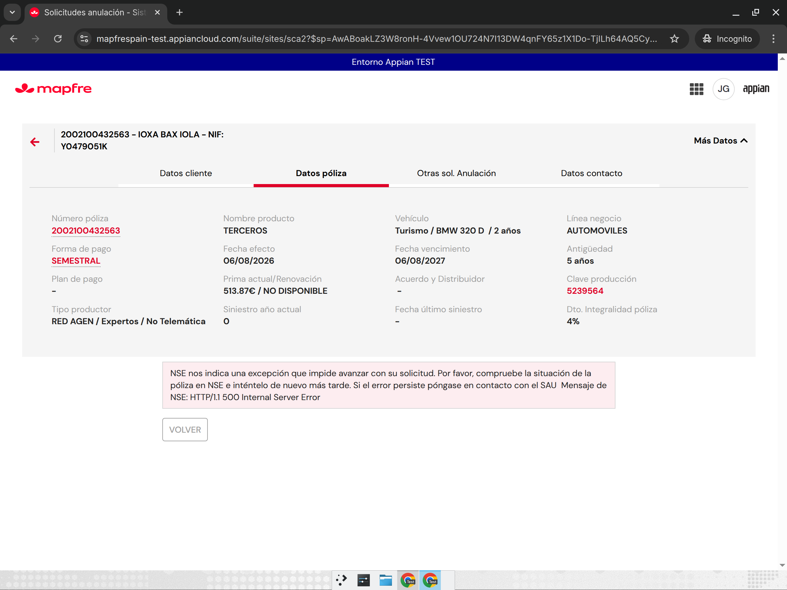
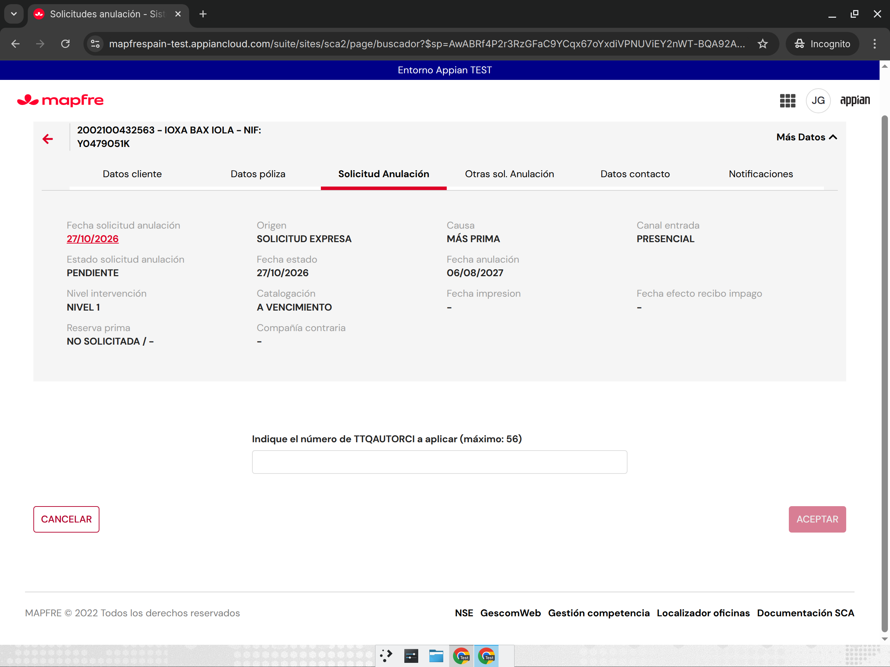
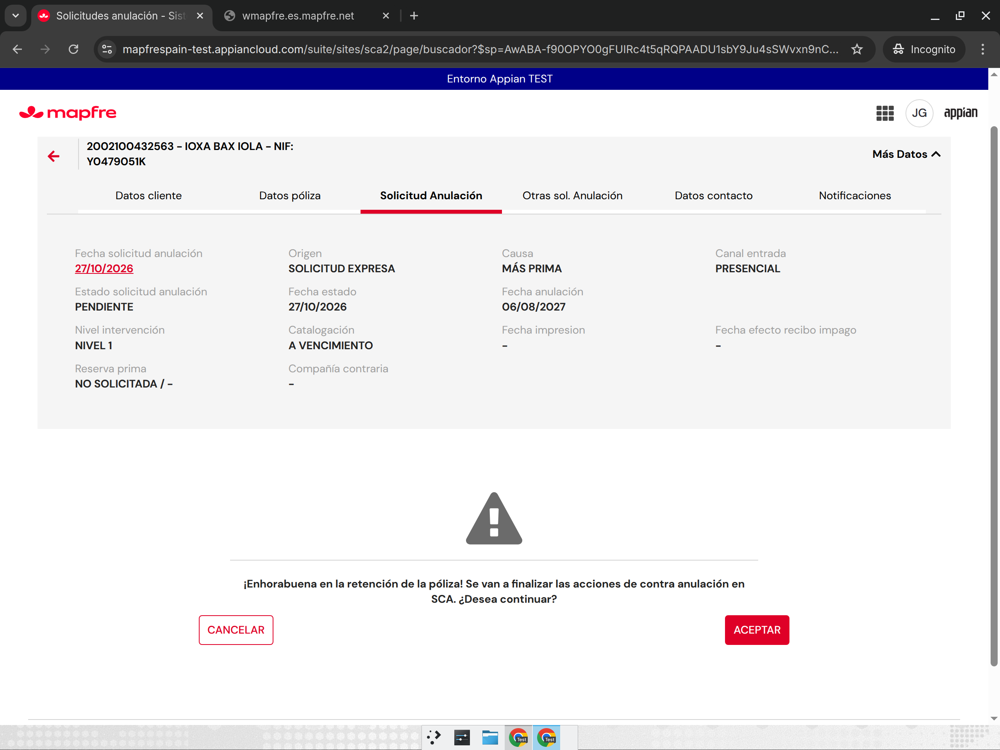
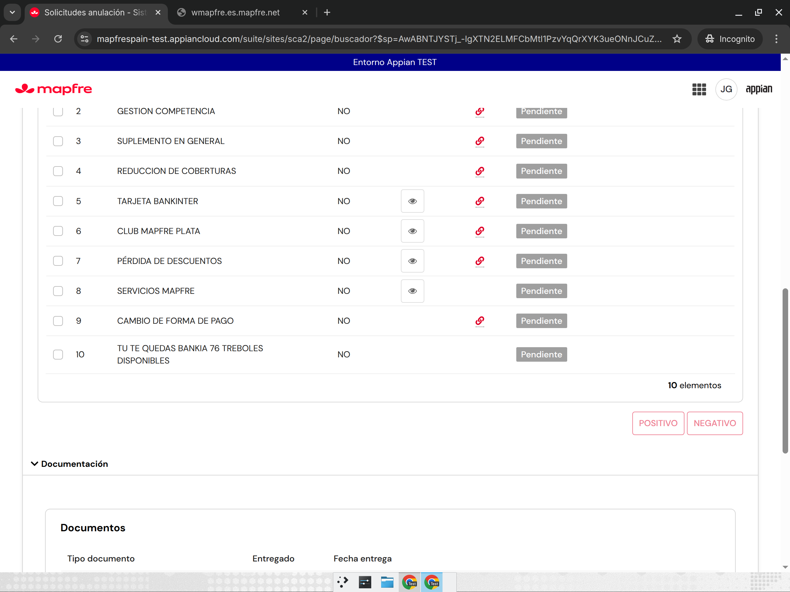
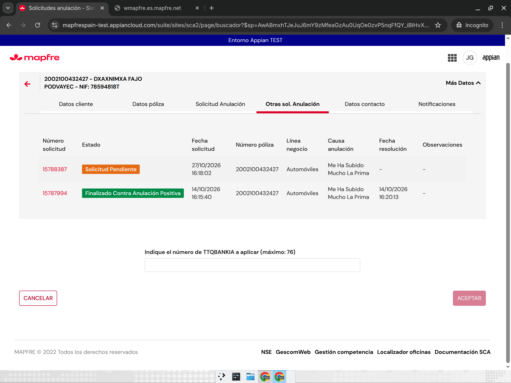
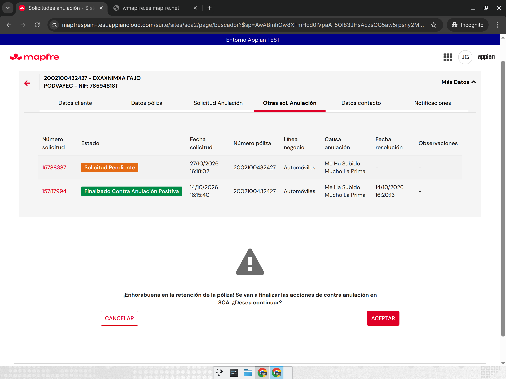
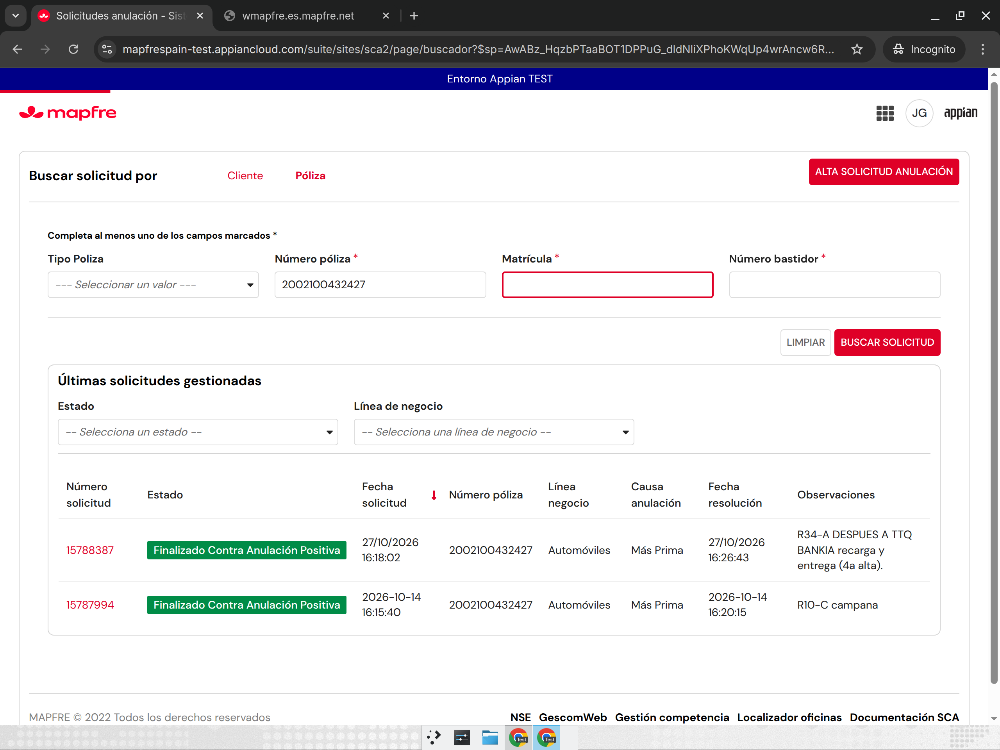
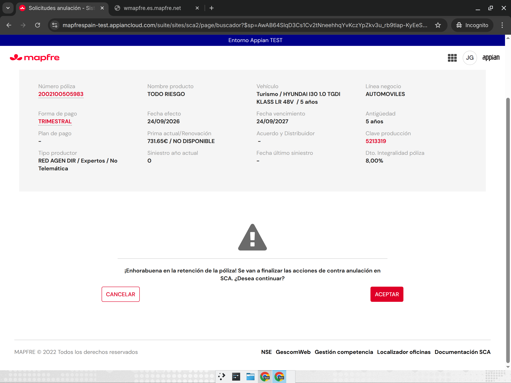

# R34-A — Recarga del argumentario y tréboles; enhorabuena al final (SCA2, TEST)

Estado (27/10/2026, 16:45): **corrección aplicada y probada en TEST**. Entre las 10:15 y las 14:20 el servicio NSE de
simulación de anulación de TEST respondió «HTTP/1.1 500 Internal Server Error» y no se pudieron crear solicitudes (§3.1).

Origen: 5.º «Análisis SCA2» del analista, puntos 1 y 2 de [`../55-ronda34-analisis-sca2.md`](../55-ronda34-analisis-sca2.md).
Reserva de objetos: [`coordinacion-ronda34.md`](coordinacion-ronda34.md).

## 1. Punto 1 — Tras «RECARGAR ARGUMENTO» el POSITIVO de tréboles ya no abre la pantalla TTQ

### Cómo decide SCA2 si abre la pantalla de tréboles
`SCA2_ContraAnulacionOpciones` carga el argumentario con el servicio `consultarListadoArgumentos`. Ese servicio devuelve
la **lista de argumentos** (`listadoArgumentos`) y, en el mismo resultado, las **campañas de tréboles** (`treboles` = DEFCART:
código de campaña, tréboles disponibles y recomendados). Al pulsar POSITIVO, la pantalla «Indique el número de TTQ… a aplicar
(máximo: N)» se abre sólo si el argumento seleccionado tiene una campaña en ese bloque `treboles`
(`local!descart` → `campanaDescart` → `codCampana` / `tuTeQuedas` / `esRegateable` / `maximo`).

### Causa raíz [Observado en el código]
- El botón RECARGAR ARGUMENTO está en `SCA2_ContraAnulacionCompaniaCatalogacion` (v6). Vuelve a llamar al servicio, pero
  **guarda sólo la lista** (`index(…, "listadoArgumentos", {})`) en la variable que le pasa Opciones (`local!listaArgumentos`).
- Las campañas (`local!descart`) se siguen calculando con la **respuesta de la primera carga** (`local!respArgumentario`),
  que la recarga no toca.
- Además, el argumento que estaba marcado antes de recargar (`local!argumentoSeleccionado`) sigue siendo el objeto de la
  lista antigua (la casilla queda marcada tras CANCELAR la pantalla TTQ, como en SCA).
- Resultado: si al recargar cambia el argumentario (caso del analista: el cliente se hace de Club MAPFRE y el servicio
  devuelve otra campaña u otro argumento de tréboles), el argumento nuevo/antiguo no encuentra su campaña en el bloque de
  tréboles antiguo → `esRegateable` falso → POSITIVO salta directamente a «¡Enhorabuena…!» sin pantalla de tréboles.
- SCA (`SCA_CompañiaContrariaCatalogacion` v7, sólo lectura) **guarda la respuesta completa** (lista + tréboles) y
  `SCA_ContraAnulacionOpcionesEstrategicas` le pasa la respuesta completa (`local!argumentario`), de la que derivan tanto la
  lista como las campañas. SCA2 se separó de SCA en ese punto.
- [Observado en pantalla, §3.2] Si la recarga no cambia nada del argumentario, SCA2 seguía abriendo la pantalla.
- [Pendiente] `SCA2_consultarListadoArgumentos` (lote R34-B) no lleva el parámetro `rand` que sí usa SCA para evitar que
  Appian reutilice una respuesta con la misma petición. No se ha podido comprobar si afecta (en TEST no se puede cambiar el
  cliente a Club); se recomienda a R34-B añadirlo por paridad (no es un objeto de R34-A).

### Corrección aplicada
| Objeto | Versión | Cambio |
|---|---|---|
| `SCA2_ContraAnulacionCompaniaCatalogacion` | v6 → v7 | RECARGAR guarda la **respuesta completa** (lista + tréboles), como SCA; nuevos inputs `argumentoSeleccionado` e `indiceArgumentoSeleccionado` que la recarga deja vacíos |
| `SCA2_ContraAnulacionOpciones` | v59 → v60 | Pasa a la recarga `local!respArgumentario` (respuesta completa) y la selección actual |
| `SCA2_ContraAnulacionArgumentarioEstrategicas` | v6 → v7 | La casilla de la tabla «Argumentos disponibles…» se desmarca cuando la selección queda vacía (tras recargar se vuelve a elegir sobre la lista nueva) |

## 2. Punto 2 — La enhorabuena al final (mejora; SCA tampoco lo hace)

### Hoy
POSITIVO → pantalla del servicio (tréboles/TTQ, retos, SVA → correo) → su ACEPTAR sólo cierra la pantalla →
«¡Enhorabuena en la retención de la póliza!… ¿Desea continuar?» → su ACEPTAR ejecuta, por este orden, el servicio
(tréboles/TTQ, retos o SVA), el argumento económico (R30) y el cierre positivo → si el servicio falla, aviso
«No se han podido asignar tréboles…» y el argumento vuelve a Pendiente.

### Ahora (aplicado)
POSITIVO → pantalla del servicio → **su ACEPTAR ejecuta el servicio**:
- **Falla**: sólo el aviso de fallo (mismos textos), el argumento vuelve a Pendiente y no sale la enhorabuena.
- **Va bien**: «¡Enhorabuena…! ¿Desea continuar?» → ACEPTAR → argumento económico (R30, mismas condiciones) → cierre positivo.
Argumentos sin pantalla: sin cambios (enhorabuena directa → ACEPTAR → económico → cierre).

| Objeto | Versión | Cambio |
|---|---|---|
| `SCA2_ContraAnulacionSGO` (modales de tréboles/retos/SVA) | v1 → v2 | El ACEPTAR de tréboles ejecuta executeAsignar (Club MAPFRE) + gestionarTTQ / marcarAsignacionBonificacion; a Retos y a SVA-correo les pasa la acción del servicio. Nuevos inputs: `dataServicio`, `tipoArgumentoVariable`, `return`, `mensajeInfo`, `mcaVentanaInfo` |
| `SCA2_ContraAnulacionModalRetos` | v1 → v2 | Nuevo input `onAceptar`: el ACEPTAR ejecuta asignarRetos |
| `SCA2_ContraAnulacionModalSVAEmail` | v1 → v2 | Nuevo input `onAceptar`: tras validar el correo ejecuta asignarSVA + marcarAsignacionBonificacion |
| `SCA2_ContraAnulacionModalRecuperacionPoliza` | v10 → v11 | Se retiran de su ACEPTAR los pasos 5-7 (servicio), que pasan a las pantallas; mantiene observaciones, R30 y cierre |
| `SCA2_ContraAnulacionOpciones` | v59 → v60 | Los datos del modal de recuperación pasan a un local (`local!dataRecuperacion`, mismo contenido) que se entrega también a SGO |

El código del servicio **se mueve** (no se copia): los textos de enhorabuena y de los avisos de fallo no cambian y no hay
literales nuevos. Se retiran los avisos de éxito «Se ha realizado la asignación de tréboles al usuario correctamente.»
(y su variante «…muy cerca del Vencimiento…») y «Ha comenzado el proceso de asignación de SVA…», que hoy nunca se ven porque
el mismo clic cierra el positivo.

Diff completo (7 objetos): adjunto al mensaje de entrega (`r34a-cambios.patch`). Procedimiento por objeto: GET vivo
idéntico al backup local → PUT → relectura idéntica a lo enviado → `POST /interfaces/{uuid}/test` sin errores
(Opciones con la solicitud 15788380; resto con entradas vacías y SGO con el modal de tréboles abierto). No se ha tocado
ningún objeto de SCA, SCAC, CORE, CMP ni del lote R34-B.

| Objeto | uuid | Versión |
|---|---|---|
| `SCA2_ContraAnulacionModalRetos` | `_a-0000f069-4f37-8000-9cc8-011c48011c48_20051206` | 1 → 2 |
| `SCA2_ContraAnulacionModalSVAEmail` | `_a-0000f069-4f37-8000-9cc8-011c48011c48_20051560` | 1 → 2 |
| `SCA2_ContraAnulacionSGO` | `_a-0000f069-4f37-8000-9cc8-011c48011c48_20060093` | 1 → 2 |
| `SCA2_ContraAnulacionCompaniaCatalogacion` | `_a-0000f069-4f37-8000-9cc8-011c48011c48_20060061` | 6 → 7 |
| `SCA2_ContraAnulacionArgumentarioEstrategicas` | `_a-0000f069-4f37-8000-9cc8-011c48011c48_20060043` | 6 → 7 |
| `SCA2_ContraAnulacionOpciones` | `_a-0000f069-4f37-8000-9cc8-011c48011c48_20056435` | 59 → 60 |
| `SCA2_ContraAnulacionModalRecuperacionPoliza` | `_a-0000f069-4f37-8000-9cc8-011c48011c48_20052951` | 10 → 11 |

## 3. Pruebas

### 3.1 Prueba «antes» (27/10, 10:14–10:32, JJGONZ2) — bloqueada
| Póliza | Resultado del alta | Solicitud |
|---|---|---|
| 2002100432563 | GUARDAR → «NSE … HTTP/1.1 500 Internal Server Error» | no creada |
| 2002100432561 | igual | no creada |
| 0731380454474 | igual | no creada |
| 0731380454486 | igual | no creada |
| 0731700187136 | igual | no creada |

Comprobado también por LCP: `SCA2_simularAnulacionAltaNse` y `SCA_simularAnulacionAltaNse` fallan en 0,3 s con el 500 de
NSE (09:33, 09:43, 09:52 UTC y reintentos cada 10 min). Ninguna solicitud antigua se ha tocado.

### 3.2 Prueba «antes» (versiones originales, 15:26–15:40, JJGONZ2)
| Paso | Resultado | Solicitud | Póliza |
|---|---|---|---|
| POSITIVO a «TU TE QUEDAS RCI 56 TREBOLES DISPONIBLES» | Pantalla «Indique el número de TTQAUTORCI a aplicar (máximo: 56)» → CANCELAR | 15788380 | 2002100432563 |
| RECARGAR sin cambios (la casilla sigue marcada) → POSITIVO | Pantalla TTQ (máximo 56) | 15788380 | 2002100432563 |
| Desmarcar/marcar → POSITIVO; cambiar compañía contraria a 1808 ABANCA → RECARGAR → POSITIVO | Pantalla TTQ (máximo 56) | 15788380 | 2002100432563 |
| Hacer al cliente de Club MAPFRE (enlace de Aplicación) | No posible: `wmapfre.es.mapfre.net` no resuelve desde TEST (DNS) | — | — |
| 1 trébol → ACEPTAR | Sale la **enhorabuena antes** de la entrega → ACEPTAR → finalizada positiva 15:39:21 | 15788380 | 2002100432563 |

Conclusión: sin cambio en el argumentario la recarga no pierde la pantalla (confirma la causa del §1: sólo falla cuando la
recarga trae campañas/argumentos distintos, p. ej. al hacerse Club el cliente). Ese cambio real no se puede provocar en TEST.

### 3.3 Prueba «después» (16:00–16:30, JJGONZ2) y verificación en CORE
| ID | Caso | Esperado | Real | OK/KO | Solicitud | Póliza |
|---|---|---|---|---|---|---|
| a1 | POSITIVO a «TU TE QUEDAS BANKIA 76 TREBOLES DISPONIBLES» | Pantalla TTQ | «Indique el número de TTQBANKIA a aplicar (máximo: 76)» → CANCELAR | OK | 15788387 | 2002100432427 |
| a2 | RECARGAR sin cambios | Casilla desmarcada; al volver a elegir, POSITIVO abre TTQ | Desmarcada; TTQ máximo 76 | OK | 15788387 | 2002100432427 |
| a3 | Compañía contraria 1808 ABANCA → RECARGAR | Igual | Desmarcada; TTQ máximo 76 | OK | 15788387 | 2002100432427 |
| a4 | RECARGAR en póliza sin campaña | Desmarca; sin TTQ | Desmarca; no hay «TU TE QUEDAS» (la campaña de la póliza se consumió en 15788380 y ahora ofrece «CLUB MAPFRE PLATA») | OK | 15788384 | 2002100432563 |
| b1 | 1 trébol → ACEPTAR (servicio OK) | Entrega y después enhorabuena | Enhorabuena sin aviso → ACEPTAR → finalizada positiva 16:26:43. CORE (`consultarBonoCliente`): fila **TTQBANKIA** (vigencia 15/11/2026) y fila **ECONOMICO** de hoy (el argumento es económico: se insertó tras el OK) | OK | 15788387 | 2002100432427 |
| b2 | Tréboles KO (cliente sin Te Cuidamos) | Sólo aviso, sin enhorabuena, argumento Pendiente | **No probado**: no hay póliza «NO CLUB» sin solicitud abierta en TEST (2002300300497 tiene 15788003 pendiente, no tocada) | — | — | — |
| b3 | Argumento sin pantalla y económico («REDUCCION DE COBERTURAS») | Enhorabuena directa → ACEPTAR → económico → cierre | Enhorabuena directa → finalizada positiva 15:55:27; CORE: fila **ECONOMICO** de hoy | OK | 15788382 | 2002100505983 |
| c | Comparación con SCA | Mismos pasos | **SCA no comparable**: el sitio /suite/sites/sca devolvió «403 Acceso denegado» a JJGONZ2; tampoco había alta posible por la mañana (NSE). Comparación hecha sobre el código de SCA (§1) | — | — | — |

Diferencias con SCA: SCA (por código) tampoco reordena la enhorabuena (servicio en el ACEPTAR de la enhorabuena) y en la
recarga conserva el argumento marcado; SCA2 ahora entrega primero y pide volver a elegir el argumento tras recargar.

Otras observaciones (no de este lote): el detalle de las solicitudes finalizadas positivas muestra la gestión de contra
anulación «Incompleta» y sin fecha fin (ya anotado en R10-C, `SCA2_DetalleSolicitud`). Solicitudes de esta ronda que quedan
pendientes (sin uso posterior, pendientes de limpiar si se desea): 15788383 (2002100517805) y 15788384 (2002100432563).
Pólizas probadas por la mañana sin crear solicitud (NSE 500): 2002100432563, 2002100432561, 0731380454474, 0731380454486, 0731700187136.

## 4. Dudas para el analista
1. **CANCELAR en la enhorabuena después de entregar tréboles/SVA/retos**: con el nuevo orden, el servicio ya se ha
   ejecutado cuando sale la enhorabuena. Si el gestor pulsa CANCELAR, el cliente se queda con los tréboles y el argumento
   vuelve a Pendiente (si repite POSITIVO, se volverían a entregar). ¿Se quita CANCELAR en ese caso, o se mantiene?
2. **Argumento económico**: se sigue insertando al ACEPTAR la enhorabuena (positivo definitivo, como en R30) y sólo si el
   servicio fue bien. Insertarlo antes de mostrar la enhorabuena dejaría una fila si el gestor cancela. ¿Correcto así?
3. **Observaciones de más de 999 caracteres**: el aviso sale al ACEPTAR la enhorabuena, es decir, después de entregar el
   servicio. ¿Hay que comprobarlo antes de entregar tréboles?
4. **Aviso de tréboles «muy cerca del Vencimiento»**: hoy no se ve (el mismo clic cierra el positivo) y con el cambio
   tampoco. ¿Debe mostrarse antes de la enhorabuena?
5. **Fallo de SVA** («No ha sido posible asignar el SVA al cliente»): hoy el positivo seguía igualmente; con el cambio el
   argumento queda abierto, como el resto de fallos. ¿Correcto?
6. **Entrega parcial** (p. ej. Club MAPFRE asigna los tréboles pero gestionarTTQ falla): el argumento queda abierto con el
   aviso «No se han podido asignar los tréboles al cliente», pero el cliente ya tiene los tréboles. ¿Qué debe hacerse?

7. **Selección tras recargar**: SCA2 desmarca ahora el argumento al recargar (hay que volver a elegirlo); SCA lo deja marcado con los datos antiguos. ¿Conforme?
8. **Fallo de tréboles en pantalla (b2)**: no se ha podido probar por falta de póliza «NO CLUB» libre en TEST; ¿nos podéis facilitar una?
