# R38-A — `SCA2 CMD RefrescarCacheCabecera`: revisión MNI y errores de campos de la caché de cabecera

Entorno: **Appian TEST** (`mapfrespain-test`), aplicación SCA2. Fecha: 30/10/2026. Sesión hija R38-A (coordinación en [`coordinacion-ronda38.md`](coordinacion-ronda38.md)).

Petición: «revisa el modelo SCA2 CMD RefrescarCacheCabecera para ver si se puede optimizar con un MNI, para que no sea un proceso que tenga un bucle muy grande. Además, revisa los errores de la consola sobre los campos de la cabecera de caché».

## 1. Resumen

| Tema | Resultado |
|---|---|
| MNI en el PM | **No se aplica.** Es viable técnicamente, pero no mejora lo suficiente para compensar los riesgos (§4). El PM **no se ha modificado** (sigue en v6.0, temporizador 07:05 intacto). |
| Errores de campos de la caché | **Corregido.** Causa: el campo `polizaFechaultimosiniestro` guarda, en pólizas Vida, el **enlace GESVIDA (~287 caracteres)** y la columna es `VARCHAR(255)`: el refresco lo recortaba (avisos `REFRESCO_CACHE_RECORTE`, antes `value too long for type character varying(255)`) y la cabecera servida desde caché mostraba el enlace **truncado**. Ahora se guarda sin el prefijo fijo y se recompone al leer (§5). |
| Regresión | Alta nueva (póliza 0731900095024, solicitud 15788603) → CA y detalle con cabecera correcta, sin errores de evaluación en consola (§6). |
| Hallazgos sin corregir (fuera del encargo) | `validaHasta` se graba a las 07:00 **GMT** (08:00 en Madrid) y el temporizador corre a las 07:05 Madrid; filas duplicadas por solicitud (§7). Se dejan para decisión. |

## 2. Estado actual del PM (v6.0, sin cambios)

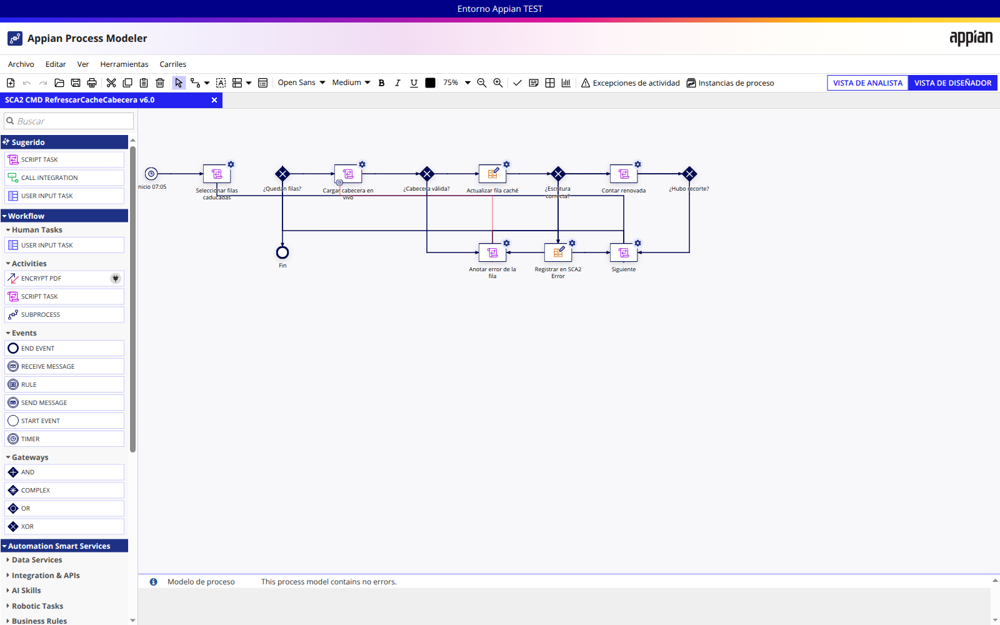

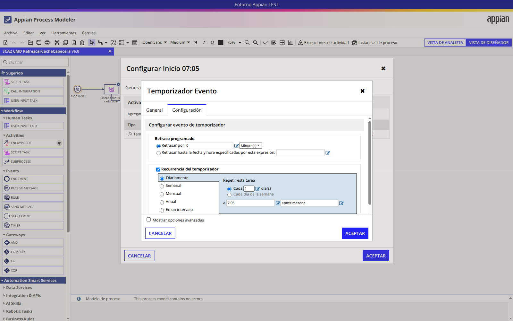

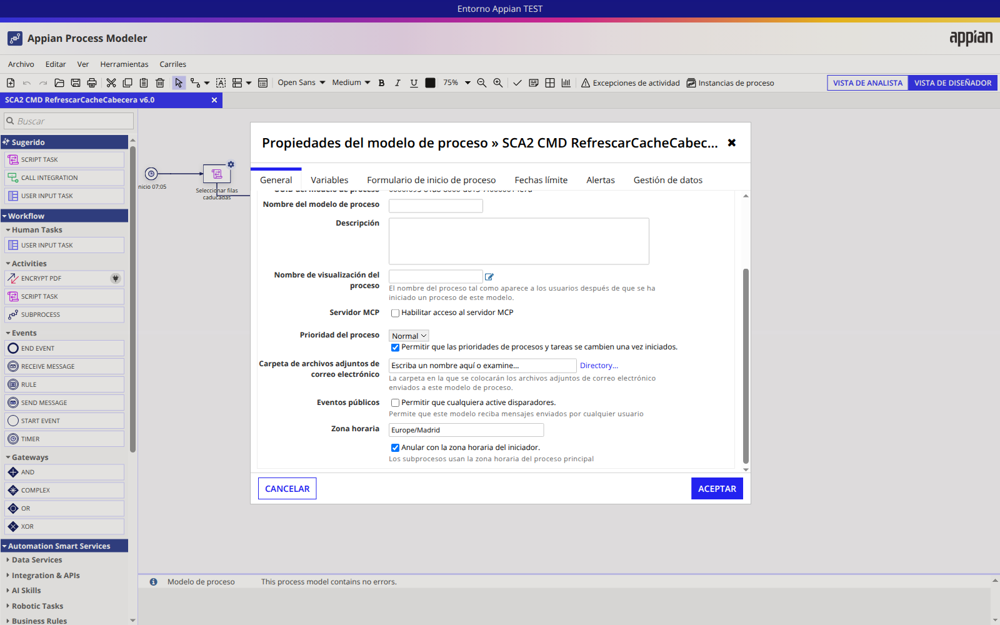

Flujo (uuid `0000f095-81a8-8000-d613-7f0000014e7a`, archivado automático a los 7 días):

```text
Inicio 07:05 → Seleccionar filas caducadas → ¿Quedan filas? ──no──→ ¿Hubo recorte? → Fin
                                                │sí
                    ┌──────────── Siguiente ◄───┤ (indice+1, limpia variables)
                    │                           ▼
                    │                  Cargar cabecera en vivo (timer 2 min → Anotar error)
                    │                           ▼
                    │                  ¿Cabecera válida? ──no──→ Anotar error → Registrar en SCA2 Error
                    │                           ▼ sí
                    │                  Actualizar fila caché (Write Records, recorte opcional)
                    │                           ▼
                    └──── Contar renovada ◄── ¿Escritura correcta? ──no──→ Anotar error → SCA2 Error
```

- **Selección:** filas `SCA2 Datos Cabecera` con `origenCache = CACHE`, `validaHasta <= now()` y solicitud abierta, ordenadas por `validaHasta`, **máximo `cons!SCA2_CACHE_REFRESCO_BATCH` = 50** por ejecución.
- **Por fila:** 1 carga en vivo (`SCA2_obtenerDatosCabeceraLive`, ~15 integraciones) + 1 Write Records; ~6–8 nodos ejecutados por iteración.
- El PM no escribe en `SCA2 Transicion` (no es un comando de solicitud); R36 no le afecta.

### Métricas de las ejecuciones (variables de proceso por LCP)

| Proceso | Fecha | Filas | Solicitudes distintas | Procesadas | Errores | Duración aprox. |
|---|---|---|---|---|---|---|
| 9114790 | 22–28/10 | 28 | 26 | 28 | 0 | ~3 min |
| 11218107 | 22–28/10 (v3.0) | 28 | 26 | 22 | 6 (`varchar(255)`) | ~3 min |
| 537586185 | 29/10 07:05 | 50 | 34 | 50 | 0 (3 avisos de recorte) | ~4 min 45 s |
| 14391740 | 30/10 07:05 | 4 | 3 | 4 | 0 (3 avisos de recorte) | ~24 s |
| **537589429** | **30/10 08:02 (prueba R38-A, manual)** | **50** | — | **50** | **0** | **~5 min** |

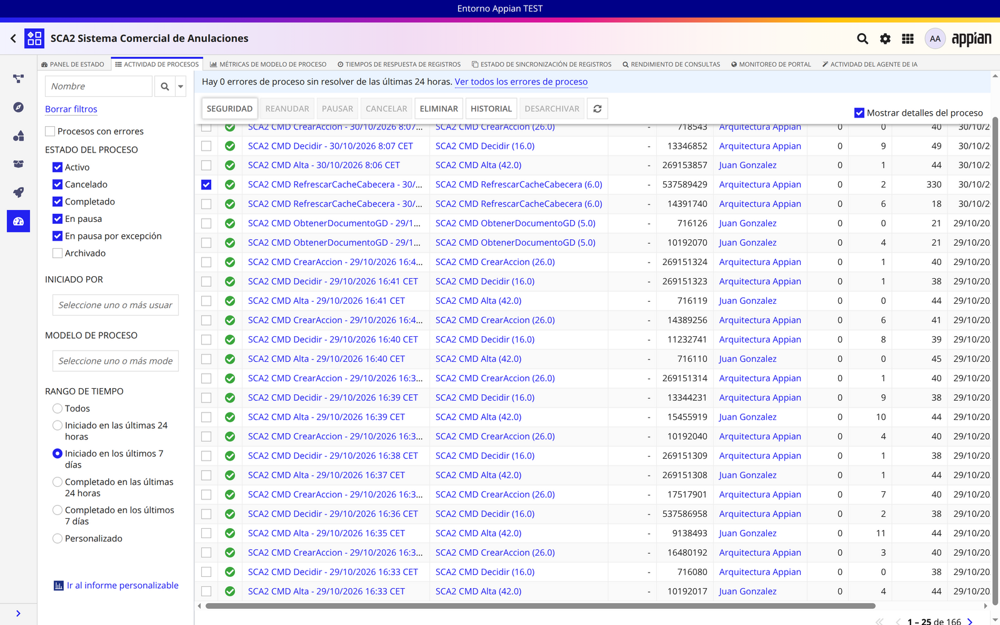

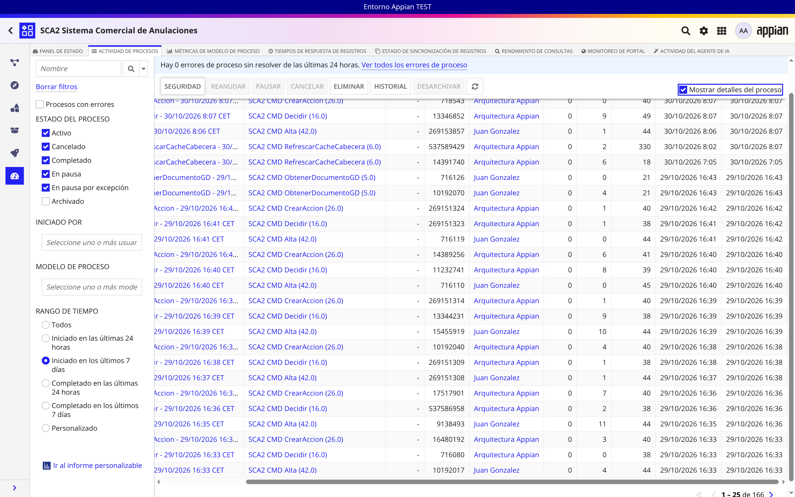

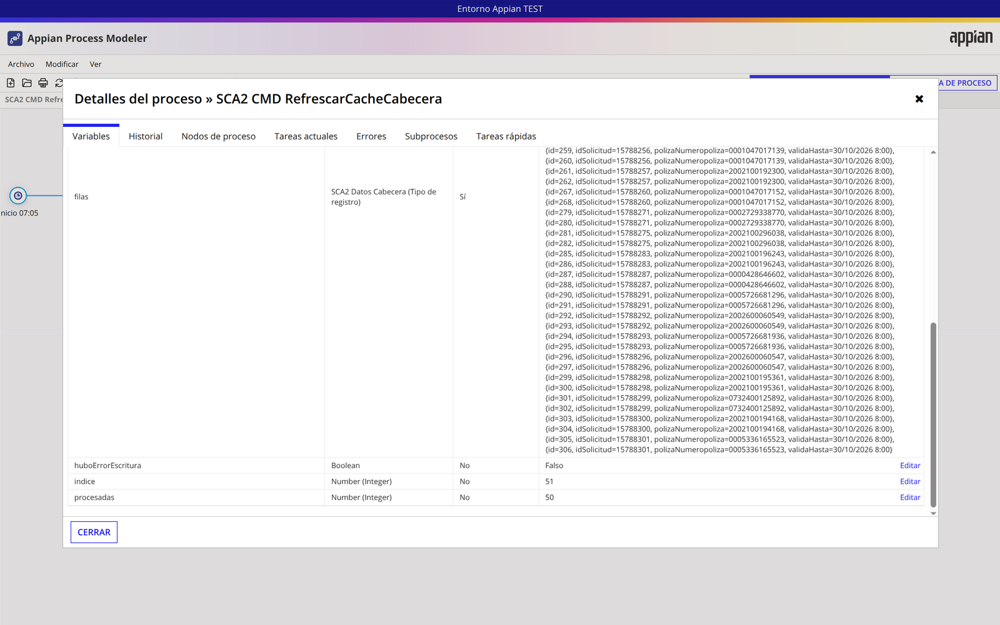

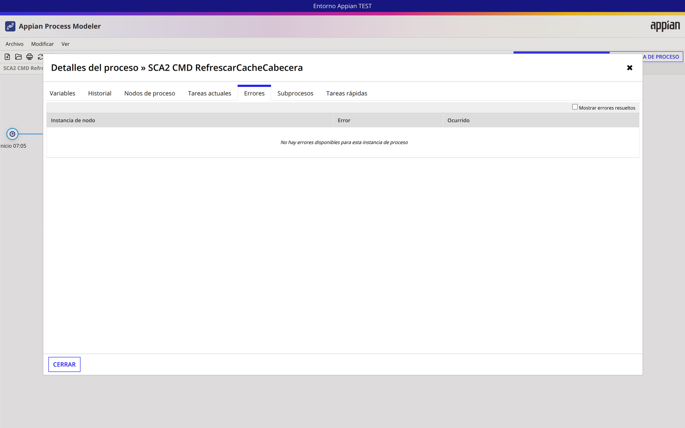

Coste medio: **~5,7 s por fila**, dominado por la carga en vivo (servicios CORE/API), no por el motor de procesos. Máximo por instancia: 50 iteraciones ≈ 350–400 nodos. Appian no muestra AMU/memoria por instancia en la monitorización de la app.

## 3. Datos de la caché (antes de la prueba)

458 filas; 238 con `origenCache = CACHE` para 132 solicitudes; **106 solicitudes con 2 filas** (duplicadas); 91 filas caducadas a las 07:00.

## 4. MNI frente a otras opciones — decisión

| Opción | Ventaja | Inconvenientes en este PM |
|---|---|---|
| A. Bucle actual por lotes de 50 (sin cambios) | Aislamiento de errores por fila (timer 2 min, registro en SCA2 Error), lote acotado por constante, 1 instancia de proceso | Tiempo secuencial (~5 min para 50) y ~400 nodos por instancia |
| B. Subproceso por fila con **MNI** (secuencial) | Elimina el bucle del diagrama | Mismo tiempo; 50 instancias hijas extra al día (más carga de motor y archivado); **LCP no expone la configuración MNI** (ningún nodo SCA2 la tiene y el JSON no trae el campo) → solo se configura en Designer y una edición posterior por LCP podría perderla sin aviso |
| C. Subproceso con **MNI en paralelo** | Tiempo total mucho menor | 50 cabeceras × ~15 llamadas simultáneas a CORE/API Clients a las 07:05 (riesgo de timeouts y saturación); los contadores `procesadas`/`errores` y el aviso de recorte hay que agregarlos desde 50 hijos |
| D. `a!forEach` + 1 escritura por lista | 4–5 nodos en total | 50 cargas en vivo en **una sola expresión** (~5 min, sin el timer de 2 min por fila); un fallo de escritura invalida el lote entero; Appian recomienda no encadenar integraciones en bucles de expresión |

**Decisión: no modificar el PM.** El bucle ya está acotado a 50 iteraciones (lejos del límite de 1000 instancias MNI y de los avisos de bucles grandes), el tiempo lo marcan los servicios externos y no el número de nodos, y las alternativas empeoran el aislamiento de errores, la carga sobre CORE o la mantenibilidad por LCP. Si en el futuro se quiere procesar **todas** las filas caducadas cada día (hoy 91 > 50), la opción recomendada sería B/C con un subproceso por **lote** (p. ej. 25 filas por hijo, MNI sobre los lotes) y configurar el MNI en Designer; queda como decisión (§8).

## 5. Errores de campos de la caché: causa y corrección

**Evidencia (SCA2 Error, bandeja de errores):**
- 29/10 06:05 (ids 177–181): `Actualizar fila caché` → `value too long for type character varying(255)`.
- 30/10 06:05 (ids 184–186): `REFRESCO_CACHE_RECORTE` → «Campos recortados al límite de su columna: polizaFechaultimosiniestro 287/255».
- En Monitorización no hay errores de proceso (las incidencias se registran como avisos y el PM termina `COMPLETED`).

**Causa raíz:** `SCA2_obtenerDatosCabeceraLive` (copia de SCA) rellena `datosPoliza.fechaUltimoSiniestro` con el **enlace GESVIDA** (`cons!SCA2_TXT_LINK_GESVIDA_CABECERA` de 116 caracteres + póliza + nombres de tomador/asegurado) cuando la póliza es de Vida. La columna `POLIZA_FECHAULTIMOSINIESTRO` de `sca2_datos_cabecera` es `VARCHAR(255)`; el usuario `devin` no puede cambiar el DDL. Resultado: escrituras fallidas (antes) o enlace recortado (después del recorte de R37), y la cabecera servida desde caché mostraba un enlace incompleto (filas 402/403 con 255 caracteres).

**Corrección (sin cambiar firma ni tabla):**

| Objeto | Versión | Cambio |
|---|---|---|
| `SCA2_construirFilaCacheCabecera` (uuid `_a-0000f09f-42ed-8000-9d42-011c48011c48_5649210`) | v1 → **v2** | Al construir la fila del PM, si el valor empieza por `cons!SCA2_TXT_LINK_GESVIDA_CABECERA` se guarda sin ese prefijo |
| `SCA2_renovarCacheCabecera` (`_a-0000f093-2064-8000-9d36-011c48011c48_5607622`) | v2 → **v3** | Mismo cambio en la fila que escribe la Web API |
| `SCA2_obtenerDatosCabecera` (`_a-0000f069-4f37-8000-9cc8-011c48011c48_20053304`) | v6 → **v7** | Al leer de caché, si el valor no empieza por `http` y contiene `&stGNombreTomador=`, antepone el prefijo → enlace completo |

Cada regla: lectura viva → backup JSON local → reemplazo de una sola línea → relectura (expresión idéntica a la enviada, mismas entradas, 2 líneas de diferencia). Fechas normales (`dd/mm/aaaa`) y nulos no cambian.

**Pruebas de la corrección:**

| Caso | Esperado | Real | OK/KO |
|---|---|---|---|
| `construir` con enlace de 318 caracteres | Se guarda sin prefijo (202) | 202 caracteres | OK |
| `construir` con fecha `15/03/2024` / nulo | Sin cambios | `15/03/2024` / nulo | OK |
| PM manual 537589429 (50 filas) | 0 errores, 0 avisos de recorte | 50 procesadas, `errores`/`excesosCache` vacíos, 0 filas nuevas en SCA2 Error | OK |
| Fila con enlace Vida escrita tras el cambio (id 471) | Guardada en 171 caracteres | 171 | OK |
| `obtener` v7 sobre esa fila | Enlace recompuesto de 287 caracteres, igual al vivo | 287, empieza por el prefijo GESVIDA | OK |
| `obtener` v7 en solicitudes sin enlace (15788436, 15788454) | Sin error | 0,2 s, sin error | OK |

## 6. Comparación de la caché antes/después y regresión

| Medida | Antes | Después |
|---|---|---|
| Filas `SCA2 Datos Cabecera` | 458 | 461 (+2 de la solicitud nueva 15788603, +1 fila `X`/`X` §8) |
| Filas renovadas | — | 52 (50 PM + 2 por Web API) |
| Campos cambiados | — | `fechaCache` y `validaHasta` (52/50); contenido: solo `polizaVehiculo` (24, dato vivo `1,576 → 1,578`) y 3 filas con datos de cliente actualizados en origen |
| Longitud máx. `polizaFechaultimosiniestro` | 255 (recortado) | 171 (codificado) |
| Avisos/errores de recorte | 3 por ejecución | 0 |

Muestra: filas 230/231/233 (solicitudes 15788204/05/08) conservan nombre y producto (`TERCEROS AMPLIADO`, `BASICAR TR CON FRANQUICIA`, `TODO RIESGO 100`); solo cambian `fechaCache` (→ 30/10) y `validaHasta` (→ 31/10).

Regresión UI (JJGONZ2, testing agent): alta nueva con la póliza **0731900095024** (Hogar) → solicitud **15788603** → CA con cabecera de cliente/póliza correcta y detalle correcto; sin argumentos ejecutados. Consola: ningún `pageerror`, warning ni error de evaluación/campos de la cabecera. Sí aparecen **38 errores HTTP 404** de recursos `https://mapfrespain-test.appiancloud.com/suite/...` cuya causa no se ha determinado (no se relacionan con la cabecera; quedan como duda §8).

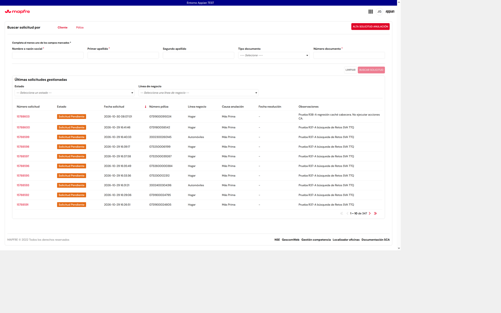

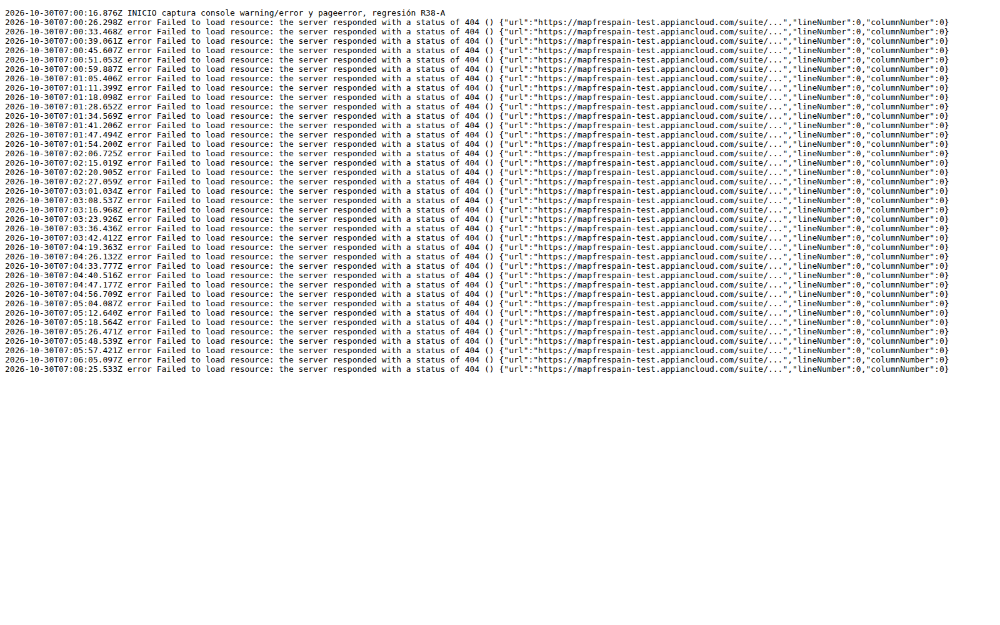

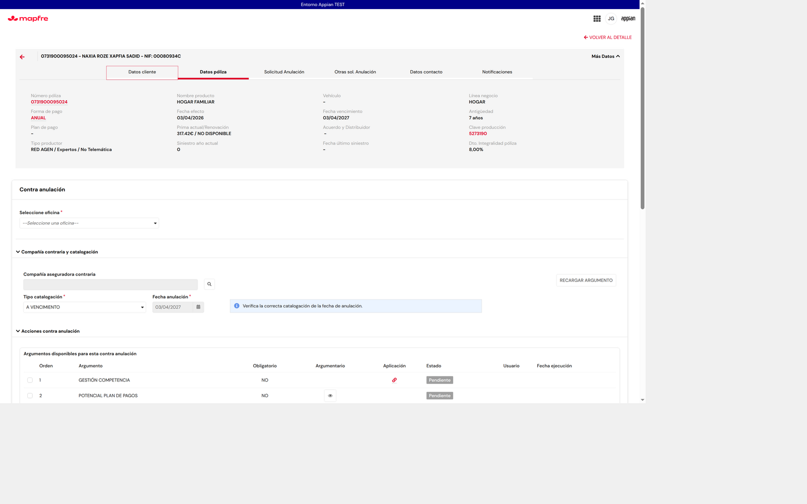

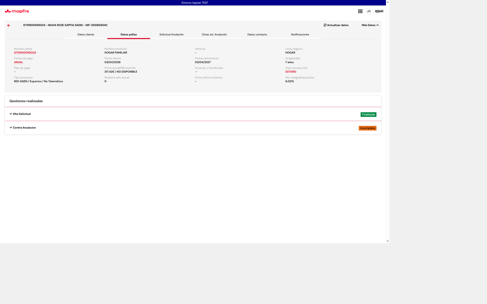

## 7. Hallazgos no corregidos (fuera del encargo)

1. **Hora de caducidad en GMT:** las filas se graban con `validaHasta = 07:00 GMT` (08:00 en Madrid en invierno, 09:00 en verano), mientras que el temporizador corre a las 07:05 Madrid. A las 07:05 la mayoría de filas aún no ha caducado: la ejecución diaria del 30/10 solo encontró 4 filas, y la caché sirve datos del día anterior hasta las 08:00. Afecta a `SCA2_calcularValidaHastaCache`.
2. **Filas duplicadas por solicitud:** 106 de 132 solicitudes tienen 2 filas de caché; la solicitud nueva 15788603 generó 2 filas en 3 s (inserciones simultáneas de la Web API al abrir la cabecera). La lectura usa la más reciente, pero el PM renueva ambas (doble llamada en vivo).
3. Hoy el servicio en vivo ya no devuelve el enlace GESVIDA para 0000063001441/0000063001442 (vacío), aunque a las 07:05 sí lo hacía: el dato de origen varía.

## 8. Riesgos y dudas (para decidir)

- ¿Se quiere renovar **todas** las filas caducadas cada día (hoy 91 > lote de 50)? Si sí: subproceso por lotes con MNI configurado en Designer (§4).
- ¿Corregir la hora de caducidad (§7.1) a 07:00 Madrid o mover el temporizador a las 08:05/09:05?
- ¿Corregir la duplicidad (§7.2)?
- Fila `SCA2 Datos Cabecera` id 471 con `idSolicitud = X` y póliza `X` (30/10 07:55 Madrid), creada por una llamada a la Web API con parámetros de prueba de origen no identificado; no se ha borrado.
- 38 errores HTTP 404 de recursos `/suite/...` en la consola durante la regresión: causa sin determinar.
- Alternativa definitiva al recorte: ampliar la columna `POLIZA_FECHAULTIMOSINIESTRO` (requiere DDL de BD).

## 9. No probado y motivo

- Cabecera de una solicitud **Vida nueva** en la UI con el enlace GESVIDA: no hay póliza Vida libre en el bloque de reserva; verificado por regla (`obtener` v7 recompone 287 caracteres).
- AMU/memoria por instancia: Appian no lo muestra en la monitorización de la aplicación.

Backups locales (fuera del repo, sin secretos): `pm_live_before.json`, `bk_construir_v1_before.json`, `bk_renovar_v2_before.json`, `bk_obtener_v6_before.json`, `cache_before.csv`, `cache_after.csv`.
