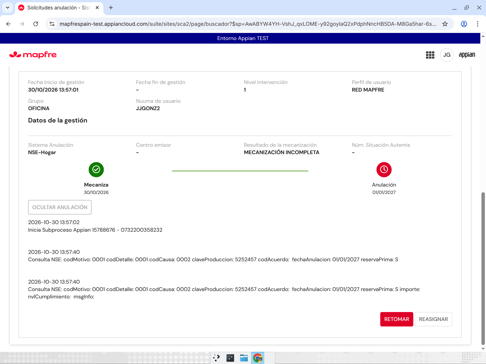
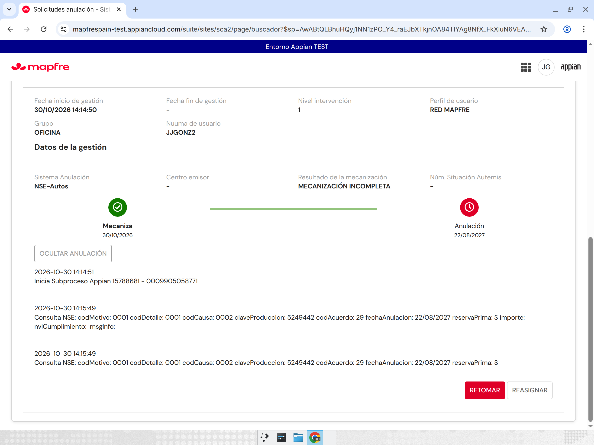
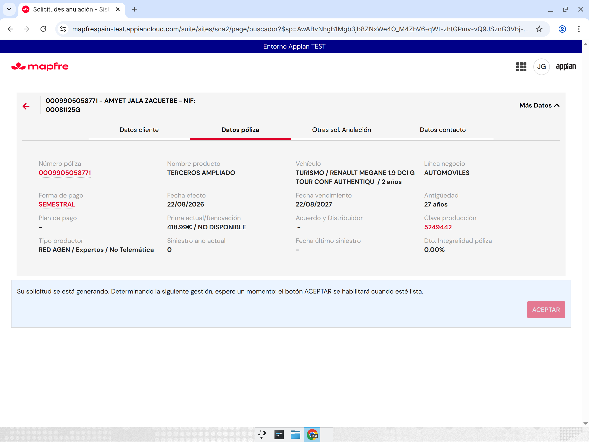
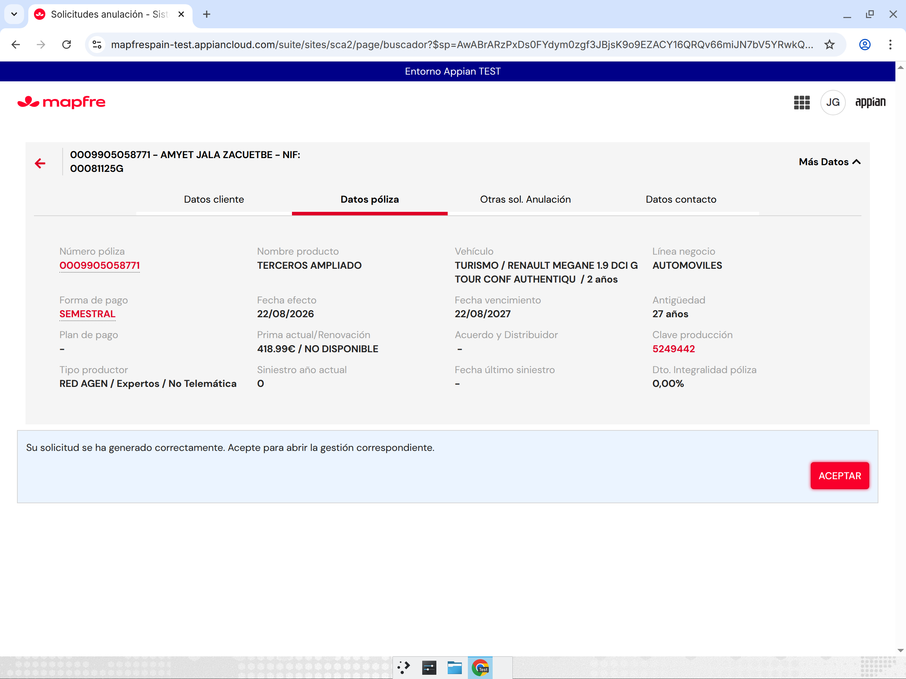

# R40 / R41 — Traza «Consulta NSE» y botón ACEPTAR en la espera del alta (SCA2, TEST)

## R40 — Traza de consulta en pólizas NSE

**Petición**: en pólizas NSE (migradas), las observaciones de la mecanización no deben decir «Consulta NEW» (que se refiere a wAutemis), sino «Consulta NSE». Es un comportamiento heredado de SCA; SCA no se ha tocado.

**Cambio** (`SCA2_MecanizacionPrincipal` v21 → v22):
- Las dos trazas (`tipoGestion` 5) usan ahora como prefijo
  `if(local!polizaWAutemis, cons!SCA2_TXT_TRAZA_CONSULTA_NEW, cons!SCA2_TXT_TRAZA_CONSULTA_NSE)`.
- Constantes nuevas: `SCA2_TXT_TRAZA_CONSULTA_NEW` = «Consulta NEW: » y `SCA2_TXT_TRAZA_CONSULTA_NSE` = «Consulta NSE: ».
- El resto del texto se mantiene: codMotivo, codDetalle, codCausa, claveProduccion, codAcuerdo, fechaAnulacion, reservaPrima e importe/nvlCumplimiento/msgInfo.

**Pruebas con solicitudes nuevas** (UI, JJGONZ2):

| Solicitud | Póliza | Sistema | Resultado |
|---|---|---|---|
| 15788676 | 0732200358232 | NSE-Hogar | OK: las dos trazas empiezan por «Consulta NSE:» y se mantienen tras recargar |
| 15788681 | 0009905058771 | NSE-Autos | OK: las dos trazas empiezan por «Consulta NSE:» y se mantienen tras recargar |
| 15788678 | 0002729345675 | — | Se quedó en PENDIENTE tras el alta, sin CA (no llegó a la mecanización) |

**No probado**: regresión wAutemis («Consulta NEW:»). No hay ninguna póliza wAutemis libre que haya llegado a mecanización. La condición `local!polizaWAutemis` es la misma que ya usaba la pantalla.

## R41 — Espera del alta: ACEPTAR deshabilitado

**Petición**: el mensaje de espera hablaba de un botón GUARDAR que ya no se ve, y daba la sensación de que la pantalla se había roto. Se pide mostrar el botón ACEPTAR deshabilitado hasta que la gestión esté lista.

**Cambio**:
- `SCA2_AltaSolicitudPage` v42 → v43. El botón ACEPTAR de la tarjeta de espera pasa de `showWhen` a `disabled`: siempre está visible y solo se habilita cuando la gestión está lista o el alta ha terminado con error (`PDTE-`).
- `SCA2_TXT_ESPERA_DECISION_INICIAL` v1 → v2: «Su solicitud se está generando. Determinando la siguiente gestión, espere un momento: el botón ACEPTAR se habilitará cuando esté lista.»

**Pruebas** (solicitud nueva 15788681): se muestra el texto nuevo con ACEPTAR deshabilitado, y al pulsarlo no ocurre nada. Cuando aparece «Su solicitud se ha generado correctamente…», ACEPTAR se habilita y abre la contra anulación.

**No probado**: el mensaje de más de 30 s («Está tardando un poco más…») con el botón deshabilitado, porque el alta no tardó tanto.

Copias de seguridad: `~/sca2work/r40/` y `~/sca2work/r41/` (antes y después).
