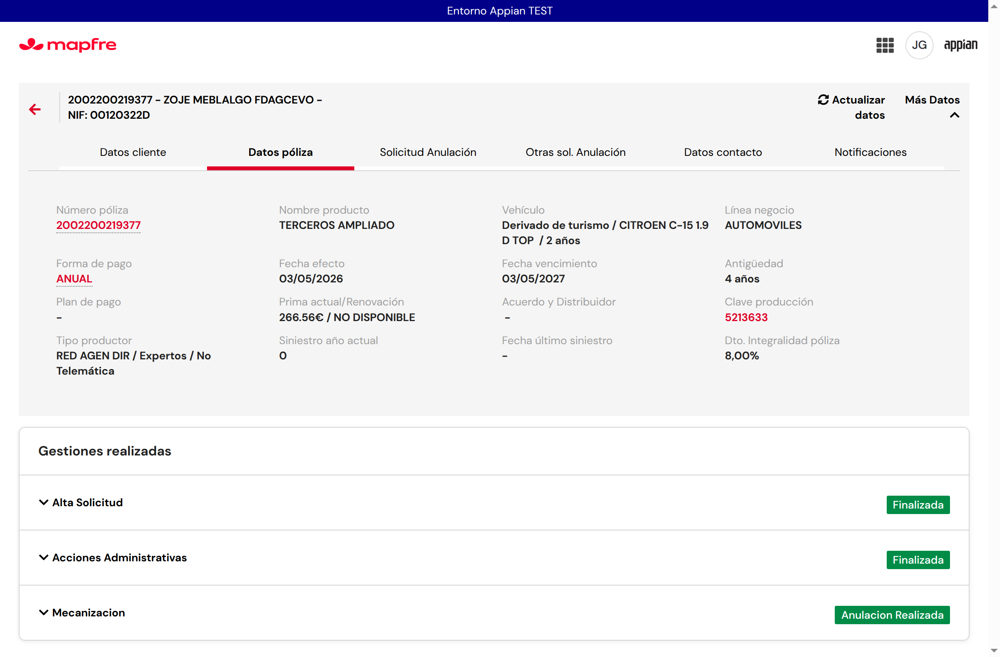
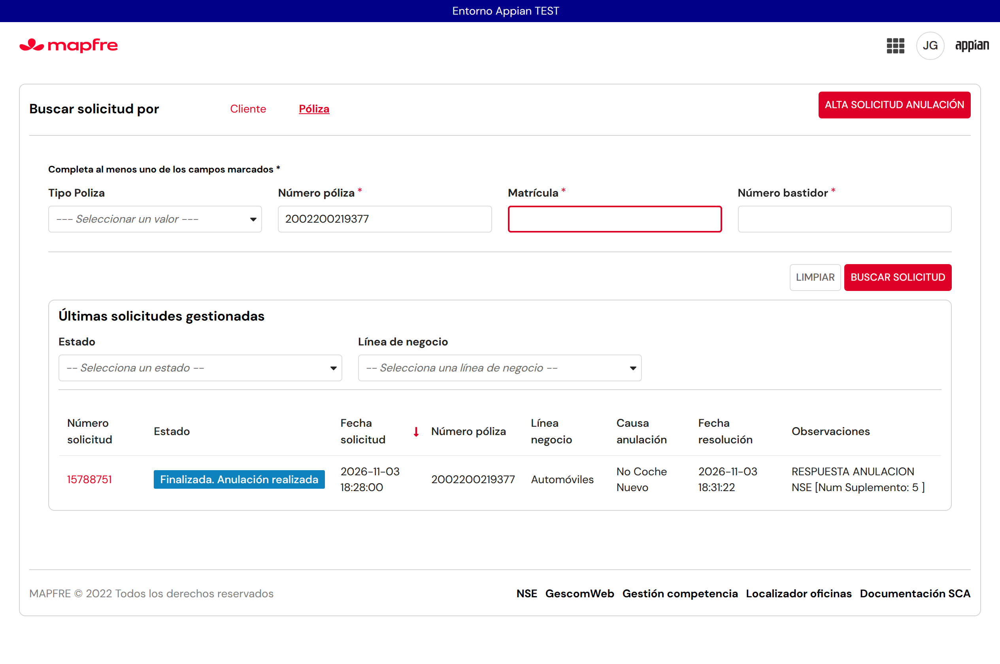
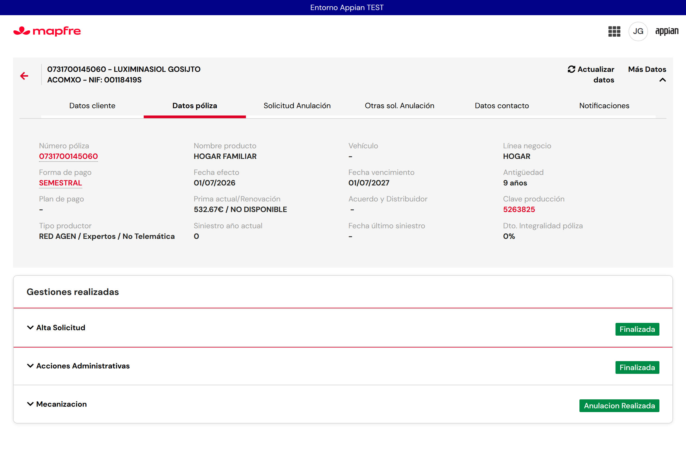
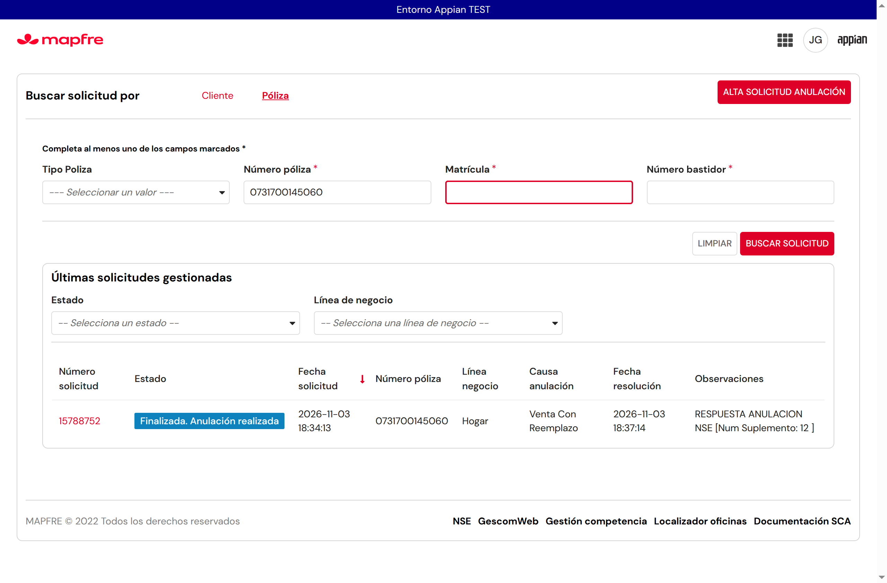
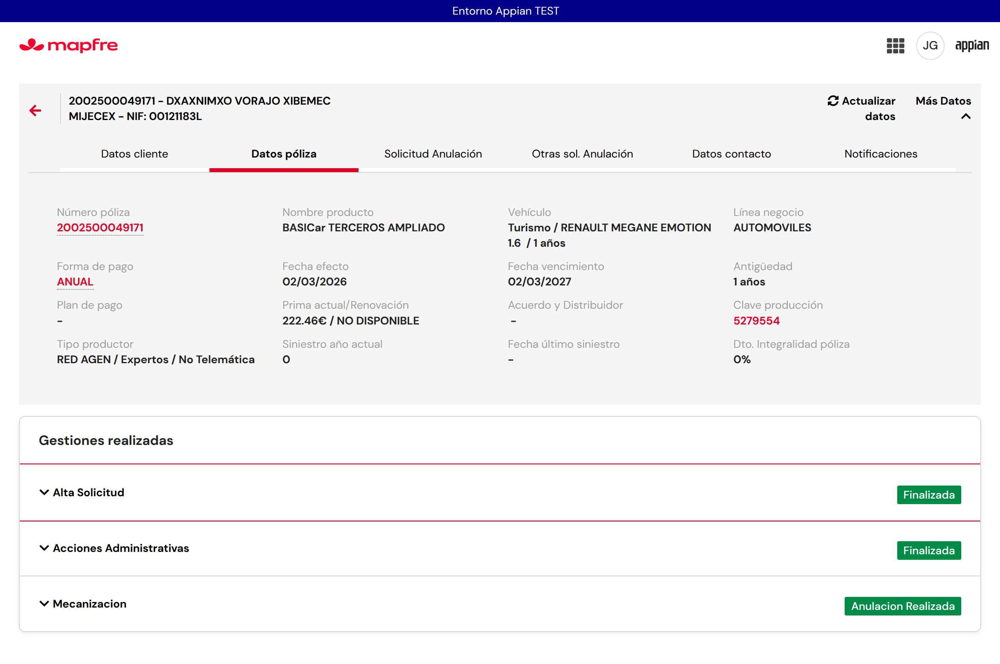
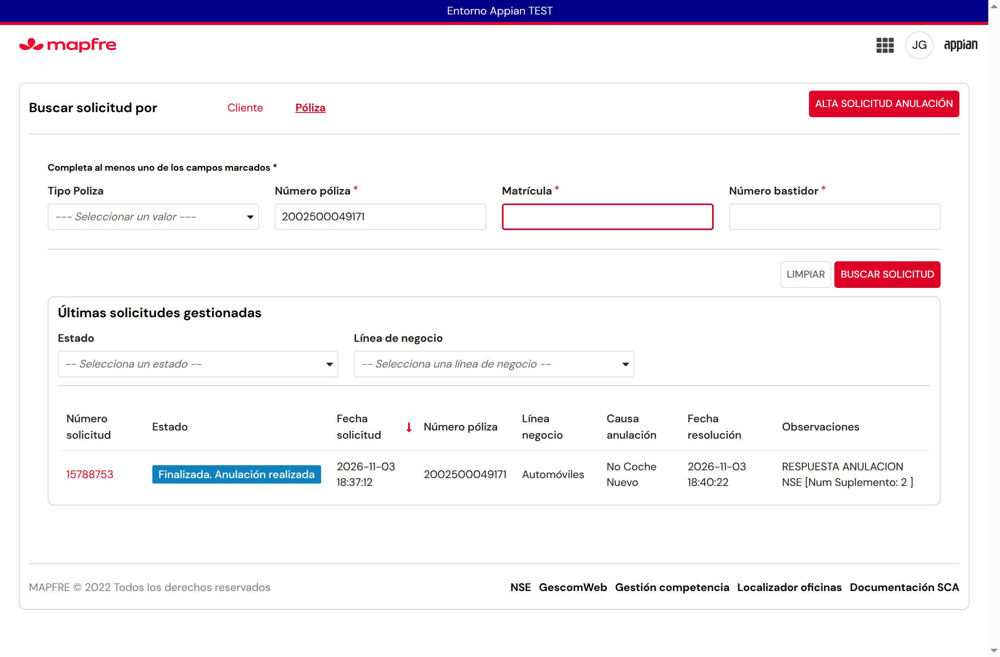
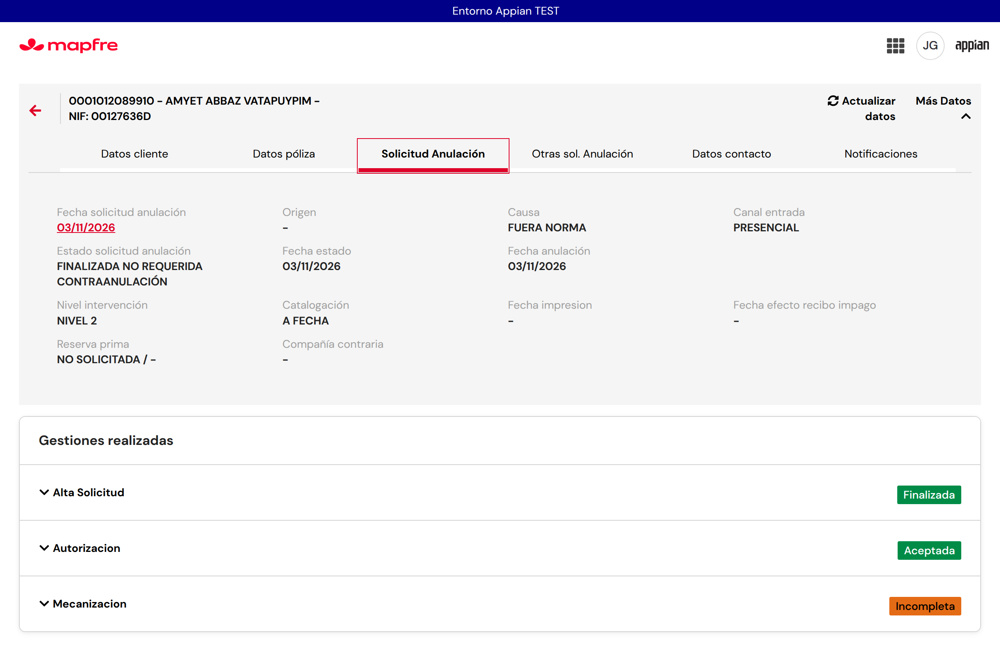
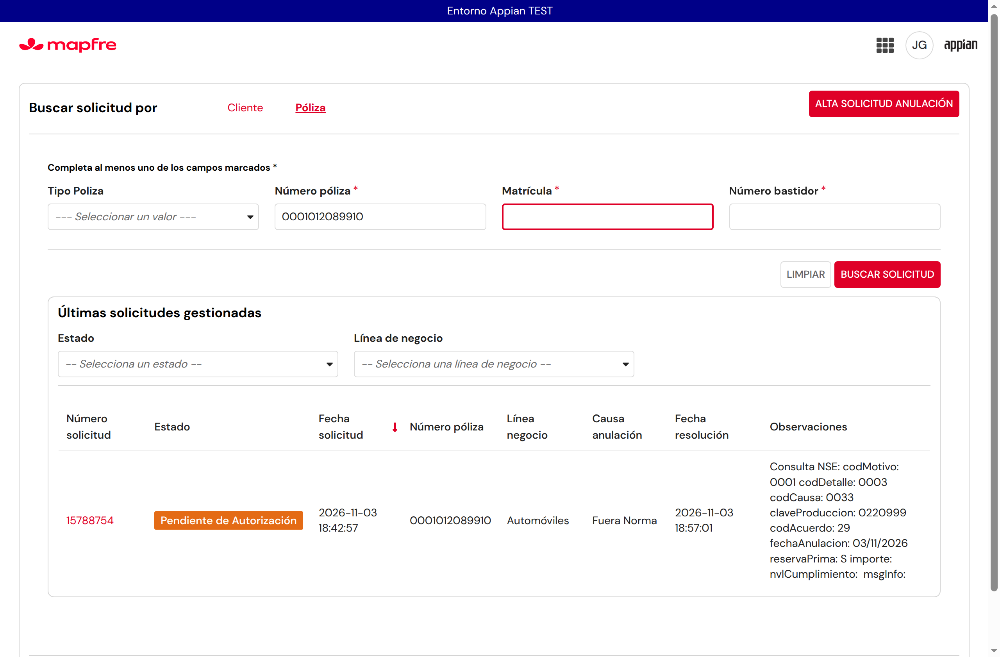

# R44-A — Estados tras Acción Administrativa, anulación a vencimiento y mecanización (SCA2, Appian TEST)

Fecha: 03/11/2026. Sitio: https://mapfrespain-test.appiancloud.com/suite/sites/sca2 . Usuario de pruebas: JJGONZ2 (NOPRO).
Contrato y textos del analista: [coordinacion-ronda44.md](coordinacion-ronda44.md). Pólizas: [polizas/REGISTRO.md](polizas/REGISTRO.md) (marca «R44-A»).

## 1. Resumen

| # | Punto del analista | Resultado |
|---|---|---|
| 1 | El botón no se deshabilita al primer clic (doble envío) | **Corregido y probado**: el ACEPTAR de «Su solicitud se ha generado correctamente…» se deshabilita al pulsarlo. Doble clic rápido: una sola navegación, sin solicitudes ni gestiones duplicadas. |
| 2 | Acc. Adm. con anulación al vencimiento salta a VERTI/Vencimiento | **Corregido y probado**: como en SCA, si la solicitud tiene una Acción Administrativa no se induce VERTI/Vencimiento. En los 3 casos de Acc. Adm. no apareció. |
| 3 | Anulación a vencimiento con NSE OK deja la mecanización «Incompleta» y la lista con estado incorrecto | **Corregido y probado** en NSE Autos y NSE Hogar: mecanización «ANULACION REALIZADA» y lista «Finalizada. Anulación realizada». |
| 4 | «El cliente no entrega documentación» (NSE Autos, NSE Hogar, Autemis) | **Corregido y probado en NSE Autos y NSE Hogar**. wAutemis **no probado** (el alta falla antes de crear la solicitud, ver §5). |
| 5 | Entrega de documentos que lleva a anulación a vencimiento queda «Incompleta» | **Corregido y probado** (NSE Autos). |
| 6 | Autorización requerida → pendiente de autorizar; si no → anulación directa y mecanización finalizada | **Parcial**: la rama sin autorización funciona cuando NSE responde (casos 3-5). La rama «pendiente de autorizar» **no se ha podido probar** (ninguna póliza disponible devolvió los controles 00000005/00000006). Una anulación directa fuera de Acc. Adm. (15788754) quedó «Incompleta» porque NSE no respondió en 10 minutos (ver §5). |

## 2. Causa de cada punto

1. **Doble clic.** En `SCA2_AltaSolicitudPage` el botón ACEPTAR solo dependía de que la solicitud estuviera lista; tras el primer clic seguía activo hasta que la pantalla cambiaba, así que admitía más pulsaciones.
2. **VERTI desde Acc. Adm.** En `SCA2 CMD Mecanizar`, el nodo 331 «¿Inducir Verti?» decidía solo por el resultado del servicio de contacto (VERTI o VENCIMIENTO), sin tener en cuenta el origen. SCA no induce VERTI cuando la anulación viene de una Acción Administrativa (SCA2 ya lo hacía así en `SCA2 CMD CrearAccion`, pero no en Mecanizar). El servicio de contacto no se lanza desde las pantallas de Acc. Adm.: se consulta al mecanizar.
3. **Mecanización «Incompleta» con NSE OK** (puntos 3, 4 y 5, misma causa). En la anulación lanzada desde Acc. Adm. la solicitud pasa en segundos de mecanizar a fin (`SCA2 CMD Finalizar`), que cierra la solicitud en CORE. NSE responde de forma asíncrona (escribe el número de suplemento en ANL unos segundos después) y en SCA2 nadie actualizaba la mecanización en CORE antes de ese cierre: CORE cerraba la gestión de mecanización como INCOMPLETA y, una vez cerrada, ya no admite cambios. La lista calcula el estado a partir de esa gestión, por eso mostraba un estado incoherente. En SCA el estado lo fija la llamada CORE `actualizarMecanizacion` tras la respuesta de ANL/NSE.
4. **Lista de solicitudes.** No tenía un error propio: con la mecanización en «ANULACION REALIZADA» muestra «Finalizada. Anulación realizada». Con una mecanización INCOMPLETA en una solicitud finalizada muestra «Pendiente de Autorización» (comportamiento existente; ver dudas).

## 3. Cambios (solo objetos SCA2)

Orden seguido en todos: lectura viva → copia JSON → cambio mínimo → relectura y comparación. En los PMs se compararon nodo a nodo: solo cambian los nodos indicados y se conservan `activityChained` e `IsSynchronous` (el nodo 331 de Mecanizar sigue encadenado a 332 y 324; `CMD Finalizar` se sigue lanzando como subproceso síncrono desde `CMD CrearAccion`).

| Objeto | Versión antes → después | Cambio |
|---|---|---|
| Interfaz `SCA2_AltaSolicitudPage` | v49 → v50 | `local!aceptarPulsado`: ACEPTAR deshabilitado tras el primer clic. |
| PM `SCA2 CMD Mecanizar` | v44 → v45 | Nodo 331: no induce VERTI/Vencimiento si `SCA2_vieneDeAccionAdministrativa`. |
| PM `SCA2 CMD Finalizar` | v12 → v14 | Nodos nuevos 14 «Actualizar mecanización NSE», 15 «¿Esperar respuesta NSE?» y 16 «Esperar NSE» (1 min, máx. 10 veces) antes de «Finalizar Solicitud» en CORE; variables `mecNseRes` y `contadorNse`. |
| Regla `SCA2_actualizarMecanizacionAnulacionNse` | nueva (v1 → v3) | NSE Autos/Hogar: si NSE respondió OK (suplemento en ANL) y la mecanización sigue INCOMPLETA, llama a CORE `actualizarMecanizacion` con «anulación realizada»; si NSE aún no ha respondido, devuelve `esperar`. v2 corrige la lectura de ANL; v3 añade la espera. |
| Regla `SCA2_vieneDeAccionAdministrativa` | nueva (v1) | ¿La solicitud tiene una gestión CORE de Acción Administrativa? |
| Constantes `SCA2_TXT_COD_EST_MECANIZACION_ANULADA` («1»), `SCA2_TXT_EST_GESTION_INCOMPLETA`, `SCA2_TXT_ACCION_GESTION_MECANIZACION` («5»), `SCA2_TXT_ACCION_GESTION_ACCADM` («3»), `SCA2_VAL_ESPERA_NSE_FINALIZAR_MAX_INTENTOS` (10) | nuevas (v1) | Literales de negocio. |

No se ha modificado SCA, SCAC, CORE, CMP, NSE, ANL ni SGD, ni el batch `SCA2 Batch Mecanizacion NSE` (sigue desactivado).

## 4. Pruebas (solicitudes nuevas)

Ruta real: alta → Acción Administrativa → mecanización (ANULAR PÓLIZA) → fin automático. En estos casos el sistema no ofreció contra-anulación ni tarea manual de nivel 2, así que no se pudieron recorrer esas pantallas.

| Caso | Póliza | Solicitud | Esperado | Mecanización (CORE / tarjeta) | Lista | Resultado |
|---|---|---|---|---|---|---|
| (a) NSE Autos, no entrega documentación, vencimiento 03/05/2027 | 2002200219377 | 15788751 | Anulación realizada / Finalizada. Anulación realizada | ANULACION REALIZADA | Finalizada. Anulación realizada | **OK**. Sin VERTI. |
| (a) NSE Hogar, no entrega documentación, vencimiento 01/07/2027 | 0731700145060 | 15788752 | Ídem | ANULACION REALIZADA | Finalizada. Anulación realizada | **OK**. Sin VERTI. |
| (b) NSE Autos, entrega de documentos que lleva a vencimiento 02/03/2027 | 2002500049171 | 15788753 | Ídem | ANULACION REALIZADA | Finalizada. Anulación realizada | **OK**. Sin VERTI. |
| (e) Doble clic en ACEPTAR tras el alta | 2002200219377 | 15788751 | Una navegación, sin duplicados | 1 alta, 1 Acc. Adm., 1 mecanización | 1 solicitud | **OK**. |
| (d) Anulación directa sin autorización (fuera de Acc. Adm., sin controles 05/06) | 0001012089910 | 15788754 | Anulación realizada | INCOMPLETA (NSE no escribió suplemento en 10 min) | Pendiente de Autorización | **KO / no concluyente**: NSE no respondió (ANL sin suplemento ni concluida). |
| (c) Autorización requerida (wAutemis) | 0002729379905 | — | Pendiente de autorizar | — | — | **No probado**: error en el alta (§5). |
| Antes de la corrección final: NSE Hogar (a) | 0730680141136 | 15788749 | — | INCOMPLETA | — | KO de la v1 de la regla (lectura de ANL). |
| Antes de la corrección final: NSE Autos (a) | 2002200410628 | 15788750 | — | INCOMPLETA | — | KO de la v2: NSE escribió el suplemento 1 s después de que Finalizar lo consultara (origen de la espera de la v3). |

En los tres casos OK, `SCA2 CMD Finalizar` esperó una vez (≈1 min) y, al volver a consultar, la mecanización ya estaba en ANULACION REALIZADA (la actualizó el circuito común ANL/CORE durante la espera), así que la regla no tuvo que llamar a CORE. Lo que corrige el estado es que SCA2 ya no cierra la solicitud en CORE antes de que NSE responda. La llamada directa de la regla a CORE no se ha visto actuar en una solicitud nueva.

Evidencias (vídeo del caso NSE Autos y capturas):

| Detalle | Lista |
|---|---|
|  |  |
|  |  |
|  |  |
|  |  |

Otras: mecanización `r44-a-v3-{autos,hogar,documentos}-mecanizacion.png`, Acc. Adm. `r44-a-v3-autos-aa.png` y `r44-a-v3-documentos-aa.png`, doble clic `r44-a-autos-aceptar-doble.png`, error wAutemis `r44-a-wautemis-error-catalogacion.png`, usuario `r44-a-v3-usuario.png`, KO previos `r44-a-hogar-{mecanizacion,tarjetas}.png` y `r44-a-autos-tarjetas.png`, directa `r44-a-directa-tarjetas.png`.

## 5. No probado y limitaciones

- **Autorización requerida (c)**: no se ha reproducido. La póliza wAutemis del bloque (0002729379905) solo ofrece catalogación «A FECHA» y al GUARDAR el alta da un error de pantalla («Tipo catalogación»: valor 1 no está entre las opciones, solo 4). Es un fallo previo de `SCA2_AltaSolicitudPage`, ajeno a este cambio, que no se ha corregido por estar fuera del alcance.
- **wAutemis** en general (puntos 4 y 6): no probado por el mismo motivo. La corrección de la mecanización solo actúa en NSE Autos/Hogar.
- **Anulación directa (d)**: en 15788754 NSE no escribió el suplemento en ANL en 10 minutos, así que la mecanización quedó INCOMPLETA y la solicitud se finalizó a los 10 minutos.
- No se ha probado el doble envío de otros botones (ANULAR PÓLIZA, finalizar…), ni la comparación en vivo con SCA.
- Contra-anulación negativa y nivel 2 manual: el sistema no los ofreció en estos casos.

## 6. Dudas para el analista

1. En las anulaciones NSE, `SCA2 CMD Finalizar` espera hasta 10 minutos (1 minuto cada vez) a que NSE responda antes de cerrar la solicitud en CORE. ¿Es aceptable ese máximo? Si NSE no responde, la solicitud se cierra con la mecanización INCOMPLETA.
2. Solicitud finalizada con mecanización INCOMPLETA (caso 15788754): la lista muestra «Pendiente de Autorización» y la cabecera «Finalizada no requerida contra anulación». ¿Qué estado debe mostrar la lista en ese caso?
3. ¿Por qué NSE no responde en una anulación directa con causa 33 y reserva de prima (15788754)? ¿Es un comportamiento esperado de TEST?
4. ¿Hay alguna póliza wAutemis/NSE libre que devuelva los controles 00000005/00000006 para probar «pendiente de autorizar»? ¿Se corrige el error de catalogación del alta wAutemis en otra ronda?
