# R45-D — Etiquetas y colores de estado de la lista de solicitudes (D1)

Entorno: Appian TEST, aplicación SCA2. Fecha: 06/11/2026. Usuario funcional JJGONZ2 (SSO Mapfre NO PRO). Referencia funcional cerrada: tabla de etiquetas de `../anexos/r45-Analisis_SCA2.txt` (D2 resuelta: «los estados de Pedro» = esta tabla).

## Resumen

| Punto | Resultado |
|---|---|
| Localización de reglas SCA2/SCA | OK |
| Implementación tabla D1 (29 combinaciones) + constantes | OK |
| Regla de prueba en Designer: 29/29 | OK |
| Reales nuevas: pendiente, anulación realizada, CA positiva, cancelada | OK |
| Real nueva: mecanización enviada / pendiente de autorización | NO REPRODUCIDO (la póliza acabó en nivel 2); cubierto solo por la regla de prueba |
| Comparación SCA | Parcial (casos 1–3 en lista inicial; después error de navegación de SCA) |

## 1. Dónde se calcula la etiqueta y el color

- **SCA2** (lista «Últimas solicitudes gestionadas», buscador y «Otras solicitudes»): `SCA2_BuscadorTabla` / `SCA2_Buscador` → `SCA2_calcularEstadoSolicitud` (estado CORE de solicitud + gestiones; ahora también `cod_tip_est_mecaniza`) → etiqueta; `SCA2_colorEstadoSolicitud` (etiqueta → constante `SCA2_VAL_COLOR_*`). `SCA2_textoEstadoSolicitud` mapea los estados internos SCA2 y queda como fallback. `SCA2_TablaOtrasSolAnulacion` y las tarjetas de `SCA2_DetalleSolicitud` no se tocaron (ver pendientes).
- **SCA**: la lista de `sca-site` muestra el estado de su propia tabla de solicitudes («Pendiente», etc.), no la tabla combinada del analista; por eso en SCA los casos 1–3 aparecen como «Pendiente» (`../img/r45-d-sca-casos123-lista.png`).

## 2. Cambio realizado

`SCA2_calcularEstadoSolicitud` obtiene `codTipEstMecaniza` (entrada opcional `codEstMecaniza` o, si falta, consulta `SCA2_consultaBBDDSCA` con `idSolicitud`, solo para solicitud 2/4/5) y aplica la tabla D1 antes del cálculo anterior. Lo no cubierto por la tabla sigue con la lógica anterior sin cambios. `SCA2_BuscadorTabla` y `SCA2_Buscador` pasan `idSolicitud`. `SCA2_colorEstadoSolicitud` compara contra las constantes de etiqueta. No se tocan PMs (R42/R44 intactos).

### Objetos modificados y versiones

| Objeto | UUID | Versión | Backup |
|---|---|---|---|
| ER `SCA2_calcularEstadoSolicitud` | `_a-0000f069-4f37-8000-9cc8-011c48011c48_20052795` | v3→v4 | `backups-r45/r45-d-SCA2_calcularEstadoSolicitud-original.xml` |
| ER `SCA2_colorEstadoSolicitud` | `..._20063676` | v3→v4 | `backups-r45/r45-d-SCA2_colorEstadoSolicitud-original.xml` |
| IF `SCA2_BuscadorTabla` | `..._20056379` | v3→v4 | `backups-r45/r45-d-SCA2_BuscadorTabla-original.xml` |
| IF `SCA2_Buscador` | `..._20055660` | v3→v4 | `backups-r45/r45-d-SCA2_Buscador-original.xml` |
| 15 constantes nuevas (abajo) | — | nuevas (v1) | — |

Despliegue con Deployment API v2: inspección `18b180ce-306e-4ee2-9959-56b82f9fc7ff` (0 errores, 0 avisos), importación `d5191e65-c37c-4b34-8ffc-d7166c5052bb` (19 objetos, 0 fallos). Reexport de la aplicación `9af63180-522b-4ea5-8a04-98235a9c98f5`: los 4 objetos en su nueva versión y las 15 constantes dentro de SCA2.

### Constantes nuevas

| Constante | Valor |
|---|---|
| `SCA2_TXT_COD_EST_MECANIZACION_PDTE_AUTORIZAR` | `2` |
| `SCA2_TXT_COD_EST_MECANIZACION_INCOMPLETA` | `3` |
| `SCA2_TXT_COD_EST_MECANIZACION_CERRADA` | `4` |
| `SCA2_TXT_COD_EST_MECANIZACION_ENVIADA` | `7` |
| `SCA2_TXT_ETQ_ESTADO_PENDIENTE` | `Solicitud Pendiente` |
| `SCA2_TXT_ETQ_ESTADO_POLIZA_ANULADA_NIVEL2` | `Póliza Anulada. Solicitud Pendiente Nivel 2` |
| `SCA2_TXT_ETQ_ESTADO_MECANIZACION_ENVIADA` | `Mecanización Enviada` |
| `SCA2_TXT_ETQ_ESTADO_PDTE_AUTORIZACION` | `Pendiente de Autorización` |
| `SCA2_TXT_ETQ_ESTADO_CANCELADA` | `Cancelada` |
| `SCA2_TXT_ETQ_ESTADO_FINALIZADA_SIN_ANULAR` | `Solicitud Finalizada sin anular` |
| `SCA2_TXT_ETQ_ESTADO_RECHAZADA_ANULACION` | `Solicitud Finalizada. Rechazada anulación` |
| `SCA2_TXT_ETQ_ESTADO_CA_POSITIVA` | `Finalizado Contra Anulación Positiva` |
| `SCA2_TXT_ETQ_ESTADO_ANULACION_REALIZADA` | `Finalizada. Anulación realizada` |
| `SCA2_TXT_ETQ_ESTADO_CADUCADA` | `Solicitud Caducada` |
| `SCA2_TXT_ETQ_ESTADO_ANULADA_CADUCADA` | `Anulada Caducada` |

Colores reutilizados: `SCA2_VAL_COLOR_NARANJA_OSCURO` (#E46B15), `SCA2_VAL_COLOR_ROJO_OSCURO` (#BE0F0F), `SCA2_VAL_COLOR_VERDE_OSCURO` (#008C47), `SCA2_VAL_COLOR_AZUL` (#0D82BD), `SCA2_VAL_COLOR_GRIS_MEDIO` (#9F9F9F).

## 3. Resultados

T = regla de prueba en Designer (todas las combinaciones de la tabla); F = solicitudes nuevas reales.

| ID | Caso | Esperado | Real | OK/KO | Solicitud | Instancia | Pasos realizados | Posible causa/solución |
|---|---|---|---|---|---|---|---|---|
| T01 | sol 1 + mec vacía | Solicitud Pendiente (#E46B15) | Solicitud Pendiente (#E46B15) | OK | — (regla de prueba) | — | Designer: `SCA2_calcularEstadoSolicitud(estadoSolicitud, datosGestiones, codEstMecaniza)` + `SCA2_colorEstadoSolicitud` | — |
| T02 | sol 2 + mec vacía | Solicitud Pendiente (#E46B15) | Solicitud Pendiente (#E46B15) | OK | — (regla de prueba) | — | Designer: `SCA2_calcularEstadoSolicitud(estadoSolicitud, datosGestiones, codEstMecaniza)` + `SCA2_colorEstadoSolicitud` | — |
| T03 | sol 4 + mec vacía + gestión máx 8 | Solicitud Pendiente (#E46B15) | Solicitud Pendiente (#E46B15) | OK | — (regla de prueba) | — | Designer: `SCA2_calcularEstadoSolicitud(estadoSolicitud, datosGestiones, codEstMecaniza)` + `SCA2_colorEstadoSolicitud` | — |
| T04 | sol 5 + mec vacía + gestión máx 8 | Solicitud Pendiente (#E46B15) | Solicitud Pendiente (#E46B15) | OK | — (regla de prueba) | — | Designer: `SCA2_calcularEstadoSolicitud(estadoSolicitud, datosGestiones, codEstMecaniza)` + `SCA2_colorEstadoSolicitud` | — |
| T05 | sol 2 + mec 1 | Póliza Anulada. Solicitud Pendiente Nivel 2 (#E46B15) | Póliza Anulada. Solicitud Pendiente Nivel 2 (#E46B15) | OK | — (regla de prueba) | — | Designer: `SCA2_calcularEstadoSolicitud(estadoSolicitud, datosGestiones, codEstMecaniza)` + `SCA2_colorEstadoSolicitud` | — |
| T06 | sol 4 + mec 7 | Mecanización Enviada (#E46B15) | Mecanización Enviada (#E46B15) | OK | — (regla de prueba) | — | Designer: `SCA2_calcularEstadoSolicitud(estadoSolicitud, datosGestiones, codEstMecaniza)` + `SCA2_colorEstadoSolicitud` | — |
| T07 | sol 5 + mec 7 | Mecanización Enviada (#E46B15) | Mecanización Enviada (#E46B15) | OK | — (regla de prueba) | — | Designer: `SCA2_calcularEstadoSolicitud(estadoSolicitud, datosGestiones, codEstMecaniza)` + `SCA2_colorEstadoSolicitud` | — |
| T08 | sol 14 + mec vacía | Cancelada (#9F9F9F) | Cancelada (#9F9F9F) | OK | — (regla de prueba) | — | Designer: `SCA2_calcularEstadoSolicitud(estadoSolicitud, datosGestiones, codEstMecaniza)` + `SCA2_colorEstadoSolicitud` | — |
| T09 | sol 14 + mec 4 | Cancelada (#9F9F9F) | Cancelada (#9F9F9F) | OK | — (regla de prueba) | — | Designer: `SCA2_calcularEstadoSolicitud(estadoSolicitud, datosGestiones, codEstMecaniza)` + `SCA2_colorEstadoSolicitud` | — |
| T10 | sol 4 + mec vacía | Solicitud Finalizada sin anular (#BE0F0F) | Solicitud Finalizada sin anular (#BE0F0F) | OK | — (regla de prueba) | — | Designer: `SCA2_calcularEstadoSolicitud(estadoSolicitud, datosGestiones, codEstMecaniza)` + `SCA2_colorEstadoSolicitud` | — |
| T11 | sol 5 + mec vacía | Solicitud Finalizada sin anular (#BE0F0F) | Solicitud Finalizada sin anular (#BE0F0F) | OK | — (regla de prueba) | — | Designer: `SCA2_calcularEstadoSolicitud(estadoSolicitud, datosGestiones, codEstMecaniza)` + `SCA2_colorEstadoSolicitud` | — |
| T12 | sol 2 + mec 3 | Solicitud Finalizada sin anular (#BE0F0F) | Solicitud Finalizada sin anular (#BE0F0F) | OK | — (regla de prueba) | — | Designer: `SCA2_calcularEstadoSolicitud(estadoSolicitud, datosGestiones, codEstMecaniza)` + `SCA2_colorEstadoSolicitud` | — |
| T13 | sol 4 + mec 4 | Solicitud Finalizada. Rechazada anulación (#BE0F0F) | Solicitud Finalizada. Rechazada anulación (#BE0F0F) | OK | — (regla de prueba) | — | Designer: `SCA2_calcularEstadoSolicitud(estadoSolicitud, datosGestiones, codEstMecaniza)` + `SCA2_colorEstadoSolicitud` | — |
| T14 | sol 5 + mec 4 | Solicitud Finalizada. Rechazada anulación (#BE0F0F) | Solicitud Finalizada. Rechazada anulación (#BE0F0F) | OK | — (regla de prueba) | — | Designer: `SCA2_calcularEstadoSolicitud(estadoSolicitud, datosGestiones, codEstMecaniza)` + `SCA2_colorEstadoSolicitud` | — |
| T15 | sol 3 + mec vacía | Finalizado Contra Anulación Positiva (#008C47) | Finalizado Contra Anulación Positiva (#008C47) | OK | — (regla de prueba) | — | Designer: `SCA2_calcularEstadoSolicitud(estadoSolicitud, datosGestiones, codEstMecaniza)` + `SCA2_colorEstadoSolicitud` | — |
| T16 | sol 4 + mec 1 | Finalizada. Anulación realizada (#0D82BD) | Finalizada. Anulación realizada (#0D82BD) | OK | — (regla de prueba) | — | Designer: `SCA2_calcularEstadoSolicitud(estadoSolicitud, datosGestiones, codEstMecaniza)` + `SCA2_colorEstadoSolicitud` | — |
| T17 | sol 5 + mec 1 | Finalizada. Anulación realizada (#0D82BD) | Finalizada. Anulación realizada (#0D82BD) | OK | — (regla de prueba) | — | Designer: `SCA2_calcularEstadoSolicitud(estadoSolicitud, datosGestiones, codEstMecaniza)` + `SCA2_colorEstadoSolicitud` | — |
| T18 | sol 4 + mec 2 | Pendiente de Autorización (#E46B15) | Pendiente de Autorización (#E46B15) | OK | — (regla de prueba) | — | Designer: `SCA2_calcularEstadoSolicitud(estadoSolicitud, datosGestiones, codEstMecaniza)` + `SCA2_colorEstadoSolicitud` | — |
| T19 | sol 5 + mec 2 | Pendiente de Autorización (#E46B15) | Pendiente de Autorización (#E46B15) | OK | — (regla de prueba) | — | Designer: `SCA2_calcularEstadoSolicitud(estadoSolicitud, datosGestiones, codEstMecaniza)` + `SCA2_colorEstadoSolicitud` | — |
| T20 | sol 6 + mec vacía | Solicitud Caducada (#9F9F9F) | Solicitud Caducada (#9F9F9F) | OK | — (regla de prueba) | — | Designer: `SCA2_calcularEstadoSolicitud(estadoSolicitud, datosGestiones, codEstMecaniza)` + `SCA2_colorEstadoSolicitud` | — |
| T21 | sol 6 + mec 3 | Solicitud Caducada (#9F9F9F) | Solicitud Caducada (#9F9F9F) | OK | — (regla de prueba) | — | Designer: `SCA2_calcularEstadoSolicitud(estadoSolicitud, datosGestiones, codEstMecaniza)` + `SCA2_colorEstadoSolicitud` | — |
| T22 | sol 6 + mec 5 | Solicitud Caducada (#9F9F9F) | Solicitud Caducada (#9F9F9F) | OK | — (regla de prueba) | — | Designer: `SCA2_calcularEstadoSolicitud(estadoSolicitud, datosGestiones, codEstMecaniza)` + `SCA2_colorEstadoSolicitud` | — |
| T23 | sol 12 + mec vacía | Solicitud Caducada (#9F9F9F) | Solicitud Caducada (#9F9F9F) | OK | — (regla de prueba) | — | Designer: `SCA2_calcularEstadoSolicitud(estadoSolicitud, datosGestiones, codEstMecaniza)` + `SCA2_colorEstadoSolicitud` | — |
| T24 | sol 12 + mec 3 | Solicitud Caducada (#9F9F9F) | Solicitud Caducada (#9F9F9F) | OK | — (regla de prueba) | — | Designer: `SCA2_calcularEstadoSolicitud(estadoSolicitud, datosGestiones, codEstMecaniza)` + `SCA2_colorEstadoSolicitud` | — |
| T25 | sol 12 + mec 5 | Solicitud Caducada (#9F9F9F) | Solicitud Caducada (#9F9F9F) | OK | — (regla de prueba) | — | Designer: `SCA2_calcularEstadoSolicitud(estadoSolicitud, datosGestiones, codEstMecaniza)` + `SCA2_colorEstadoSolicitud` | — |
| T26 | sol 11 + mec vacía | Anulada Caducada (#9F9F9F) | Anulada Caducada (#9F9F9F) | OK | — (regla de prueba) | — | Designer: `SCA2_calcularEstadoSolicitud(estadoSolicitud, datosGestiones, codEstMecaniza)` + `SCA2_colorEstadoSolicitud` | — |
| T27 | sol 11 + mec 3 | Anulada Caducada (#9F9F9F) | Anulada Caducada (#9F9F9F) | OK | — (regla de prueba) | — | Designer: `SCA2_calcularEstadoSolicitud(estadoSolicitud, datosGestiones, codEstMecaniza)` + `SCA2_colorEstadoSolicitud` | — |
| T28 | sol 11 + mec 5 | Anulada Caducada (#9F9F9F) | Anulada Caducada (#9F9F9F) | OK | — (regla de prueba) | — | Designer: `SCA2_calcularEstadoSolicitud(estadoSolicitud, datosGestiones, codEstMecaniza)` + `SCA2_colorEstadoSolicitud` | — |
| T29 | sol 20 + mec vacía | Anulada Caducada (#9F9F9F) | Anulada Caducada (#9F9F9F) | OK | — (regla de prueba) | — | Designer: `SCA2_calcularEstadoSolicitud(estadoSolicitud, datosGestiones, codEstMecaniza)` + `SCA2_colorEstadoSolicitud` | — |
| F1 | Pendiente; póliza 0732400126579 | Solicitud Pendiente, naranja | Solicitud Pendiente, naranja | OK | 15788799 | No visible en el site | Alta → DECISION DE CLIENTE / PRECIO / ME HA SUBIDO MUCHO LA PRIMA → A VENCIMIENTO → guardar/aceptar → dejar contra-anulación sin terminar → lista. SCA real: PENDIENTE en detalle. | Ninguna discrepancia de etiqueta/color observada. |
| F2 | Mecanización enviada o autorización; póliza 2002200407025 | Mecanización Enviada o Pendiente de Autorización, naranja, según respuesta CORE | Póliza Anulada. Solicitud Pendiente Nivel 2, naranja; suplemento NSE 6 | NO PROBADO para la rama objetivo; etiqueta alternativa observada | 15788802 | No visible en el site | Alta por precio → contra-anulación, oficina MADRID CORREDORES NORTE II → argumento INCREMENTO PRIMA SINIESTROS negativo → finalizar → vencimiento → consulta NSE → ANULAR PÓLIZA → impresión manuscrita RGPD, sin certificar firma → salir de gestiones auxiliares → lista. SCA real: Pendiente en lista inicial. | La póliza no produjo enviada/autorización. Para completar la cobertura se necesita una póliza libre del bloque que produzca esa respuesta técnica o instrucciones funcionales para reproducirla. |
| F3 | Anulación realizada; póliza 2002100303453 | Finalizada. Anulación realizada, azul | Finalizada. Anulación realizada, azul; suplemento NSE 7 | OK | 15788803 | No visible en el site | Alta → DECISION DE CLIENTE / VENTA DEL VEHICULO / NO VOY A COMPRARME OTRO COCHE → A FECHA → Acción Administrativa → oficina MADRID CORREDORES NORTE II → marcar no entrega documentación → confirmar anulación a vencimiento → NSE → ANULAR PÓLIZA → esperar procesamiento → volver a lista. | Inicialmente tarjeta Mecanizacion Incompleta; el procesamiento terminó y la lista mostró el azul esperado. SCA inicial aún Pendiente; no se comprobó el SCA final. |
| F4 | Contra-anulación positiva; póliza 2002500316057 | Finalizado Contra Anulación Positiva, verde | Finalizado Contra Anulación Positiva, verde | OK | 15788806 | No visible en el site | Alta por precio, A VENCIMIENTO → aceptar generación y abrir gestión → oficina MADRID CORREDORES NORTE II → seleccionar INCREMENTO PRIMA SINIESTROS → POSITIVO → aceptar retención → recargar lista. | La lista de retorno necesitó recarga para mostrar la nueva fila. SCA no comparado por error de retorno ya documentado. |
| F5 | Cancelada; póliza 0732000131328 | Cancelada, gris | Cancelada, gris | OK | 15788807 | No visible en el site | Alta por precio, A VENCIMIENTO → abrir contra-anulación → CANCELAR → aceptar «Va a proceder a cancelar la solicitud de contra anulación» → aceptar confirmación → recargar lista. | Caso cubierto por cancelación desde contra-anulación. No demuestra la rama NO de Anulación/Suscripción (14/4) reservada a R45-B. SCA no comparado por error ya documentado. |
| F6 | Filtro Estado = Cancelada (observación) | La nueva cancelada se conserva y las filas mostradas corresponden a Cancelada | 15788807 gris se conserva, pero aparecen etiquetas de autorización y finalizadas sin anular | KO (preexistente, no causado por R45-D) | 15788807; otras filas solo consulta | No aplica | Abrir filtro Estado → Cancelada → cerrar selector → leer filas. | Preexistente: con la regla anterior (regla de prueba ANTES/AHORA) esas filas ya daban la misma etiqueta (15788455 sol 4 + mec 3 → Pendiente de Autorización; 15788141/15788109/15788044 sol 5 sin mec → Finalizada sin anular). El filtro usa el estado persistido SCA2, no la etiqueta calculada. Ver duda Q2. |

Comprobación adicional con solicitudes existentes (solo lectura, mecanización real de BBDD): 15788751 (5+1) azul; 15788316 (2+1) nivel 2 naranja; 15787741 (2+3) rojo; 15788704 (3) verde; 15788790 (14) gris.

## 4. Capturas

| Antes | Después |
|---|---|
| 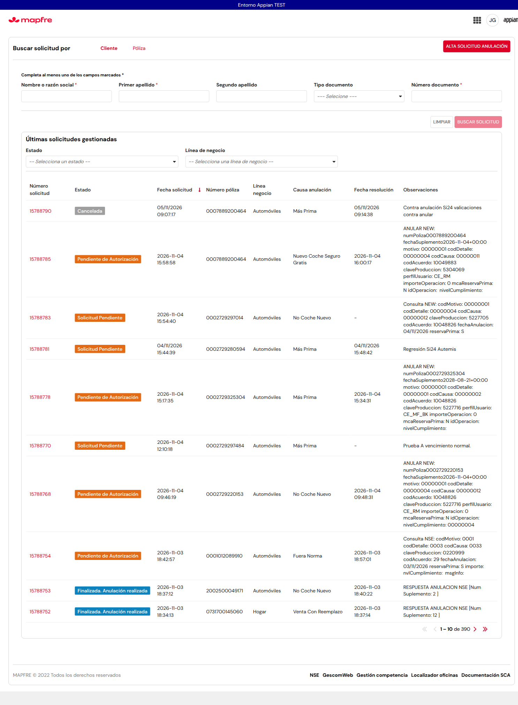 | 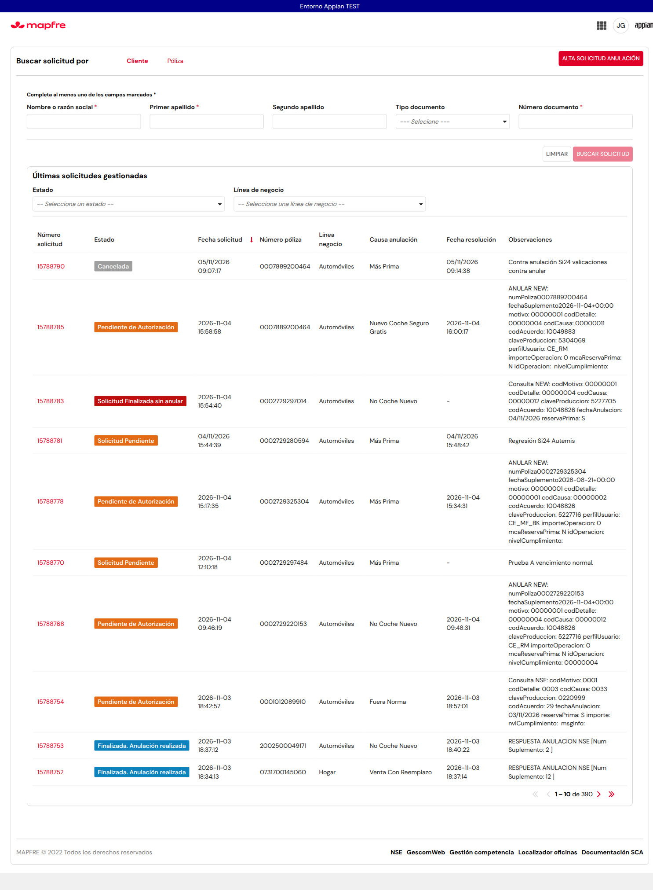 |

| SCA2 casos nuevos | SCA (lista inicial casos 1–3) |
|---|---|
| 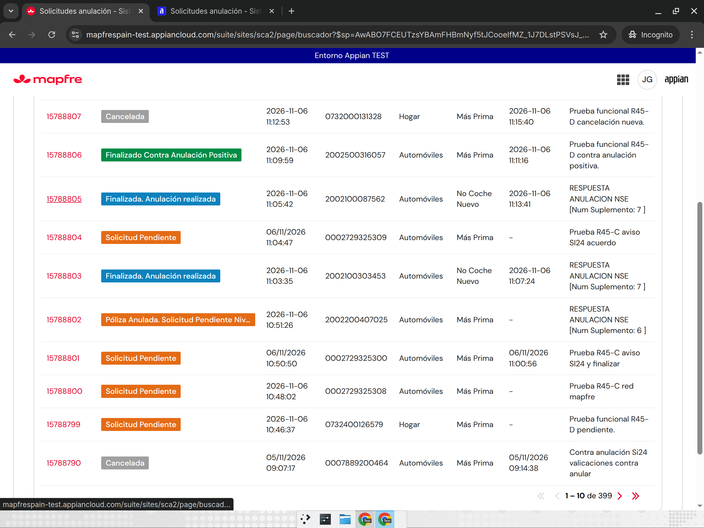 | 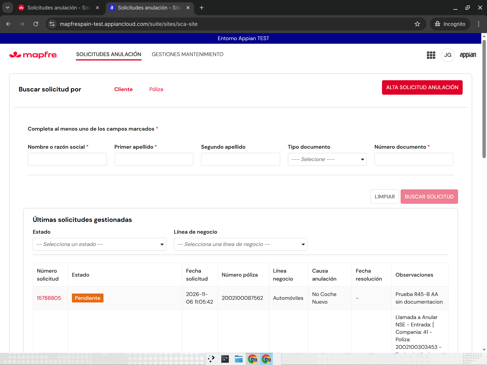 |

Otras: regla de prueba `../img/r45-d-regla-prueba-designer.png`; casos `../img/r45-d-caso*.png`; error SCA `../img/r45-d-sca-error-retorno.png`; filtro `../img/r45-d-regresion-filtro-cancelada.png`.

## 5. Comparación SCA vs SCA2

- SCA (`/suite/sites/sca-site`) cargó sin 403: casos 1–3 se ven como «Pendiente» (SCA no aplica la tabla combinada; la diferencia es la pedida por el analista).
- Al volver del detalle de 15788799, SCA falló en `sca_datoscabecera` (`a!submitLink`, línea 23, destino de guardado inválido; evaluation ID `c802e:029b7`). Casos 4–5 y el estado final del caso 3: **no comparables** en SCA; no se insistió.

## 6. Dudas para el analista (fuera de la tabla; se conserva el comportamiento actual)

- Q1: solicitud 4/5 + mecanización 3 (incompleta) o 5: hoy «Pendiente de Autorización» o lo que dé la lógica anterior por gestiones. ¿Qué etiqueta? (ejemplo real 15788455).
- Q2: el filtro «Estado» de la lista usa el estado SCA2 persistido, no la etiqueta D1; con «Cancelada» salen filas con otras etiquetas (preexistente). ¿Debe filtrar por la etiqueta D1?
- Q3: solicitud 2 + mecanización 1 sin gestión 5; 2 + mecanización 2/4/7; 14 + mecanización distinta de vacía/4; 3 + cualquier mecanización; estados 7–10, 13, 15–19: no están en la tabla → lógica anterior.

## 7. Pendientes

- Probar con solicitud nueva real 4/5 + mecanización 7 (enviada) y 4/5 + 2 (autorización): la póliza 2002200407025 acabó en nivel 2. Hace falta una póliza cuya simulación/NSE devuelva esa respuesta.
- ~~Aplicar la tabla en el detalle y en «Otras solicitudes»~~: hecho en la fase 2 (sección 8).
- La lista no se refresca sola al volver de finalizar (hace falta recargar); preexistente.
- Cancelada por la rama NO de Anulación/Suscripción (14/4) depende de R45-B; aquí se probó la cancelación desde contra-anulación.

## 8. Fase 2 (06/11): rendimiento y coherencia lista / detalle / «Otras solicitudes»

### Cambio

- **Mecanización precargada:** `SCA2_BuscadorTabla`, `SCA2_Buscador` («Otras solicitudes») y `SCA2_TablaOtrasSolAnulacion` calculan una sola vez, a nivel de interfaz, la mecanización de los `idSolicitud` del resultado con estado CORE 2/4/5. Lo pasan a `SCA2_calcularEstadoSolicitud` por `codEstMecaniza`. La consulta por fila queda solo como fallback cuando no viene. CORE no ofrece una consulta de mecanización para varias solicitudes (`consultarOptimizadoProceso` es por solicitud), así que la precarga hace una llamada por solicitud elegible, fuera de la expresión de cada celda.
- **Sin mecanización:** la constante nueva `SCA2_TXT_COD_EST_MECANIZACION_SIN` (`-`) indica «consultado y sin mecanización», para no repetir la consulta.
- **Misma regla en todas las vistas:** `SCA2_TablaOtrasSolAnulacion` (columna Estado) y `SCA2_SolicitudAnulacion` (dato «Estado solicitud anulación» del detalle) usan la misma regla y los mismos colores que la lista. El detalle toma `codEstSolic` de `SCA2_consultarSolicitudes`, porque la cabecera trae otro dominio de códigos (p. ej. 10 en F1). Si no hay código, se conserva la presentación anterior.
- **Sin cambios en `SCA2_DetalleSolicitud`:** el estado de la solicitud lo muestra la interfaz hija `SCA2_SolicitudAnulacion`. Las tarjetas de acciones (`local!estadoCard`) muestran el estado de cada gestión, no el de la solicitud, y no se tocan.
- **Fuera de alcance:** Q1/Q2/Q3 no se implementan (están con el usuario). Los casos reales 4/5+7 y 4/5+2 quedan para cuando R45-B tenga pólizas con controles 05/06.

### Objetos y versiones (fase 2)

| Objeto | Versión | Backup |
|---|---|---|
| ER `SCA2_calcularEstadoSolicitud` | v4→v5 | `backups-r45/r45-d2-SCA2_calcularEstadoSolicitud-original.xml` |
| IF `SCA2_BuscadorTabla` | v4→v5 | `backups-r45/r45-d2-SCA2_BuscadorTabla-original.xml` |
| IF `SCA2_Buscador` | v4→v5 | `backups-r45/r45-d2-SCA2_Buscador-original.xml` |
| IF `SCA2_TablaOtrasSolAnulacion` | v2→v3 | `backups-r45/r45-d2-SCA2_TablaOtrasSolAnulacion-original.xml` |
| IF `SCA2_SolicitudAnulacion` | v3→v4→v5 (2 imports) | `backups-r45/r45-d2-SCA2_SolicitudAnulacion-original.xml` |
| Constante `SCA2_TXT_COD_EST_MECANIZACION_SIN` (`74a8297c-6023-440a-b13b-bf354c66716d`) | nueva (v1), añadida a SCA2 en Designer | — |

Despliegues (Deployment API v2):
- Import 1: inspección `3247019d-92bb-469b-bcab-c149530149b5` (0 errores, 0 avisos, 0 omitidos); importación `1bb87e02-b6eb-433b-9a03-1469dfb1d8dd` (6 importados, 0 fallos).
- Import 2 (`SCA2_SolicitudAnulacion`): inspección `5a8a346a-94c9-4760-8658-9db244990861`; importación `05d78fc8-9304-46f8-a4da-84b76c96ad6b` (1 importado, 0 fallos).
- Reexport final `e466582e-943a-4956-89e5-251fc6c42122`: definiciones iguales a las importadas y constante dentro de la aplicación.

### Tiempos de carga (JJGONZ2, misma lista, segundos)

| Vista | Antes 1 / 2 / 3 | Después 1 / 2 / 3 | Media antes → después |
|---|---|---|---|
| Lista «Últimas solicitudes gestionadas» | 3,7 / 3,7 / 3,7 | 3,3 / 3,2 / 3,7 | 3,70 → 3,40 |
| Buscador: póliza 2002100303453 → detalle con «Estado solicitud anulación» | 4,1 / 4,6 / 4,6 | 4,6 / 4,6 / 4,1 | 4,43 → 4,43 |

En esta muestra no hay mejora apreciable en el buscador y la mejora en la lista es pequeña. El número de llamadas a CORE por solicitud elegible es el mismo, porque CORE no tiene consulta en lote; lo que se gana es que no se repiten al reevaluar las celdas.

### Coherencia lista / detalle / «Otras solicitudes»

| ID | Caso | Esperado | Real | OK/KO | Solicitud | Instancia | Pasos realizados | Posible causa/solución |
|---|---|---|---|---|---|---|---|---|
| C1 | F1 pendiente en las 3 vistas | Solicitud Pendiente, naranja | Lista, detalle y «Otras sol.»: Solicitud Pendiente, naranja | OK | 15788799 | No visible en el site | Lista → abrir solicitud → pestaña Solicitud Anulación → tabla «Otras sol. Anulación» | Primera versión del detalle: «Pendiente», porque la cabecera trae el código 10. Corregido tomando `codEstSolic` de `consultarSolicitudes` (v4→v5). |
| C2 | F3 anulación realizada en las 3 vistas | Finalizada. Anulación realizada, azul | Igual en las 3 vistas | OK | 15788803 | No visible en el site | Igual que C1 | — |
| C3 | F4 contra anulación positiva en las 3 vistas | Finalizado Contra Anulación Positiva, verde | Igual en las 3 vistas | OK | 15788806 | No visible en el site | Igual que C1 | — |
| C4 | F5 cancelada en las 3 vistas | Cancelada, gris | Igual en las 3 vistas | OK | 15788807 | No visible en el site | Igual que C1 | — |

Capturas: `../img/r45-d2-F{1,3,4,5}-{lista,detalle,otras}.png`.

| F3 lista | F3 detalle | F3 otras solicitudes |
|---|---|---|
| 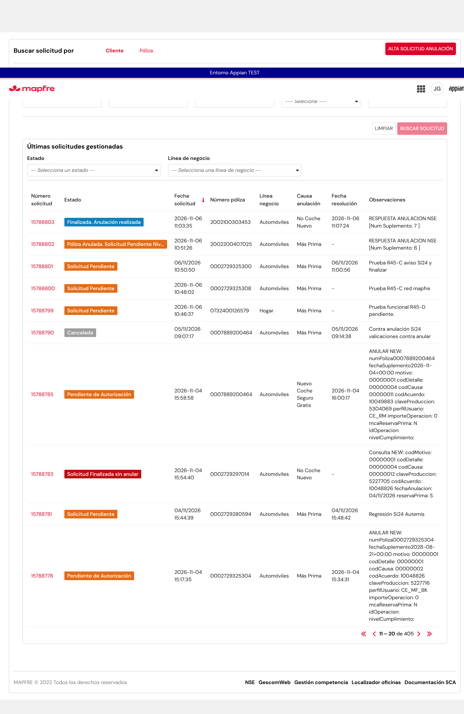 | 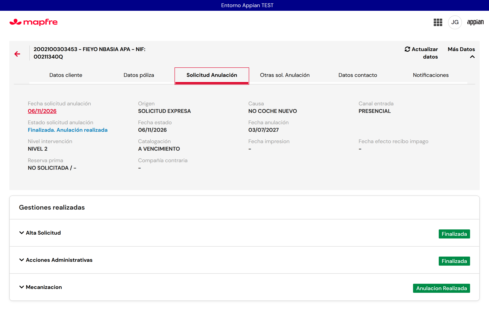 |  |

## 9. Fase 3 — revisión de la regresión B1 (15788805)

06/11/2026, Appian TEST, usuario funcional JJGONZ2. Diagnóstico de solo lectura sobre las solicitudes existentes; después se creó exclusivamente la nueva solicitud autorizada 15788822 para observar el mismo recorrido B1. **Objetos modificados en fase 3: ninguno. No hubo reservas ni importaciones.** Tiempos de carga no remedidos porque la precarga no cambió.

### Diagnóstico en solo lectura

B1 (póliza 2002100087562) había mostrado «Solicitud Finalizada sin anular» y tarjeta «Mecanización incompleta». La comparación actual con F3 no reproduce el fallo:

| Solicitud | Mecanizaciones BBDD SCA | Código extraído | Gestión acción 5 | Estado gestión | ¿Otra INCOMPLETA? |
|---|---|---|---|---|---|
| 15788805 | 1: `[numGestionPca:43708008,codTipEstMecaniza:1,codUsr:JJGONZ2]` | 1 | 43708008 | ANULACION REALIZADA | No |
| 15788803 | 1: `[numGestionPca:43708005,codTipEstMecaniza:1,codUsr:JJGONZ2]` | 1 | 43708005 | ANULACION REALIZADA | No |

`SCA2_consultaGestion` devuelve tres gestiones en cada solicitud (acciones 8, 3 y 5); una sola mecanización, ninguna INCOMPLETA. Se contrastó también `SCA2_consultaBBDDSCA` con los flags exactos de precarga (`devolverMecanizacion:true`, gestiones y resto false): mismo código 1. Con estado CORE 5, la regla común devuelve «Finalizada. Anulación realizada», tanto con precarga como usando el fallback.

La extracción de `local!mecPrecargadas` convierte `mecanizacion` a texto y toma la **primera aparición textual** de `codTipEstMecaniza:`, hasta la coma o el corchete; no ordena por fecha ni selecciona la más reciente:

```appian
trim(if(
  find("codTipEstMecaniza:", local!mecTexto) = 0,
  "",
  index(split(
    index(split(local!mecTexto, "codTipEstMecaniza:"), 2, ""),
    {",", "]"}
  ), 1, "")
))
```

Aquí solo hay un elemento: no se está ignorando una segunda mecanización. La ausencia de código por sí sola tampoco explica el fallo si llegan las gestiones actuales: la regla ya reconoce el literal `ANULACION REALIZADA` como fallback.

**Fuente de `local!estadoCard` en `SCA2_DetalleSolicitud`:** `local!gestionesCore` toma `MSSConsultaGestion` de `SCA2_consultaGestion(ri!idSolicitud)`. Para mecanización filtra acción `"5"`; selecciona por ordinal de tarjeta, alineando por el final si hay más gestiones que tareas y usando la última del tipo si falta ese ordinal. No ordena por fecha. `local!gestionCA` es la gestión seleccionada. Para esta tarjeta no interviene `local!estadoAut`: toma `codEstGestion` de esa gestión CORE; si falta, cae a `local!itemAccion.estado` y finalmente a `INCOMPLETA`. No usa las filas parcialmente vacías de `gestiones` de BBDD SCA.

**Comparación de export anterior a R45-D y export nuevo** (`1be41949-ea19-4d61-a6fb-86dba8c62842`, COMPLETED): `SCA2_DetalleSolicitud` v2→v3 solo añade los dos `showWhen` de R45-C F4: RETOMAR restringido según asignación para CA/mecanización/Verti, y REASIGNAR oculto en CA nivel 2 para CE_MF_SI24. La selección de gestión y el cálculo de `local!estadoCard` son idénticos. `SCA2_consultaGestion` v2→v2 y `SCA2_consultaBBDDSCA` v3→v3 conservan sus definiciones. La atribución R45-C procede de coordinación y los comentarios del diff, no de una auditoría de usuario por versión.

**Resultado actual: no se reproduce.** 15788805 muestra «Finalizada. Anulación realizada», azul, en lista, dato del detalle y «Otras sol.»; tarjeta «Anulacion Realizada». Capturas actuales revisadas:

| Lista | Detalle y tarjeta | Otras solicitudes |
|---|---|---|
| 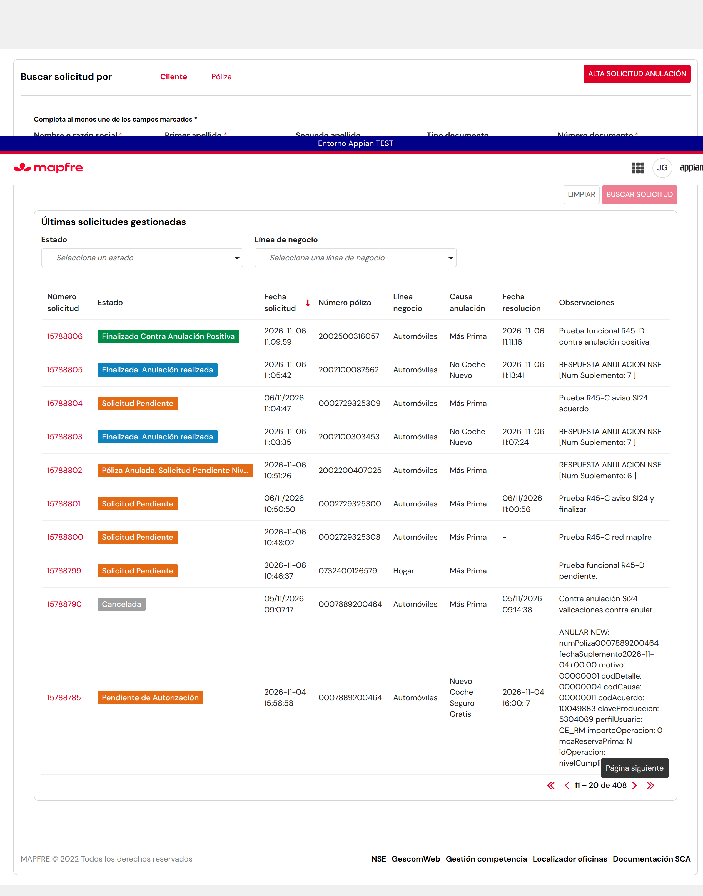 |  | 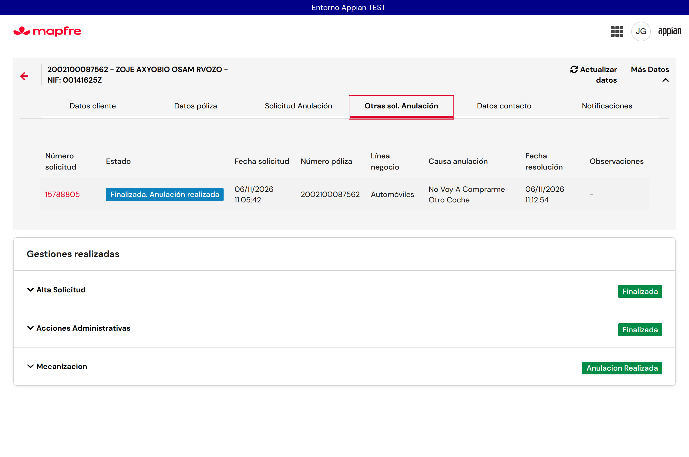 |

### Prueba nueva por el camino B1: 15788822

Póliza **2002200051799**, primera de `polizas/bloque-R45-D.txt` ausente del registro; sin solicitudes previas en «Otras sol.». Alta DECISION DE CLIENTE / VENTA DEL VEHICULO / NO VOY A COMPRARME OTRO COCHE, PRESENCIAL, A FECHA 06/11/2026 → Acción Administrativa VILLALBA, «El cliente no entrega documentación» → anulación a vencimiento **01/02/2027** → simulación INFORMATIVO → ANULAR PÓLIZA una vez, **11:32:35** → retorno automático al detalle al finalizar el flujo. Gestión 5 **43708057**, suplemento NSE **5**.

Horas de shell obtenidas con `date +%T`; CORE/UI lleva una hora más (fin gestión CORE 12:33:16 = shell 11:33:16). Primera lectura tras retorno: tarjeta **«Incompleta»**, observada por DOM antes de recargar, sin captura de ese primer estado. Referencia temporal 11:33:14; t0 empieza 11:33:15, t2 11:35:26 (~2m12s), t5 11:38:23 (~5m09s). t0 no es el instante del clic ANULAR: empieza unos 40 segundos después, tras el retorno.

Se recargó el navegador en cada punto. Las vistas y consultas son secuenciales, no una instantánea atómica:

| Punto | Hora capturas (shell) | Lista | Estado solicitud en detalle | Tarjeta mecanización | Otras sol. | codTipEstMecaniza | codEstGestion (acción 5) |
|---|---|---|---|---|---|---|---|
| t0 | 11:33:21–24 | Póliza Anulada. Solicitud Pendiente Nive… (truncado), naranja | Finalizada. Anulación realizada, azul | Anulacion Realizada | Finalizada. Anulación realizada, azul | 1 | ANULACION REALIZADA |
| ~t2 | 11:35:38–40 | Finalizada. Anulación realizada, azul | Igual, azul | Anulacion Realizada | Igual, azul | 1 | ANULACION REALIZADA |
| ~t5 | 11:38:36–38 | Finalizada. Anulación realizada, azul | Igual, azul | Anulacion Realizada | Igual, azul | 1 | ANULACION REALIZADA |

| Punto | Lista | Detalle y tarjeta | Otras solicitudes |
|---|---|---|---|
| t0 | 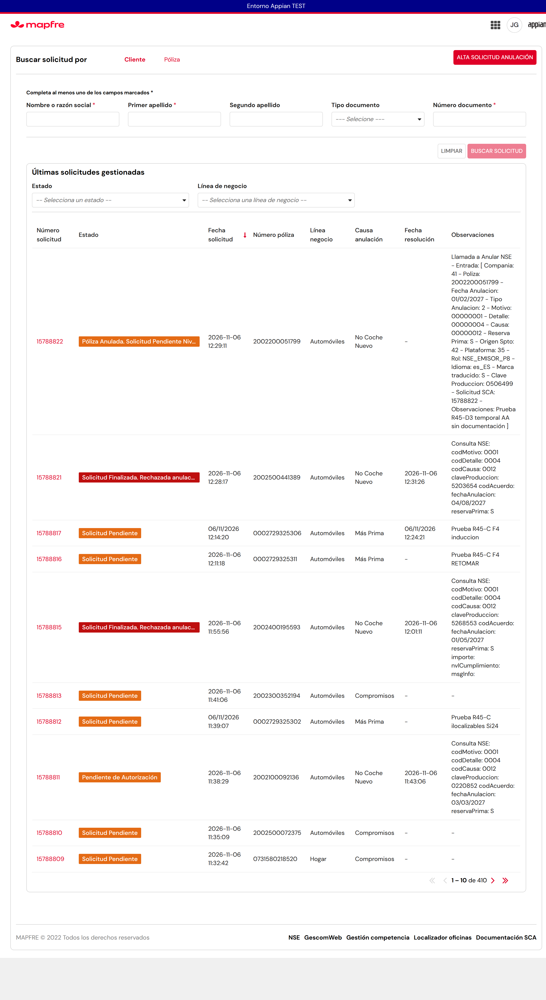 |  |  |
| t2 | 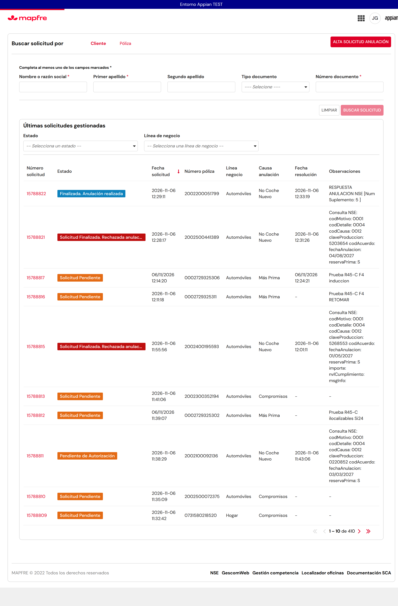 |  |  |
| t5 |  | 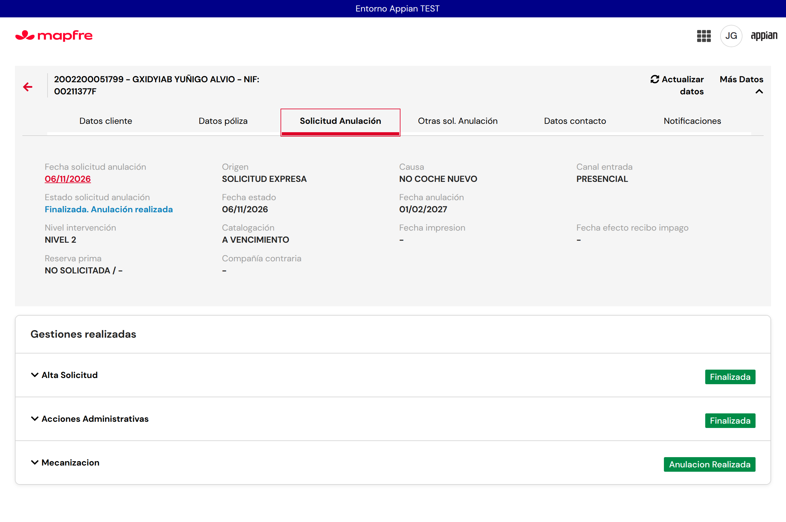 |  |

**Conclusión:** hay estados transitorios visibles mientras NSE/CORE termina: tarjeta «Incompleta» al retornar y lista naranja en t0, con convergencia a azul. Detalle y «Otras sol.» ya estaban azules dentro de los segundos de t0; la lista se confirmó azul en la siguiente muestra (~t2) y siguió igual en ~t5. La evidencia es compatible con convergencia en menos de 2 minutos, pero el muestreo no mide el instante exacto de cambio de la lista (t0→siguiente captura: 2m17s). **No se reprodujo «Solicitud Finalizada sin anular».** La causa más probable de B1 es una observación durante esa transición: **inferencia, no demostrada**. No se consultó CORE en el instante de la tarjeta Incompleta, por lo que no se distingue entre transición del backend y retención de variables de la interfaz abierta.

Incidencia auxiliar: en t0 `ev.py` evaluó pero su captura de Designer agotó 30s. Se recuperó el resultado original del DOM sin repetir la consulta; las tres capturas funcionales t0 sí se guardaron. No se repitió el alta ni ANULAR PÓLIZA.

### Tabla de resultados y regresión

| ID | Caso | Esperado | Real | OK/KO | Solicitud | Instancia | Pasos realizados | Posible causa/solución |
|---|---|---|---|---|---|---|---|---|
| D3-B1 | Revisión B1 en las 3 vistas | Finalizada. Anulación realizada, azul; tarjeta realizada | Correcto en las 3 vistas; una mecanización código 1 y gestión 5 realizada | OK, fallo no reproducido | 15788805 | No visible en el site | Consultas de solo lectura, comparación con 15788803, recarga y capturas | Probable observación transitoria histórica; inferencia no demostrada. Sin cambio. |
| D3-N | Nueva B1, sin documentación | Convergencia a anulación realizada | Incompleta al retorno, lista naranja t0; detalle/Otras azules en t0 y todo azul en t2/t5 | OK | 15788822 | No visible en el site | Alta A FECHA → AA sin documentación → vencimiento → ANULAR PÓLIZA → finalizar; recargas y consultas t0/t2/t5 | Transición observada; no se reproduce el literal rojo. |
| D3-F1 | Regresión lista pendiente | Solicitud Pendiente, naranja | Igual | OK | 15788799 | No visible en el site | Recargar lista y comprobar etiqueta/color | Sin regresión. |
| D3-F3 | Regresión lista realizada | Finalizada. Anulación realizada, azul | Igual | OK | 15788803 | No visible en el site | Igual que D3-F1 | Sin regresión. |
| D3-F4 | Regresión lista CA positiva | Finalizado Contra Anulación Positiva, verde | Igual | OK | 15788806 | No visible en el site | Igual que D3-F1 | Sin regresión. |
| D3-F5 | Regresión lista cancelada | Cancelada, gris | Igual | OK | 15788807 | No visible en el site | Igual que D3-F1 | Sin regresión. |
| D3-29 | Combinaciones de etiqueta/color | 29/29 | 29/29 fórmula fase 1 y 29/29 regla desplegada | OK | No aplica, datos simulados | No aplica | Ejecutar q5.txt con ev.py, comparar cases.py; repetir mismos casos invocando la regla desplegada | q5 contiene fórmula embebida: se distingue de la prueba adicional del objeto actual. |

Capturas de regresión: [F1](../img/r45-d3-regresion-F1-lista.png), [F3](../img/r45-d3-regresion-F3-lista.png), [F4](../img/r45-d3-regresion-F4-lista.png), [F5](../img/r45-d3-regresion-F5-lista.png). Resultado: **F1/F3/F4/F5 OK; 29/29 en ambas pruebas**.

### Pendiente / decisión funcional

Si el analista quiere un estado explícito mientras NSE no ha terminado o un refresco automático en lugar del estado intermedio, es una **decisión funcional, no implementada**. Si R45-B vuelve a observar el fallo, pedir captura con la hora para cruzarla con la gestión CORE y los datos que recibió la interfaz. No cambiar la regla ni procesos sin una entrada real que reproduzca el fallo.
