# R46-A: análisis «Analisis SCA2.docx», detalle (nivel, inducción Verti) y etiquetas de estado

Fecha: 10/11/2026. Entorno: Appian TEST (`mapfrespain-test`), site `sca2`; nunca PRO. Herramienta: MCP de Appian TEST (`appian-dev-mcp-c90b`, plugin 26.9.15). Usuarios funcionales: JJGONZ2 (Red Mapfre / Oficina) y SISANS (Si24), con «SSO Mapfre NO PRO».
Origen: documento del analista «Analisis SCA2.docx», que responde a `../63-dudas-analista-pendientes.md`. Coordinación: `coordinacion-ronda46.md`.

## 1. Resumen

| Punto | Resultado |
|---|---|
| Nivel «Nivel X» en el detalle, también en el nivel 1 | Aplicado (`SCA2_DetalleSolicitud` v73→v74) [Observado] |
| Nivel real en «Inducción Verti/vencimiento (componente)» | Aplicado: se toma de la gestión CORE de mecanización en la que se generó la inducción. 15788817 pasa de «NIVEL 2» a «Nivel 1» [Observado] |
| Quitar «Gestión Verti/Vencimiento» y dejar solo la inducción | Aplicado. La tarea VERTI solo se ve mientras está pendiente (Incompleta), porque es la vía de RETOMAR [Observado] |
| Campos del bloque de inducción | Aplicados: perfil = `codPerfil` CORE, grupo = `codSubPerfil` CORE y nuuma sin dominio. Se añade «Opción seleccionada en componente», que muestra «-» porque CMP no registra la opción [Observado]/[Pendiente] |
| Etiqueta 4/5 + mecanización 3/5 | Aplicado: «Solicitud Finalizada sin anular», en rojo (`SCA2_calcularEstadoSolicitud` v6→v7) [Observado] |
| Revisión completa de la tabla frente a R45-D | Coincide salvo 4/5 + 3/5, ya corregido (sección 4) [Observado] |
| Filtro «Estado» | Sin cambios. Interpretación y propuesta en la sección 5 [Inferido] |
| Combinaciones fuera de la tabla | Hay ejemplos reales en TEST (sección 6) [Observado] |
| ACEPTAR en Vida | Por código es igual que en Autos y Hogar; no se puede probar en funcional por el 4004 de CORE [Observado] |
| Clave de producción `184720372 / 0035099` | Confirmada por el analista. No se cambia. Se ve en la consulta de 0006000328 [Observado] |
| Pruebas UI con solicitudes nuevas | Si24 (15788840): detalle de la inducción OK. Hay 2 KO previos a R46-A: el error del componente aparece como «Completado sin incidencias» (N5) y la VERTI de nivel 2 de Oficina queda bloqueada (N6). Regresión de lista, buscador, detalle y Otras: OK (sección 8) [Observado] |

## 2. Clasificación de los puntos del documento

| # | Punto del analista | Clasificación | Acción en R46-A |
|---|---|---|---|
| 1 | «Nivel» delante del número también en el nivel 1 | Cambio en SCA2 | `SCA2_DetalleSolicitud`: `local!nivelCard` y la cabecera de Alta pasan a «Nivel n» [Observado] |
| 2 | La inducción está en nivel 1 hasta que se retoma la solicitud y vuelve a contra anulación | Cambio en SCA2 | El nivel de la tarea INDUCCION/VERTI sale de la gestión CORE de mecanización (`accionRealizada = 5`) con inicio igual o anterior a la creación de la tarea, no del nivel actual de la solicitud [Observado] |
| 3 | Quitar «Gestión Verti/Vencimiento» y dejar «Inducción Verti/vencimiento (componente)» | Cambio en SCA2 | `local!acciones` excluye la tarea VERTI que no está pendiente [Observado] |
| 4 | Fechas dd/mm/aaaa hh:mm:ss | Ya cumplido | Sin cambio (`text(…, "dd/MM/yyyy HH:mm:ss")`) [Observado] |
| 5 | Perfil (Red Mapfre, Si24…) en lugar del usuario | Cambio en SCA2 | `codPerfil` de `infoUsuario` de la gestión CORE [Observado] |
| 6 | Grupo según el perfil (Red Mapfre → Oficina) | Cambio en SCA2 | `codSubPerfil` CORE (p. ej. RED MAPFRE / OFICINA, SI24 / SI24 EXPERTOS); si no hay gestión, el grupo de la tarea [Observado] |
| 7 | Nuuma solo con el código (JJGONZ2) | Cambio en SCA2 | `nuuma` CORE; si no hay, el usuario sin dominio y en mayúsculas [Observado] |
| 8 | Opción enviada al componente | Ya cumplido | Sin cambio [Observado] |
| 9 | Opción seleccionada en el componente (Verti, Vencimiento o ambas) | Cambio en SCA2 parcial; depende de CMP | Campo añadido con «-»: `CMP Traza inducir cliente` no guarda la opción ejecutada (solo `servicio`, `estado`, `error`…). Ver duda N2 [Pendiente] |
| 10 | Estado, instancia, resultado y detalle del resultado como ahora | Ya cumplido | Sin cambio [Observado] |
| 11 | Clave de producción `184720372 / 0035099` | Responde una duda (cerrada) | Solo verificación [Observado] |
| 12 | ACEPTAR: igual que en Autos y Hogar | Responde una duda (cerrada) | Comprobado por código (sección 7) [Observado] |
| 13 | Alta Vida, 4004, `numApli`, logs, 15788717, `fecValidez`, estructura comercial y prima | Abierta; depende del AM/CORE | Sin cambios [Pendiente] |
| 14 | 4/5 + mecanización 3 o 5 | Cambio en SCA2 | «Solicitud Finalizada sin anular», en rojo [Observado] |
| 15 | Tabla completa de etiquetas | Revisión | Sección 4 [Observado] |
| 16 | Filtro «Estado»: «Son los estados los que indican la etiqueta» | Responde una duda; interpretación | Sección 5 [Inferido] |
| 17 | Combinaciones fuera de la tabla: «no pueden darse; si hay ejemplo, exponlo» | Responde una duda | Ejemplos en la sección 6 [Observado] |
| 18 | Estado provisional durante NSE/ANL | Abierta; depende de negocio | Sin cambios [Pendiente] |

## 3. Cambio en el detalle (`SCA2_DetalleSolicitud` v73→v74)

- **`local!tareasMaps`**: en las tareas INDUCCION o VERTI, `local!gT` es la última gestión CORE con `accionRealizada = "5"` cuyo `fecInicioGestion` es igual o anterior a `fechaCreacion` de la tarea. De ella salen `nivel` (`nivelIntervencion`), `perfil` (`infoUsuario.codPerfil`), `grupo` (`infoUsuario.codSubPerfil`) y `nuuma` (`infoUsuario.nuuma`). Si no hay gestión, el nivel actual de la solicitud, el grupo de la tarea y el usuario sin dominio. Antes, perfil y nuuma eran el email del usuario y el nivel era el actual de la solicitud. Por eso la inducción salía en «NIVEL 2» [Observado].
- **`local!nivelCard`**: normaliza cualquier valor («1», «NIVEL 2») a «Nivel n». Igual en la cabecera «Nivel intervención» de Alta [Observado].
- **`local!acciones`**: es `local!accionesTodas` sin las tareas VERTI que no están Incompletas. La VERTI pendiente se sigue mostrando, con RETOMAR/REASIGNAR (R45-C) [Observado].
- **Bloque de inducción**: columna nueva «Opción seleccionada en componente» [Observado].
- Protocolo: reservada en la coordinación (commit `48a7156`), lectura de la v73, backup local, cambio mínimo, `updateInterface` (v74), reexportación idéntica al fichero subido y `validateDesignObjects`. El único error que aparece es el de siempre: el caso de prueba con `idSolicitud` nulo en `sca2_cargarsolicitud`, ajeno al cambio [Observado].
- Riesgo [Inferido]: si CORE no devuelve la gestión 5 (p. ej. por una mecanización en curso), la tarjeta usa el nivel actual de la solicitud, como antes del cambio.

## 4. Tabla de etiquetas: analista frente a R45-D

Comprobado con `testRule` sobre la regla desplegada v7 (22 casos, con y sin gestiones) [Observado].

| Combinación del analista | Etiqueta esperada | R45-D (v6) | v7 |
|---|---|---|---|
| 1/2 + mecanización vacía | Solicitud Pendiente | OK | OK |
| 4/5 + mecanización N/A + gestión máxima 8 | Solicitud Pendiente | OK | OK |
| 2 + mecanización 1 + gestión 5 | Póliza Anulada. Solicitud Pendiente Nivel 2 | OK | OK |
| 4/5 + mecanización 7 | Mecanización Enviada | OK | OK |
| 14 + mecanización vacía o 4 | Cancelada | OK | OK |
| 4/5 + mecanización vacía; 2 + mecanización 3 | Solicitud Finalizada sin anular | OK | OK |
| **4/5 + mecanización 3 o 5** | **Solicitud Finalizada sin anular (rojo)** | **KO**: con gestiones reales daba «Pendiente de Autorización» o «Solicitud Caducada» | **OK** |
| 4/5 + mecanización 4 | Solicitud Finalizada. Rechazada anulación | OK | OK |
| 3 + mecanización vacía | Finalizado Contra Anulación Positiva | OK | OK |
| 4/5 + mecanización 1 | Finalizada. Anulación realizada | OK | OK |
| 4/5 + mecanización 2 | Pendiente de Autorización | OK | OK |
| 6/12 + mecanización vacía, 3 o 5 | Solicitud Caducada | OK | OK |
| 11 + mecanización vacía, 3 o 5; 20 | Anulada Caducada | OK | OK |

Color de «Solicitud Finalizada sin anular»: `#BE0F0F` (rojo, `SCA2_colorEstadoSolicitud`) [Observado].

## 5. Filtro «Estado»

- Situación [Observado]: `SCA2_Buscador` filtra la consulta paginada de `SCA2 Solicitud` por `estadoSolicitud`, que es el estado interno de SCA2 (EN_ACCION, FINALIZADA, CANCELADA…). La etiqueta se calcula después, fila a fila, con `SCA2_calcularEstadoSolicitud`, a partir del estado CORE de la solicitud, la mecanización (BBDD SCA) y las gestiones (CORE).
- Interpretación [Inferido]: «Son los estados los que indican la etiqueta» quiere decir que la etiqueta es función de los estados (solicitud + mecanización + gestión) según la tabla. El filtro debería devolver las filas cuyos estados dan la etiqueta elegida.
- Decisión [Inferido]: **no se cambia en R46-A**. Para filtrar por etiqueta hay que calcularla antes de paginar: una consulta CORE y otra a BBDD SCA por cada una de las 441 solicitudes de TEST (unos 60 s en lote en esta ronda). También se puede persistir en `SCA2 Solicitud` el estado CORE y la mecanización, que hoy no se guardan. Las dos opciones superan el «cambio mínimo» y afectan al rendimiento de la lista. Se propone como duda N1.

## 6. Combinaciones fuera de la tabla (TEST, solo lectura)

Método [Observado]: `SCA2_consultaBBDDSCA` (solicitud y mecanización) y `SCA2_consultaGestion` (gestiones) con `testRule` sobre las 441 solicitudes de `SCA2 Solicitud`, sin escribir nada. Ficheros de trabajo locales, no versionados.

| Combinación | Ejemplos en TEST | Etiqueta actual (v7) |
|---|---|---|
| 2 + mecanización 2 | 15788155, 15788199, 15788205, 15788218, 15788310 | Pendiente de Autorización |
| 2 + mecanización 4 | 15788166, 15788168 | Solicitud Pendiente |
| 3 + mecanización 1 | 15787942, 15788726 | Finalizado Contra Anulación Positiva |
| 2 + mecanización 1 sin gestión 5 | Ninguna: las 27 solicitudes 2 + 1 tienen gestión 5 (ANULACION REALIZADA). 15787772, 15787783 y 15788781 no tienen ninguna gestión de nivel 2 | Póliza Anulada. Solicitud Pendiente Nivel 2 |
| 2 + mecanización 7 | Ninguna | — |
| 14 + mecanización distinta de vacía o 4 | Ninguna (13 solicitudes 14, todas sin mecanización) | — |
| Estados 7–10, 13, 15–19 | Ninguna | — |
| Sin estado CORE | 19 altas Vida rechazadas (`PDTE-…`), p. ej. PDTE-13377305 y PDTE-269184469 | — |

Distribución observada (solicitud + mecanización): 2+vacía 158, 2+3 56, 3+vacía 49, 5+3 29, 2+1 27, 5+vacía 22, 4+vacía 19, 4+3 15, 14+vacía 13, 5+1 10, 4+1 6, 5+4 6, 2+2 5, 2+4 2, 3+1 2, 4+2 2, 4+4 1 [Observado].

## 7. Vida: ACEPTAR y clave

- ACEPTAR [Observado]: `SCA2_AltaSolicitudPage` v51 tiene un único botón ACEPTAR del mensaje de éxito, `disabled: or(local!aceptarPulsado, …)`, que se guarda en el primer clic. No hay ninguna rama por ramo, así que Vida se comporta como Autos y Hogar (R44/R45-A: sin duplicados). No se modifica. La prueba funcional en Vida no es posible mientras CORE devuelva 4004 en el alta [Pendiente].
- Clave [Observado]: `184720372 / 0035099` es lo implementado (R45-A A2) y el analista lo confirma. Verificación funcional: ver la sección 8.

## 8. Pruebas

Pruebas UI con solicitudes nuevas: 15788839 (Oficina, póliza 0002729325304) y 15788840 (Si24, póliza 0002729325314). Las históricas solo se han consultado [Observado].

### Resultado y límites

Se ejecutó el procedimiento funcional en **SCA2 TEST**, con solicitudes nuevas de Si24 y Oficina, regresión de consulta y comparación de lectura con SCA. **Hay incidencias y cobertura incompleta; no procede dar por validado el end-to-end completo.**

- **[Observado] KO F1:** el componente de inducción de SISANS mostró «No es posible realizar la inducción» y «Se ha producido un error al consultar los datos del agente». Tras ENTENDIDO, el detalle lo presenta como «Finalizada», «Terminado» y «Completado sin incidencias». Esta contradicción no se considera una inducción correcta.
- **[Observado] KO F2:** tras CA de Oficina en nivel 1 y CA de Si24 en nivel 2, VERTI queda en nivel 2 con nuuma JJGONZ2. JJGONZ2 recibe «Esta solicitud la está gestionando SI24» y no tiene RETOMAR; SISANS solo tiene REASIGNAR. No se reasignó para sortear el bloqueo.
- **[Observado] OK de presentación:** etiqueta nueva roja; Nivel 1 en tarjetas; identidad, fechas y campos del componente SISANS; VERTI pendiente con RETOMAR; desaparición de la tarjeta VERTI tras avanzar el flujo.
- **[Observado] OK R2 en solo lectura autorizada:** la consulta de Vida 0006000328 muestra **184720372 / 0035099**. No se creó ni guardó una solicitud Vida.
- **[Pendiente]** inducción efectiva sin error, flujo Oficina hasta componente, identidad del componente mecanizado por Oficina y variante VERTI cancelada. Los códigos numéricos CORE no están expuestos en estas capturas y no se dan por observados.

#### Entorno y cautelas

- SCA2: https://mapfrespain-test.appiancloud.com/suite/sites/sca2
- Comparación SCA: https://mapfrespain-test.appiancloud.com/suite/sites/sca-site
- Usuarios funcionales: SISANS y JJGONZ2, SSO Mapfre NO PRO. No se reproducen credenciales.
- Solo navegación funcional de TEST. No se usó Designer ni se modificaron objetos de Appian, ni se corrigieron fallos.
- No se modificaron ni borraron solicitudes históricas. La consulta de Vida existente se abrió solo tras autorización expresa y no se pulsaron acciones internas.
- Las observaciones de altas nuevas fueron «R46-A comprobación funcional Si24» y «R46-A comprobación funcional Oficina».
- Las fechas citadas corresponden a las que muestra la UI.

### Tabla de ejecución

**Leyenda:** [Observado] = visto en UI; [Inferido] = hipótesis sin confirmación técnica; [Pendiente] = no demostrado. En la columna OK/KO, KO también identifica cobertura bloqueada, explicada en Real.

| ID | Caso | Esperado | Real | OK/KO | Solicitud | Instancia | Pasos realizados | Posible causa/solución |
|---|---|---|---|---|---|---|---|---|
| F1-01 | Alta y CA Si24 nuevas | Alta libre, CA negativa nivel 1, paso a VERTI | [Observado] Nueva solicitud sobre 0002729325314, vencimiento 21/08/2028; Alta y CA en Nivel 1, CA Finalizada Negativa | OK | 15788840 | [Pendiente] Proceso principal no visible | Comprobar póliza libre → alta Si24 → argumento negativo → FINALIZAR → VERTI | Sin incidencia en este tramo |
| F3-01 | VERTI pendiente visible | Salir sin CONTINUAR mantiene Gestión Verti/vencimiento Incompleta con RETOMAR | [Observado] Tarjeta Incompleta, Nivel 1, nuuma SISANS, opción pendiente; RETOMAR visible | OK | 15788840 | No expuesta | Salir de gestión → consultar nueva solicitud → desplegar VERTI | Sin incidencia |
| F3-02 | RETOMAR abre VERTI | Reabrir la pantalla con opciones | [Observado] RETOMAR abre Generación de contacto a Verti y Generar vencimiento | OK | 15788840 | No expuesta | Pulsar RETOMAR → comprobar opciones → marcar ambas | Sin incidencia |
| F1-02 | Verti → componente Si24 | CONTINUAR y ANULAR PÓLIZA permiten inducción | [Observado] Se llega al componente, pero devuelve error al consultar datos del agente; título leído «Errores - 36829600» | KO | 15788840 | 17569137, mostrada después en detalle | Marcar Verti y Vencimiento → CONTINUAR → ANULAR PÓLIZA → observar error → ENTENDIDO | [Inferido] Dependencia de consulta de agente/parametrización; revisar por equipo responsable sin atribuirlo aún al cambio R46-A |
| F1-03 | Coherencia de resultado | El detalle refleja el error real del componente | [Observado] A pesar del error, muestra Finalizada, Terminado y Completado sin incidencias | KO | 15788840 | 17569137 | Volver a consulta → Otras sol. Anulación → abrir inducción | [Inferido] Cierre de la tarea o retorno del componente puede confundirse con resultado funcional correcto; revisar trazabilidad y mapeo del resultado |
| F1-04 | Identidad y campos de inducción | Nivel de mecanización, perfil/grupo/código sin email, fechas completas y opciones | [Observado] Nivel 1; SI24; SI24 EXPERTOS; SISANS; inicio 10/11/2026 15:21:20, fin 10/11/2026 15:22:05; enviada Verti y Vencimiento; seleccionada «-»; estado/resultado/instancia presentes | OK | 15788840 | 17569137 | Desplegar tarjeta Inducción Verti/vencimiento (componente) | OK de presentación; no convierte el error de F1-02/F1-03 en una inducción correcta |
| F1-05 | Ocultación de VERTI terminada | No mostrar Gestión Verti/vencimiento tras completar su paso | [Observado] Después de avanzar y cerrar el componente, ya no aparece Gestión Verti/vencimiento; sí Mecanizacion Incompleta e Inducción Finalizada | OK | 15788840 | 17569137 | Comparar detalle con VERTI pendiente y detalle posterior | [Pendiente] No se provocó una cancelación independiente; la variante cancelada no queda probada |
| F2-01 | Alta Oficina y carta | Nueva alta, CA1 y requisito de imprimir carta para finalizar | [Observado] Alta 0002729325304 por JJGONZ2; requisito de carta atendido; CA negativa deriva a nivel 2 | OK | 15788839 | [Pendiente] No visible | Alta Oficina → CA negativa → imprimir plantilla → FINALIZAR → consultar nivel 2 | El salto se registra como nivel real, no se presume mecanización en nivel 1 |
| F2-02 | Continuar Oficina/Si24 hasta inducción | Usuario autorizado puede retomar VERTI y llegar al componente | [Observado] Tras CA2 por SISANS, VERTI Nivel 2 queda con nuuma JJGONZ2. JJGONZ2 ve que la gestiona SI24; SISANS solo REASIGNAR. No se alcanza el componente Oficina | KO | 15788839 | [Pendiente] No se observó instancia de inducción | CA2 negativa con SISANS → consultar VERTI → cambiar a JJGONZ2 → comprobar ausencia de RETOMAR | [Inferido] Desalineación entre nivel/perfil y asignación de tarea. Revisar asignación; no se cambió para ocultar el problema |
| R1-01 | Regresión — lista y etiqueta | Nueva solicitud finalizada con mecanización incompleta lleva etiqueta roja exacta | [Observado] 15788840 aparece como Solicitud Finalizada sin anular en rojo; 15788839 sigue Solicitud Pendiente | OK | 15788840 / 15788839 | 17569137 / no visible | Volver a Últimas solicitudes gestionadas → comprobar ambas altas | [Pendiente] CORE 4/5 y mecanización 3/5 no visibles numéricamente; la prueba demuestra el estado UI, no todos los cruces de códigos |
| R1-02 | Regresión — buscador por póliza | Localizar la solicitud nueva y abrir detalle | [Observado] 0002729325314 abre el detalle con sus tarjetas y mecanización incompleta | OK | 15788840 | 17569137 | Buscar por póliza → BUSCAR SOLICITUD → consultar tarjetas | Sin incidencia |
| R1-03 | Regresión — buscador por cliente | Localizar el mismo detalle sin alterar datos | [Observado] Búsqueda por nombre y primer apellido del titular abre 0002729325314 | OK | 15788840 | 17569137 | Cliente → nombre y primer apellido → BUSCAR SOLICITUD | Nombre solo mantuvo BUSCAR deshabilitado; se completó primer apellido para efectuar la consulta. No se atribuye a R46-A |
| R1-04 | Regresión — Otras sol. Anulación y color | Misma etiqueta nueva en la fila, fondo #BE0F0F | [Observado] 15788840 muestra la etiqueta nueva. Lectura de estilo renderizado: rgb(190,15,15), equivalente a #BE0F0F, texto blanco | OK | 15788840 | 17569137 | Otras sol. Anulación → abrir número → leer fila y estilo calculado | Lectura de DOM/estilo únicamente, sin llamadas de backend |
| R1-05 | Regresión — Nivel X en tarjetas | Alta, Contra Anulación y Mecanización muestran Nivel 1 | [Observado] Las tres tarjetas muestran Nivel 1; Alta SI24 / SI24 EXPERTOS / SISANS; Mecanización sigue Incompleta | OK | 15788840 | 17569137 | Desplegar tarjetas una a una y capturar | [Observado] Nuuma de CA/Mecanización muestra «-»; la identidad solicitada para inducción sí es SISANS |
| R2-01 | Vida solo lectura | 0006000328 muestra 184720372 / 0035099 sin crear ni guardar | [Observado] Las tres pólizas Vida ensayadas detectan solicitud en curso. Tras autorización se acepta exclusivamente el diálogo «¿Quiere consultar la solicitud?» de 0006000328; Datos póliza muestra la clave exacta | OK | Existente; número no abierto ni anotado | No consultada | ALTA VIDA → 0006000328; consultar también disponibilidad de 0006000397 y 0006059601 → consulta autorizada de 0006000328 → leer clave → salir por navegación | [Pendiente] Formulario de una alta Vida nueva no se alcanzó por solicitudes en curso. No se guardó ni se intentó crear; el buscador Vida también devolvió póliza no válida/no disponible |
| SCA-01 | Comparación de consulta con SCA | Comparar si es viable sin modificar solicitudes | [Observado] SCA permite consultar 0002729325314: Otras muestra 15788840 como Pendiente y solo Alta, CA, Impresión y Mecanización; SCA2 muestra etiqueta nueva y tarjeta de inducción | OK | 15788840, nueva de esta ronda | No mostrada por SCA | Abrir sca-site TEST → buscar póliza → Otras sol. Anulación → leer estado/tarjetas | Comparación parcial viable. [Pendiente] Flujo de inducción end-to-end SCA no ejecutado; no se afirma equivalencia funcional |

### Solicitudes e instancias nuevas que quedan abiertas o incompletas

| Solicitud | Póliza | Estado observado al cierre | Gestión pendiente / instancia |
|---|---|---|---|
| 15788839 | 0002729325304 | Solicitud Pendiente | VERTI Incompleta, Nivel 2, nuuma JJGONZ2; bloqueo de retoma. [Pendiente] ID de proceso principal e instancia de inducción no disponibles en UI |
| 15788840 | 0002729325314 | Solicitud Finalizada sin anular; Mecanización Incompleta | Instancia de componente **17569137** aparece **Terminado**, no abierta según su tarjeta, pero con error funcional observado. La mecanización sigue incompleta. [Pendiente] ID del proceso principal |

No se eliminaron ni cerraron artificialmente estas gestiones para limpiar la prueba. No se creó ninguna solicitud Vida. No se reclama como propia ninguna otra alta que aparezca en la lista.

### Capturas de las pruebas

- 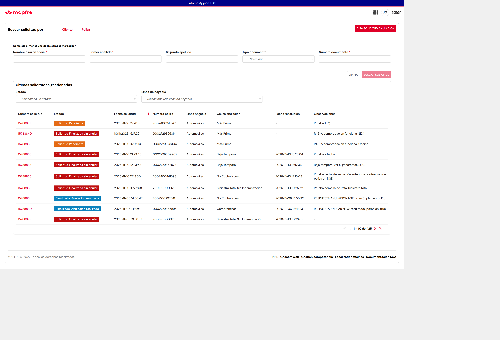
- 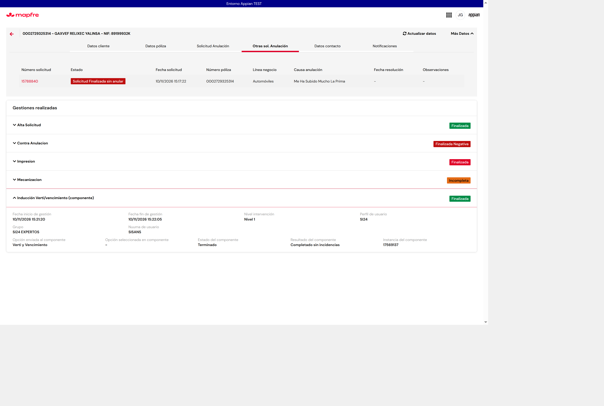
- 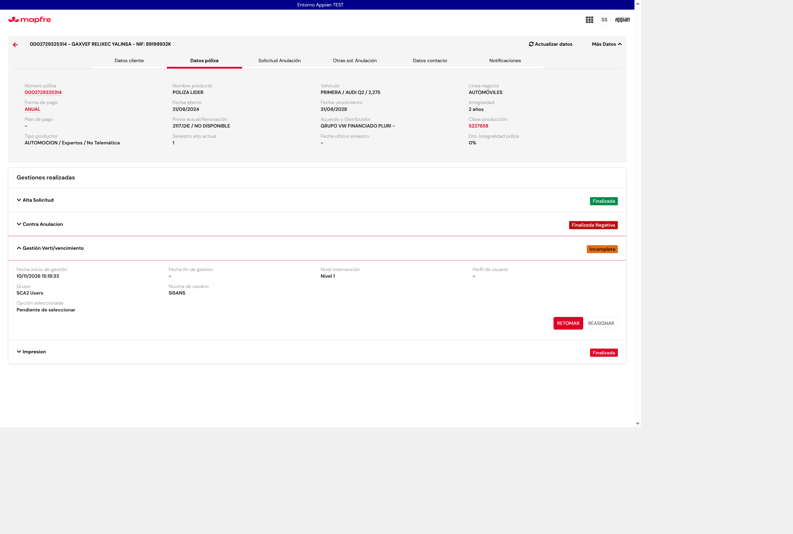
- 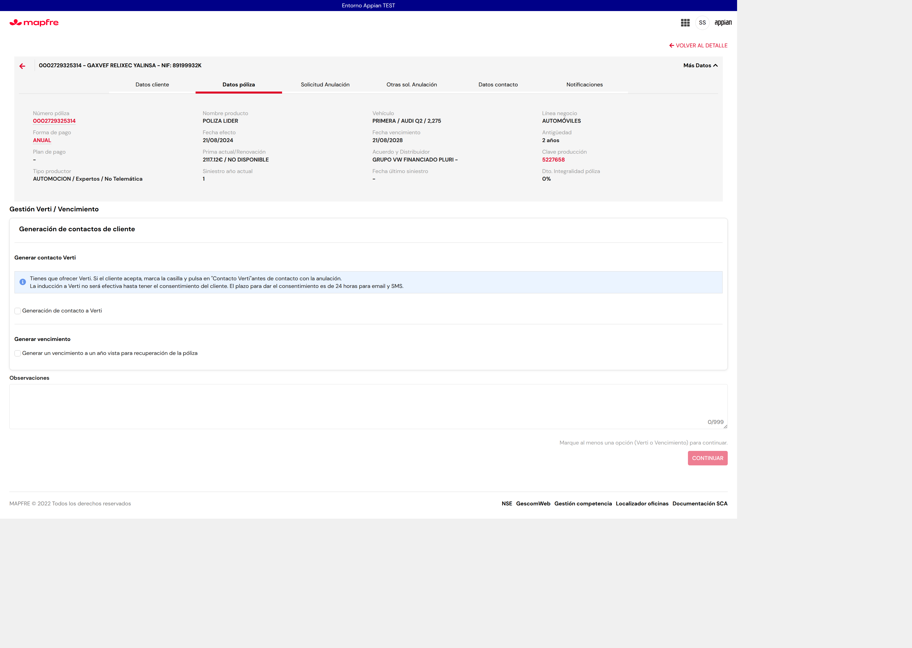
- 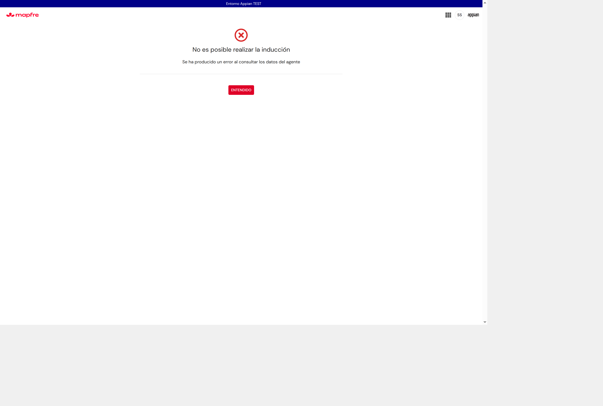
- 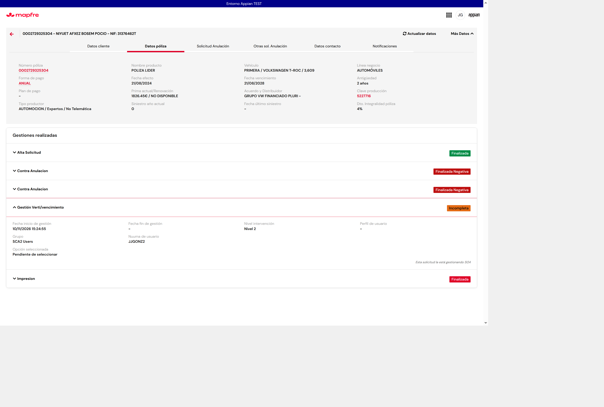
- 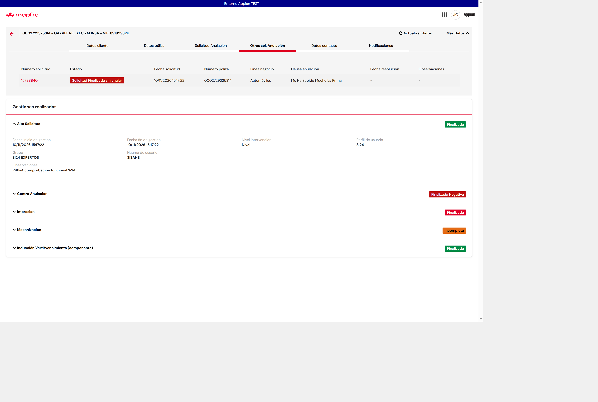
- 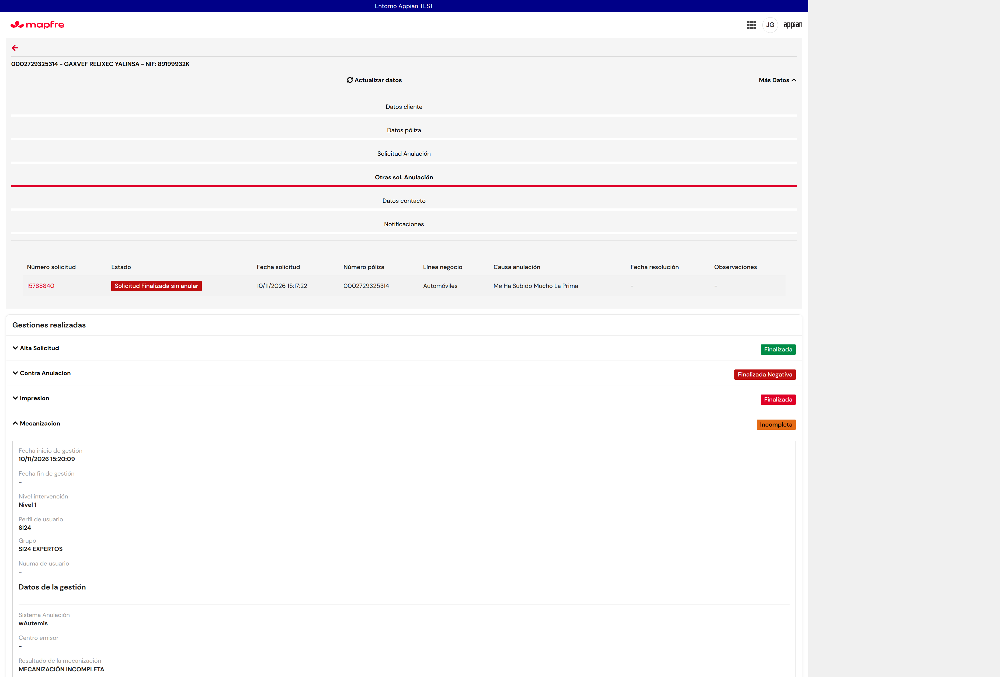
- 
- 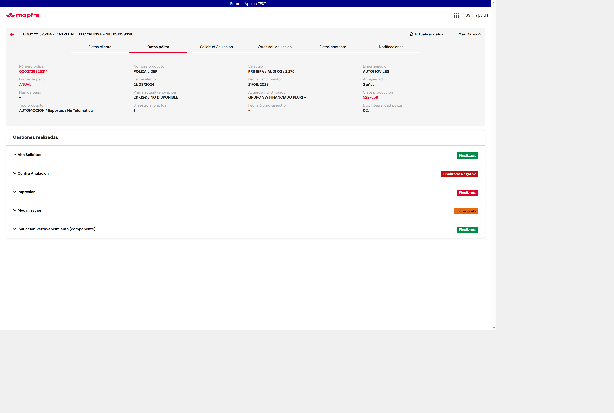
- 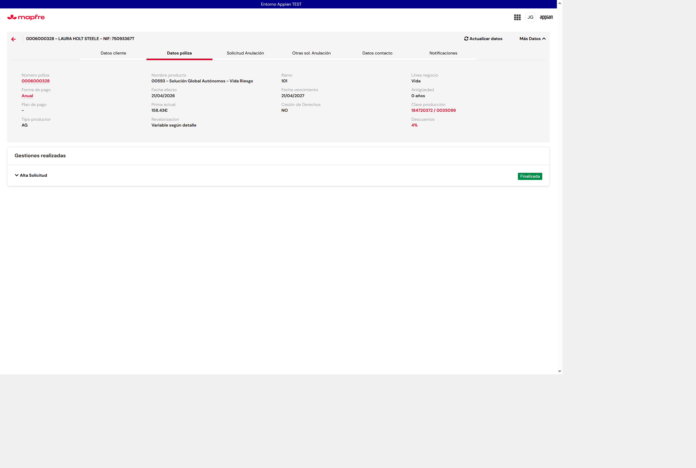
- 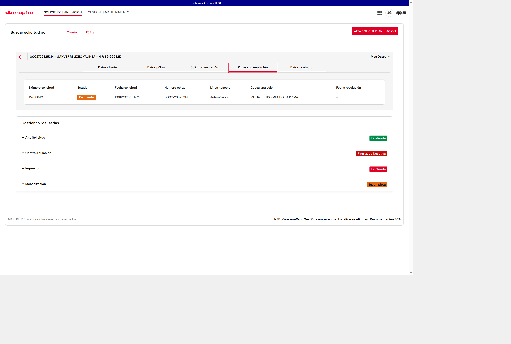

## 9. Objetos modificados

| Objeto | UUID | Versión | Backup |
|---|---|---|---|
| ER `SCA2_calcularEstadoSolicitud` | `_a-0000f069-4f37-8000-9cc8-011c48011c48_20052795` | v6 → v7 | copia local de la v6 (exportación MCP) |
| IF `SCA2_DetalleSolicitud` | `_a-0000f069-4f37-8000-9cc8-011c48011c48_20055572` | v73 → v74 | copia local de la v73 (exportación MCP) |
| IF `SCA2_BuscadorTabla` / `SCA2_Buscador` | `…_20056379` / `…_20055660` | sin cambios (v18 / v36) | — |

No se ha desactivado ni activado la aplicación. No se han tocado SCA, CORE, CMP ni otros sistemas [Observado].

## 10. Dudas nuevas para el analista

- **N1. Filtro «Estado».** ¿El filtro debe usar las 13 etiquetas de la tabla en lugar de los estados internos? Hacerlo exige calcular la etiqueta de todas las solicitudes antes de paginar, o guardar en SCA2 el estado CORE y la mecanización, con impacto en el tiempo de carga. ¿Se prioriza?
- **N2. «Opción seleccionada en componente».** CMP (`CMP Traza inducir cliente`) no guarda qué se ejecutó en el componente (Verti, Vencimiento o ambas). ¿Puede CMP devolverlo o guardarlo? Mientras tanto se muestra «-».
- **N3. Combinaciones reales fuera de la tabla:** 2+2 (p. ej. 15788155), 2+4 (15788166) y 3+1 (15787942). ¿Qué etiqueta llevan? Hoy: «Pendiente de Autorización», «Solicitud Pendiente» y «Finalizado Contra Anulación Positiva».
- **N4.** 2 + mecanización 1 + gestión 5 sin haber pasado a nivel 2 (15787772, 15787783, 15788781) muestra «Póliza Anulada. Solicitud Pendiente Nivel 2». ¿Es correcto o debería ser «Finalizada. Anulación realizada»?

- **N5. Resultado del componente tras un error.** En 15788840 (instancia 17569137), el componente mostró «Se ha producido un error al consultar los datos del agente». Tras ENTENDIDO, la tarjeta dice «Terminado / Completado sin incidencias». Se mantiene la lógica anterior a R46-A (duda 17). ¿Debe verse como error o incidencia?
- **N6. VERTI de nivel 2 en Oficina.** En 15788839, la VERTI de nivel 2 se asigna a JJGONZ2 (quien hizo el alta, duda 19), pero JJGONZ2 ve «Esta solicitud la está gestionando SI24» y no tiene acciones, y SISANS solo tiene REASIGNAR. Por eso no se llega a la inducción de Oficina. ¿A quién debe ir la VERTI de nivel 2, y quién puede retomarla?

## 11. Capturas

- Antes: `../img/r46-a-antes-detalle-induccion-15788817.png` (inducción «NIVEL 2», email en perfil y nuuma), `../img/r46-a-antes-detalle-gestion-verti-15788817.png` (bloque «Gestión Verti/Vencimiento») y `../img/r46-a-antes-otras-15788817.png` (lista).
- Después: `../img/r46-a-despues-detalle-induccion-15788817.png` (Nivel 1, SI24, SI24 EXPERTOS, SISANS; sin «Gestión Verti/Vencimiento») y `../img/r46-a-despues-otras-15788817.png`.
- La captura «antes» de la lista se hizo con la regla v7 ya desplegada. 15788817 es 2 + mecanización 3, una combinación que ya era «Solicitud Finalizada sin anular» en R45-D, así que la lista no cambia en esta solicitud [Observado].
