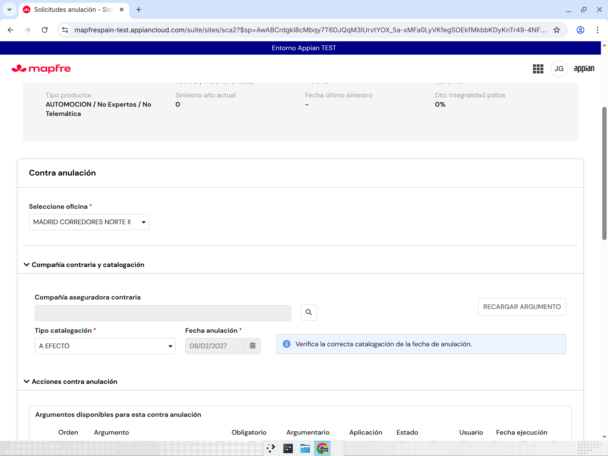
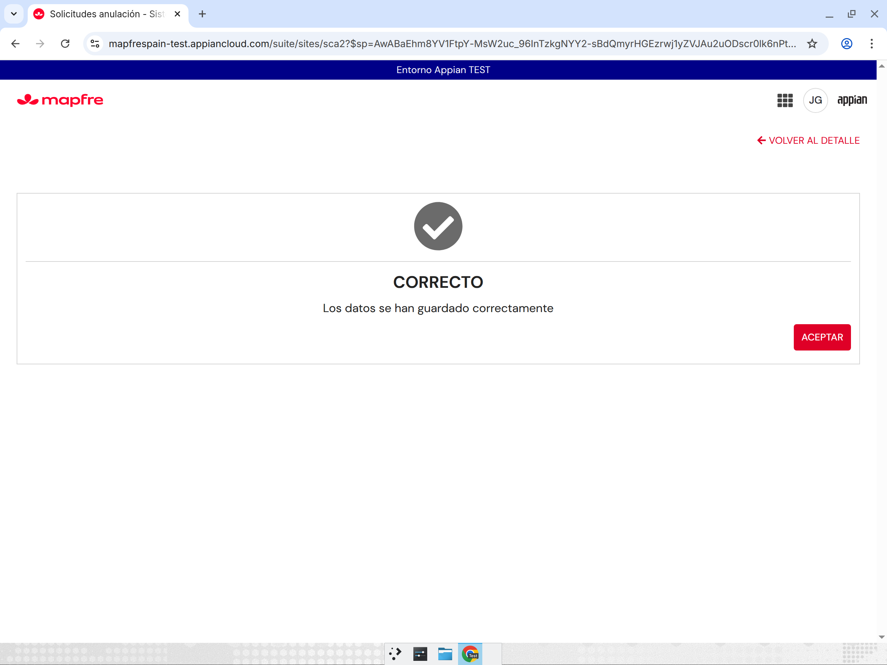

# R46-B: ANL, NSE, NEW y mecanización (segunda entrega «Analisis SCA2.docx»)

Fecha: 10/11/2026. Entorno: Appian TEST (`mapfrespain-test`), site `sca2`, y como referencia `sca-site`. Nunca PRO. Herramienta: MCP de Appian TEST (`appian-dev-mcp-c90b`). Usuarios funcionales: SISANS (Si24) y JJGONZ2 (Red Mapfre / Oficina; el secreto `APPIAN_TEST_NOPRO_JJGONZ` no existe y se usó JJGONZ2, el usuario de Red Mapfre de rondas anteriores).
Origen: respuestas del analista a `../63-dudas-analista-pendientes.md` (dudas 7–14, 31, 42 y 43). Coordinación: `coordinacion-ronda46.md`.

## 1. Resumen

| # | Punto | Resultado |
|---|---|---|
| 1 | «Cancelada» al decir NO (duda 7) | Explicación con 15788815 (sección 4.1). Sin cambios: falta la respuesta funcional [Observado]/[Pendiente] |
| 2 | wAutemis a más de 18 meses, error 916 de NEW (duda 8) | Aplicado: mensaje de Autemis en el alta y no deja continuar (`SCA2_simularAnulacion` v17→v18). Probado con 0002729389242 [Observado] |
| 3 | ANL acepta pero no lanza NSE/NEW (duda 9) | Aplicado: la mecanización sigue «Incompleta» y además se registra el error `ANL_EXCESO_TIEMPO` en `SCA2 Error` (bandeja de errores). Rama no provocada en una prueba real [Observado código]/[Pendiente E2E] |
| 4 | Nivel de NEW a vencimiento y nivel 00000004 (dudas 10 y 11) | Confirmado: SCA2 solo simula, mapea y lanza ANL; ANL decide. Sin cambios (sección 4.4) [Observado] |
| 5 | Espera a NSE/ANL (duda 12) | Aplicado: 10 consultas cada 30 s = 5 min como máximo. Observado en la instancia 10242969 (10 consultas, 288 s) [Observado] |
| 6 | Catalogación del alta wAutemis / Más Móvil (duda 13) | Aplicado: el desplegable muestra siempre la catalogación que propone el servicio (`SCA2_AltaSolicitudPage` v51→v52). Más Móvil 0732500054802: «A VENCIMIENTO TRIMESTRAL», 02/01/2027, igual que SCA [Observado]. Duda nueva N1 sobre la fecha |
| 7 | Notación «4/5 + 2» y «4/5 + 7» (duda 14 y 31) | Explicación y ejemplos (sección 4.7). Caso fuera de norma nuevo 15788855: autorizado y mecanizado; NSE dio nivel INFORMATIVO y no pasó por «Pendiente de Autorización» [Observado] |
| 8 | Rechazo NSE en una anulación pendiente de autorizar (duda 42) | Aplicado: un rechazo de ANL (ESTADO informado distinto de 1) ya no espera a CONCLUIDA y actualiza la mecanización a 4 «cerrada sin mecanizar» (`SCA2 CMD Mecanizar`, nodo 304). Sin prueba real: no hay póliza que llegue a pendiente de autorizar [Observado código]/[Pendiente E2E] |
| 9 | Catalogación final NSE en CORE (duda 43) | Aplicado: `SCA2_ContraAnulacionOpciones` v74→v78 normaliza como SCA la catalogación que se graba en CORE (NSE renovada con 2/3 → 1). Probado con la solicitud nueva 15788858: CORE pasa de 2 a 1 al POSPONER [Observado] |

## 2. Objetos modificados

| Objeto | UUID | Versión | Cambio | Backup / reexport |
|---|---|---|---|---|
| ER `SCA2_simularAnulacion` | `_a-0000f069-4f37-8000-9cc8-011c48011c48_20051692` | v17→v18 | Rama wAutemis: si el mensaje de NEW contiene `916-`, `respuesta` = texto de bloqueo + mensaje de Autemis y `avanzarAltaSolicitud: false` | Copia previa v17 y reexport v18 comparado: iguales al fichero importado [Observado] |
| IF `SCA2_AltaSolicitudPage` | `_a-0000f069-4f37-8000-9cc8-011c48011c48_20055716` | v51→v52 | `local!catalogacionDD`: si `codCatalogacionDefecto` del servicio no está en `listaCatalogacion`, se añade (el desplegable muestra lo que propone el servicio y no queda inválido) | Copia v51; reexport v52 igual al importado [Observado] |
| PM `SCA2 CMD Finalizar` | `0000f06f-1309-8000-65b3-7f0000014e7a` | versión de proceso 21.0 (la API de diseño no devuelve `versionId`) | Nodo 16: espera `now() + intervalds(0, 0, 30)` (antes 1 minuto). Nodo 15: nueva salida «Exceso de tiempo» hacia el nodo 17 cuando se agotan los intentos y la mecanización de CORE sigue `INCOMPLETA`. Nodo 17 nuevo «Write Error exceso de tiempo (R46-B)» (registro `SCA2 Error`) → nodo 5 «Finalizar Solicitud» | Copia previa y reexport: solo cambian los nodos 15, 16 y 17 (nuevo). `validateDesignObjects`: 0 errores, 0 avisos [Observado] |
| PM `SCA2 CMD Mecanizar` | `0000f06f-4cfc-8000-66d3-7f0000014e7a` | (la API de diseño no devuelve `versionId`) | Nodo 304 «¿ANL desbloqueada?»: nueva salida «Rechazada» (`ESTADO` informado y distinto de `1`) hacia el nodo 308 «Preparar actualización», sin esperar a `CONCLUIDA` | Copia previa y reexport: solo cambia el nodo 304. `validateDesignObjects`: 0 errores, 0 avisos [Observado] |
| IF `SCA2_ContraAnulacionOpciones` | `_a-0000f069-4f37-8000-9cc8-011c48011c48_20056435` | v74→v78 (v75, v76 y v77 intermedias) | Nueva `local!catalogacionFinal = rule!SCA2_determinarCatalogacionRenovada(catalogacion, origenPoliza, numPoliza)`. Se usa en: panel de catalogación cuando la póliza es renovada, las dos llamadas a `SCA2_modificarCatalogacionCodCiaCntrAnul` (FINALIZAR y POSPONER), los dos arranques de `SCA2 CMD Posponer` y el `tipoCatalogacion` que se pasa al modal SI/NO de FINALIZAR (`SCA2_ContraAnulacionModalSiNo`, que también escribe en CORE). `local!catalogacion` conserva el valor leído para la rama no renovada y la consulta de argumentos | Backup de la v74 y de la v77 vivas; reexport v78 igual al importado; diff v74→v78 limitado a esas líneas (contiene los cambios de R46-C y R46-D) [Observado] |
| CONST `SCA2_VAL_ESPERA_NSE_FINALIZAR_MAX_INTENTOS` | `_a-0000f0a4-c27c-8000-9d46-011c48011c48_5667193` | v1 (sin cambios) | Se mantiene `10`; con 30 s por ciclo da 5 minutos | — |

Al importar `SCA2_simularAnulacion` Appian avisa de que la regla no tiene casos de prueba (0 de 2). El aviso ya existía y no bloquea [Observado].

## 3. Resultados

| ID | Caso | Esperado | Real | OK/KO | Solicitud | Instancia | Pasos realizados | Posible causa/solución |
|---|---|---|---|---|---|---|---|---|
| B1 | «Cancelada» al decir NO | Explicación con ejemplo real | Sección 4.1 con 15788815 (póliza 2002400195593): CORE solicitud 5, gestiones 8 FINALIZADA, 3 FINALIZADA, 5 CERRADA SIN MECANIZAR; lista «Solicitud Finalizada. Rechazada anulación» | OK (explicación) | 15788815 (histórica, solo lectura) | — | `SCA2_consultaGestion` y documentación de R45-B | Para 14 + 4 hace falta un servicio de CORE que cancele la solicitud desde la mecanización [Pendiente analista] |
| B2-1 | wAutemis, alta A VENCIMIENTO a más de 18 meses | Mensaje de Autemis en pantalla, como NSE, y no deja continuar | «NEW nos indica una excepción que impide avanzar con su solicitud. Por favor, compruebe la situación de la póliza en Autemis y la fecha de anulación. Mensaje de Autemis: 916 - La Fecha de Efecto…»; solo botón VOLVER; no se crea solicitud | OK | — (no se crea) | — | SISANS → póliza wAutemis 0002729389242 (vencimiento 28/07/2028) → catalogación A VENCIMIENTO → ALTA (`../img/r46-b-02-wautemis-916-bloqueante.png`) | — |
| B2-2 | Consulta directa a NEW con la póliza de 15788817 | Ver el error que llega | Con 21/08/2028: `success=false`, `faultCode=4004`, `faultString` «No se ha podido inicializar el suplemento. 916-.La Fecha de Efecto…». Con 10/11/2027: `success=true`, `nvlCumplimiento=00000005` | Análisis | 15788817 (histórica, solo lectura) | — | `SCA2_consultarAnulacionPoliza` en Designer | El 916 llega en `faultString`; antes `SCA_D_ObtenerMensajeErrorNew` lo trataba como error genérico y dejaba continuar |
| B3-1 | ANL acepta y no lanza NSE/NEW | Mecanización Incompleta + error de exceso de tiempo en la bandeja | Por código: al agotar 10 × 30 s con la mecanización de CORE `INCOMPLETA` se escribe `SCA2 Error` (comando `SCA2 CMD Finalizar`, nodo `Esperar NSE/ANL`, código `ANL_EXCESO_TIEMPO`, estado pendiente) y la solicitud sigue a «Finalizar Solicitud», que deja la mecanización como estaba (Incompleta) | OK (código) / Pendiente (E2E) | 15788754 (histórica: hoy gestión 5 INCOMPLETA, sería el caso que dispara la rama) | — | Lectura del modelo, validación y reexport | No se ha podido provocar con una solicitud nueva: depende de que ANL no lance NSE/NEW [Pendiente] |
| B3-2 | La rama no salta cuando la mecanización termina bien | Sin error de exceso de tiempo | 15788855: tras 10 consultas la gestión 5 de CORE es ANULACION REALIZADA → salida por defecto; `SCA2_consultarErroresSolicitud(15788855)` = lista vacía | OK | 15788855 | 10242969 | Instancia y `SCA2_consultaGestion` por API | — |
| B4 | Nivel de NEW y nivel 00000004 | Confirmar que SCA2 solo simula y mapea | Sección 4.4 | OK (explicación) | 15788830 (histórica, solo lectura) | — | Lectura de `SCA2 CMD Mecanizar` (nodos 301 y 324) | — |
| B5 | Espera NSE/ANL | Máximo 5 min, cada 30 s | Instancia de 15788855: a los 62 s `contadorNse=2`; terminó a los 288 s con `contadorNse=10` | OK | 15788855 | 10242969 | `getProcessInstance` durante y después | La primera consulta se hace al entrar en la espera y cada una de las siguientes tras 30 s, por eso el total queda por debajo de 300 s [Inferido] |
| B6-1 | Más Móvil en el alta | El servicio propone «A vencimiento trimestral»; la fecha es la que corresponde a esa catalogación | SCA2: «A VENCIMIENTO TRIMESTRAL», fecha 02/01/2027. SCA: igual (DECISION DE CLIENTE / ASEGURADO NO DESEA SEGURO / COMPROMISOS, canal SI24). No se guardó | OK (paridad) | — (no se guarda) | — | SISANS → 0732500054802 (`../img/r46-b-04-masmovil-trimestral-fecha.png`, `../img/r46-b-05-masmovil-sca-legacy.png`) | Duda N1 (02/01 frente a 01/01) |
| B6-2 | wAutemis con valor propuesto fuera de la lista | El valor del servicio se muestra sin error | 0002729389242 (Precio / Me ha subido mucho la prima): «A EFECTO», 28/07/2025, desplegable válido | OK | — (no se guarda) | — | SISANS (`../img/r46-b-01-wautemis-catalogacion.png`, `../img/r46-b-03-wautemis-defecto-efecto.png`) | Antes (R45) el valor propuesto no estaba en la lista y daba error |
| B7-1 | Fuera de norma (DE / DE / Anulación fuera de norma) en Autos | Llegar a autorización | Revisión de autorización de la fecha; pide documentos de Autorización y DNI | OK | 15788855 | — | JJGONZ2 → póliza NSE-Autos 2002500248962 → PRESENCIAL, A FECHA 10/11/2026 (`../img/r46-b-06…08`) | — |
| B7-2 | Autorizar y mecanizar 15788855 | Ver estados CORE + mecanización | Autorización ACEPTADA (2 PDF de prueba, MADRID CORREDORES NORTE II). Simulación NSE nivel INFORMATIVO, reserva de prima Sí, sin controles; ANULAR PÓLIZA 16:26:55. Mientras NSE trabaja: «Póliza Anulada. Solicitud Pendiente Nivel 2» y mecanización Incompleta. Final: «Finalizada. Anulación realizada», mecanización ANULACIÓN REALIZADA (fin 16:27:25) | OK | 15788855 | Mecanizar 16529384, Finalizar 10242969 | `../img/r46-b-09…13`, `r46-b-15…17` | NSE no devolvió nivel 05/06, por eso no hubo «Pendiente de Autorización» (4/5 + 2) |
| B8 | Rechazo NSE en una anulación pendiente de autorizar | Mecanización 4 «cerrada sin mecanizar» | Antes: el nodo 304 exigía `CONCLUIDA=true`; ANL en PRE no la marca, así que el rechazo se quedaba esperando hasta 24 h y acababa en `ANL_TIMEOUT` sin tocar la mecanización. Ahora: con `ESTADO` informado y distinto de 1 va a 308/309, que envía `codEstMecanizacion` 4 cuando la póliza sigue vigente | OK (código) / Pendiente (E2E) | — | — | Lectura de `SCA2 CMD Mecanizar` y `SCA2_construirConsultaActualizarMecanizacion` | Falta una póliza que llegue a pendiente de autorizar para probarlo [Pendiente] |
| B9-1 | Regla de normalización | NSE renovada 2/3 → 1; el resto sin cambio | `SCA2_determinarCatalogacionRenovada`: NSE-Autos 2002000157937 con 2 y 3 → 1; NSE-Autos 2002600013207 con 2 → 1; NSE-Autos 2002000200336 (no renovada) con 2 → 2; wAutemis 0002729389242 con 2 → 2 | OK | — | — | `testRule` | — |
| B9-2 | POSPONER con v76 (primer intento) | CORE = 1 | CORE siguió en 2: el panel mostraba A VENCIMIENTO | KO → corregido | 15788858 | — | JJGONZ2, alta NSE-Autos A VENCIMIENTO 08/02/2027, retomar contra anulación, POSPONER (`../img/r46-b-21…`, `../img/r46-b-23…`) | v76 no pasaba la catalogación normalizada a `SCA2 CMD Posponer` → v77 |
| B9-3 | POSPONER con v77 | CORE = 1 | CORE siguió en 2 [Observado]. El record `SCA2 Datos Solicitud` sí quedó en 1, así que el proceso recibió la catalogación normalizada | No concluyente | 15788858 | — | Mismo flujo | Probable formulario cargado antes de importar v77 [Inferido]. Se repitió con una carga limpia (B9-4) |
| B9-4 | POSPONER con v78, carga limpia | Panel A EFECTO y CORE = 1 | CORE antes: `codTipCatalogaPca` 2. Panel: «A EFECTO / 08/02/2027». POSPONER 17:08:37: «CORRECTO — Los datos se han guardado correctamente». CORE después: `codTipCatalogaPca` **1**. Al retomar sigue A EFECTO | OK | 15788858 (abierta) | — | JJGONZ2, cerrar pestañas, abrir 15788858 desde cero, POSPONER con observación «Prueba R46-B catalogación»; `SCA2_consultaGestion` antes y después (`../img/r46-b-27…30`) | — |
| B9-5 | FINALIZAR (modal SI/NO) | CORE = 1 | No probado: cerraría la solicitud de prueba. Revisado por código: el modal escribe en CORE con el `tipoCatalogacion` que recibe, ahora `local!catalogacionFinal` | Pendiente (E2E) | — | — | Lectura de `SCA2_ContraAnulacionModalSiNo` v7 | [Pendiente] |
| B10 | Permisos de JJGONZ2 | — | Sin acceso a Designer (403) ni a la bandeja de errores («La página no existe o no tiene permiso») | Observación | — | — | `../img/r46-b-14-monitorizacion-sin-permiso.png`, `../img/r46-b-18-bandeja-errores-sin-permiso.png` | La bandeja se comprobó por API (`SCA2_consultarErroresSolicitud`) |

## 4. Respuestas y explicaciones para el analista

### 4.1 «Cancelada» al decir NO en Anulación/Suscripción (duda 7)

Ejemplo real: **15788815**, póliza 2002400195593 (Autos), alta A FECHA, motivo/detalle/causa del caso de acción administrativa «El cliente no entrega documentación», oficina VILLALBA, fecha de anulación 01/05/2027 [Observado, R45-B].

1. **Pantalla:** acción administrativa (AA) sin documentación → FINALIZAR → SCA2 simula la anulación (nivel INFORMATIVO) y muestra «¿Desea anular la póliza…?» con la fecha 01/05/2027. El gestor pulsa **CANCELAR (= NO)** [Observado].
2. **Servicios:** `SCA2 CMD CompletarAccion` cierra la acción (gestión 3 FINALIZADA) y lanza `SCA2 CMD Finalizar` con `estadoFinal = CANCELADA`. Este llama a `SCA2_actualizarMecanizacionAnulacionNse`, que envía a CORE `actualizarMecanizacion` con `codEstMecanizacion = 4` (como `SCA_Finalizar_Mecanización` de SCA: `if(cancel, "4", …)`), y después a `finalizarSolicitud` de CORE [Observado].
3. **Estados en CORE:** solicitud **5**, `mcaMecanizada` N, gestiones 8 FINALIZADA, 3 FINALIZADA y 5 **CERRADA SIN MECANIZAR**; la lista muestra «Solicitud Finalizada. Rechazada anulación» (5 + 4) [Observado].
4. **Por qué no 14:** `finalizarSolicitud` no recibe estado y siempre deja 5. El único servicio que hemos visto poner 14 es `finalizarContraAnulPca` con `mcaEstadoFinal = 9`, pero solo actúa sobre una contra anulación abierta. Se probó en R45 (15788821 y 15788826): responde `true` y la solicitud sigue en 5 [Observado]. SCA también termina en «SCA Finalizar Solicitud» tras cancelar, así que SCA dejaría 5 + 4 [Inferido por código de SCA].
5. **Qué necesitamos:** ¿se acepta 5 + 4 («Rechazada anulación»)? Si debe ser 14, ¿qué servicio de CORE cancela la solicitud desde la mecanización? Hasta entonces SCA2 no cambia nada [Pendiente].

### 4.2 wAutemis a más de 18 meses (duda 8)

- **Cómo lo hace SCA2 con NSE:** `SCA2_simularAnulacion` traduce el error con `SCA2_obtenerMensajeErrorNSE`, devuelve el mensaje y `avanzarAltaSolicitud: false`. El alta solo muestra el mensaje y VOLVER [Observado].
- **Ahora con NEW:** si la simulación wAutemis devuelve un mensaje con `916-`, se muestra «NEW nos indica una excepción que impide avanzar con su solicitud. Por favor, compruebe la situación de la póliza en Autemis y la fecha de anulación. Mensaje de Autemis: 916 - …» (el texto de Autemis sin el XML de entrada) y no se deja continuar. Los demás errores de NEW siguen como antes (decisiones `SCA_D_ObtenerCodErrorSimularNew` / `SCA_D_ObtenerMensajeErrorNew`, que no se tocan) [Observado].

### 4.3 ANL acepta y no lanza NSE ni NEW (duda 9)

- Caso 15788754: ANL REDIRIGIR_NEW sin TIPO_FLUJO; hoy CORE tiene la gestión 5 **INCOMPLETA** [Observado].
- `SCA2 CMD Finalizar` consulta cada 30 s (máximo 10). Si se agota la espera y la última gestión de mecanización de CORE sigue `INCOMPLETA`, registra en `SCA2 Error`: solicitud, comando `SCA2 CMD Finalizar`, nodo `Esperar NSE/ANL`, código `ANL_EXCESO_TIEMPO`, mensaje «Exceso de tiempo esperando la respuesta de NSE/NEW tras ANL…», detalle con el estado de la mecanización y los intentos, estado pendiente. Ese registro es el que lista `/suite/sites/sca2/page/errores`. Después la solicitud se finaliza igual que antes y la mecanización queda Incompleta [Observado código].
- Una mecanización «ANULACIÓN PENDIENTE DE AUTORIZAR» o «ANULACIÓN REALIZADA» no se considera exceso de tiempo [Observado código; 15788855 lo confirma para ANULACIÓN REALIZADA].

### 4.4 Nivel de NEW a vencimiento y nivel 00000004 (dudas 10 y 11)

Confirmado: SCA2 funciona así hoy y no se cambia nada [Observado en `SCA2 CMD Mecanizar`]:
- SCA2 simula la anulación (NEW para wAutemis, NSE para NSE) con la fecha de anulación de la solicitud.
- El subproceso «ANL Alta» (nodo 301) recibe los datos de la simulación y de la solicitud: `observaciones` (= nivel de cumplimiento de la simulación, p. ej. 00000005), fecha de anulación de la cabecera CORE, `origenPoliza`, nivel de intervención, póliza e identificadores del usuario.
- SCA2 no decide el flujo de ANL. Lo único que decide es si **espera** la respuesta de ANL antes de seguir: nodo 324 «¿wAutemis pdte. aceptar?» (wAutemis con 00000005 o 00000006, igual que SCA). Con 00000004 no espera y sigue el camino normal. Si ANL deja una wAutemis de nivel 4 pendiente de autorizar, SCA2 lo verá en CORE, pero no se queda esperando [Inferido].
- Ejemplo: 15788830 (wAutemis, nivel 00000004): gestiones 8 FINALIZADA, 2 FINALIZADA NEGATIVA, 4 FINALIZADA, 5 ANULACIÓN REALIZADA [Observado].

### 4.5 Espera a NSE/ANL (duda 12)

Configuración final [Observado]: `SCA2 CMD Finalizar`, nodo 16 «Esperar NSE (R44-A, 30 s R46-B)» = `now() + intervalds(0, 0, 30)`; máximo `cons!SCA2_VAL_ESPERA_NSE_FINALIZAR_MAX_INTENTOS = 10`. En total, **5 minutos como máximo, consultando cada 30 s**. Si llega la respuesta antes, sale en la siguiente consulta. Medido en 15788855 (instancia 10242969): 10 consultas, 288 s.

### 4.6 Catalogación del alta wAutemis / Más Móvil (duda 13)

- **Valor que propone el servicio:** en Más Móvil (0732500054802) el servicio de reglas de catalogación propone **«A VENCIMIENTO TRIMESTRAL»**. SCA2 y SCA muestran ese valor [Observado].
- **Fecha:** si el gestor no cambia la catalogación, SCA2 muestra la `fechaAnulacion` que devuelve el servicio para la catalogación propuesta: 02/01/2027, la misma que SCA [Observado en pantalla; origen en el servicio Inferido por código].
- **Cambio:** si el valor propuesto no está en la lista del servicio (caso wAutemis de R45, que solo traía «A FECHA»), SCA2 lo añade al desplegable. Así se muestra tal como lo dice el servicio y no salta el error del desplegable [Observado].

### 4.7 Notación «4/5 + 2» y «4/5 + 7» (dudas 14 y 31)

- La notación es **estado de la solicitud en CORE + estado de la gestión de mecanización** (código `cod_tip_est_mecaniza`). Estados de solicitud: 1–2 pendiente / en curso, **4 y 5 = finalizada** (5 tras `finalizarSolicitud`), 14 = cancelada [Inferido de la tabla D1 de R45-D]. Estados de mecanización: 1 anulación realizada, **2 anulación pendiente de autorizar**, 3 incompleta, 4 cerrada sin mecanizar, **7 mecanización enviada**.
- «4/5 + 2» = solicitud finalizada en SCA y mecanización a la espera de que NSE/ANL autoricen la anulación (etiqueta «Pendiente de Autorización»). «4/5 + 7» = solicitud finalizada y mecanización enviada a NSE/NEW, sin respuesta todavía (etiqueta «Mecanización Enviada»). Son las combinaciones T06/T07 de `r45-d-estados-lista.md`; hoy solo están probadas con la regla de prueba [Observado].
- **Ejemplos reales:**
  - **15788855** (nuevo): póliza NSE-Autos 2002500248962; DECISIÓN DE LA ENTIDAD / DECISIÓN DE LA ENTIDAD / ANULACIÓN FUERA DE NORMA; canal PRESENCIAL; catalogación A FECHA; fecha de anulación 10/11/2026. Pasa por la autorización fuera de norma de SCA (gestión 7), que no es la «Pendiente de Autorización» de NSE. Tras autorizar, NSE simula con nivel INFORMATIVO y anula directamente: 2 + 1 («Póliza Anulada. Solicitud Pendiente Nivel 2») y al final «Finalizada. Anulación realizada» [Observado].
  - **15788828** (R45): wAutemis 0002729356790, A VENCIMIENTO 10/02/2028; NEW no da nivel con la fecha de vencimiento y acaba 4 + INCOMPLETA (3) [Observado].
  - **15788830** (R45): wAutemis, nivel 00000004 → anulación realizada [Observado].
- **Qué hace falta para 4/5 + 2:** una póliza cuya simulación NSE/NEW devuelva nivel 00000005 o 00000006 en la fecha de anulación. Las NSE de TEST dan INFORMATIVO o el error 4021, y las wAutemis a vencimiento no dan nivel [Observado]. Si tenéis una póliza así, la probamos.

### 4.8 Rechazo NSE en una anulación pendiente de autorizar (duda 42)

- Antes: `SCA2 CMD Mecanizar` sondea ANL cada 5 min (nodos 302–304) y solo seguía si `CONCLUIDA = true`. Como ANL en PRE no marca CONCLUIDA para SCA2, un rechazo (`ESTADO = 2`) se quedaba esperando hasta 24 h y terminaba en el error `ANL_TIMEOUT` sin actualizar la mecanización [Observado código].
- Ahora: si `ESTADO` está informado y no es 1, el proceso sigue sin esperar a CONCLUIDA, como dice el analista («tras el ANL se continúa el flujo de SCA»). El nodo 309 (`SCA2_construirConsultaActualizarMecanizacion`) envía `codEstMecanizacion = if(polizaVigente = "A", "1", "4")`. Tras un rechazo la póliza sigue vigente, así que la gestión de mecanización queda en **4 «cerrada sin mecanizar»** [Observado código]/[Inferido resultado].
- La autorización (`ESTADO = 1`) sigue como antes: espera CONCLUIDA [Observado].
- Para NSE (no wAutemis), la respuesta la escribe NSE con su PL directamente en CORE (TRON_LD); SCA2 no interviene en ese paso [Observado, respuesta del analista].

### 4.9 Catalogación final NSE en CORE (duda 43)

- **Qué pasaba:** SCA guarda en el alta la catalogación ya normalizada (`antiguaCatalogacion`: NSE renovada con 2 o 3 → 1) y la usa al grabar la contra anulación en CORE. SCA2 leía la catalogación y usaba el mismo valor en las dos ramas (renovada y no renovada), así que CORE se quedaba con 2 [Observado, `r23-b-nse.md`].
- **Corrección (con vuestro OK):** `SCA2_ContraAnulacionOpciones` calcula `local!catalogacionFinal` con `SCA2_determinarCatalogacionRenovada`, la misma regla que usa el alta. Ese valor es el que llega a CORE (FINALIZAR, POSPONER y modal SI/NO) y al record de SCA2 al posponer. En pólizas no renovadas y en wAutemis no cambia nada [Observado].
- **Prueba:** solicitud nueva **15788858**: póliza NSE-Autos renovada 2002600013207; DECISIÓN DE CLIENTE / PRECIO / ME HA SUBIDO MUCHO LA PRIMA; canal PRESENCIAL; MADRID CORREDORES NORTE II; el alta propone A VENCIMIENTO 08/02/2027. Antes de POSPONER, CORE tenía 2; después, **1**, como haría SCA [Observado]. La póliza 2002000157937, la renovada de `r23-b-nse.md`, ya tiene una solicitud en curso y no se tocó (`../img/r46-b-20-poliza-2002000157937-en-curso.png`).
- **Nota de la prueba:** para preparar el caso, CORE de 15788858 se devolvió a 2 con `SCA2_modificarCatalogacionCodCiaCntrAnul` (solo esta solicitud de prueba, nunca históricas). Así se comprobó que el cambio a 1 lo hizo el POSPONER [Observado].

| Antes (v78, carga limpia) | Guardado | Después |
|---|---|---|
|  |  |  |

Detalle tras «Actualizar datos»: `../img/r46-b-29-detalle-v78.png`. Primer intento con v76: `../img/r46-b-21-alta-nse-vencimiento.png`, `../img/r46-b-23-contra-catalogacion-v76.png`.

## 5. Dudas nuevas

- **N1 (duda 13, Más Móvil):** el servicio devuelve 02/01/2027 para A VENCIMIENTO TRIMESTRAL y SCA2 la muestra igual que SCA. ¿Es esa la fecha correcta o debería ser el 01/01/2027? [Pendiente]
- **N2 (duda 7):** si «NO» en Anulación/Suscripción debe dejar 14 + 4, ¿qué servicio de CORE hay que llamar? Hasta entonces se queda en 5 + 4 [Pendiente].
- **N3:** para probar de verdad 4/5 + 2, 4/5 + 7, el rechazo con mecanización 4 y la excepción `ANL_EXCESO_TIEMPO` necesitamos una póliza que llegue a «Pendiente de Autorización» (nivel 00000005/06) o un caso en que ANL no lance NSE/NEW. ¿Tenéis alguna? [Pendiente]
- **N4:** JJGONZ2 no puede abrir la bandeja de errores. ¿Qué usuario de TEST tiene ese permiso para comprobarla en pantalla? [Pendiente]

## 6. Solicitudes de prueba que quedan abiertas

| Solicitud | Póliza | Estado | Motivo |
|---|---|---|---|
| 15788858 | 2002600013207 (NSE-Autos) | Pendiente, nivel 1, contra anulación Incompleta, sin mecanizar | Prueba de P9 (POSPONER). Se deja abierta para probar FINALIZAR (B9-5) si se quiere |

15788855 quedó finalizada (anulación realizada). No se modificó ni borró ninguna solicitud o instancia histórica [Observado].
