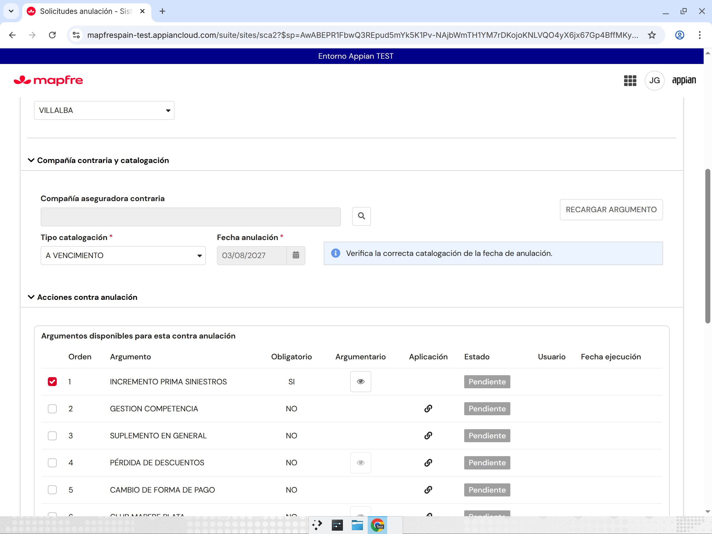
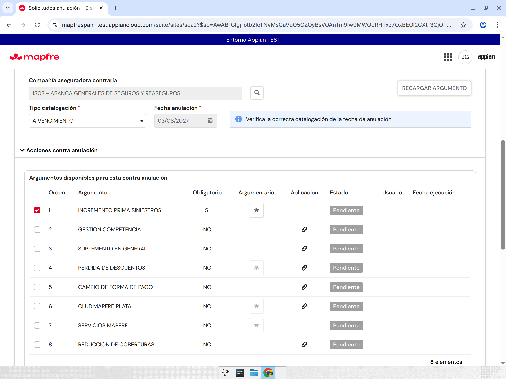
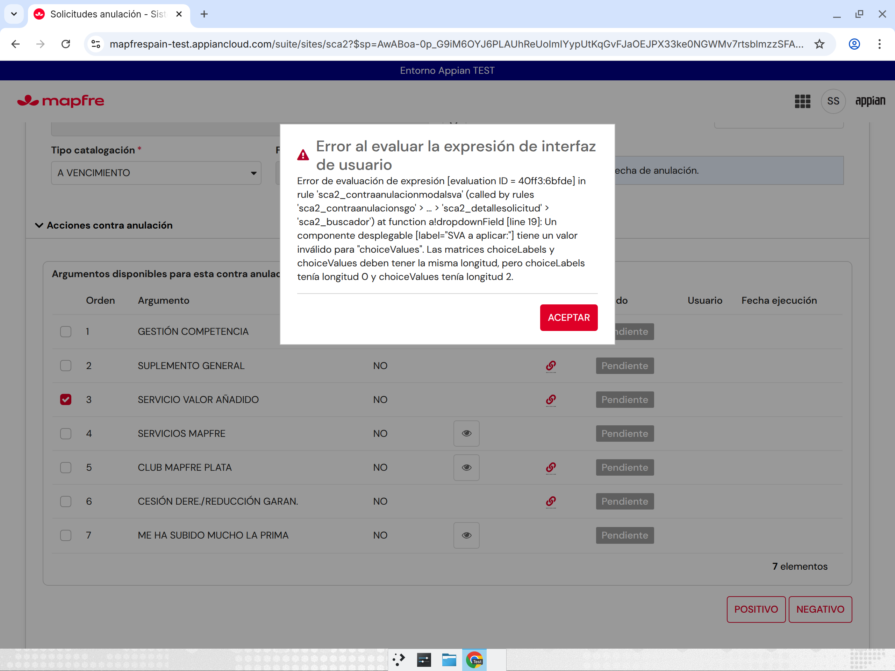
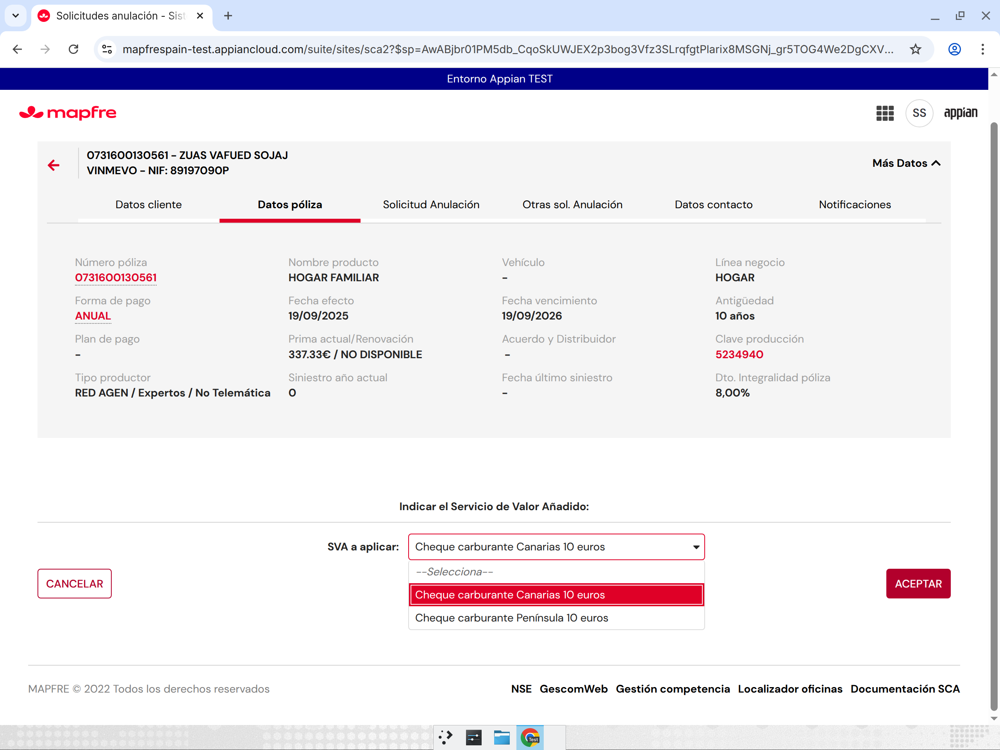
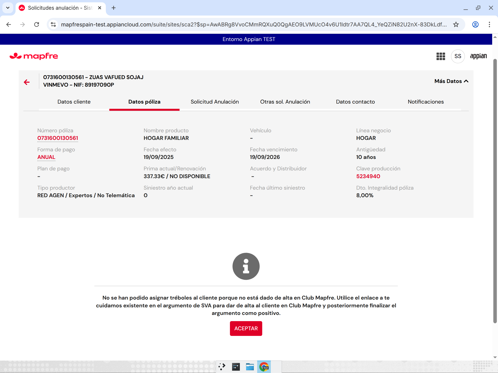
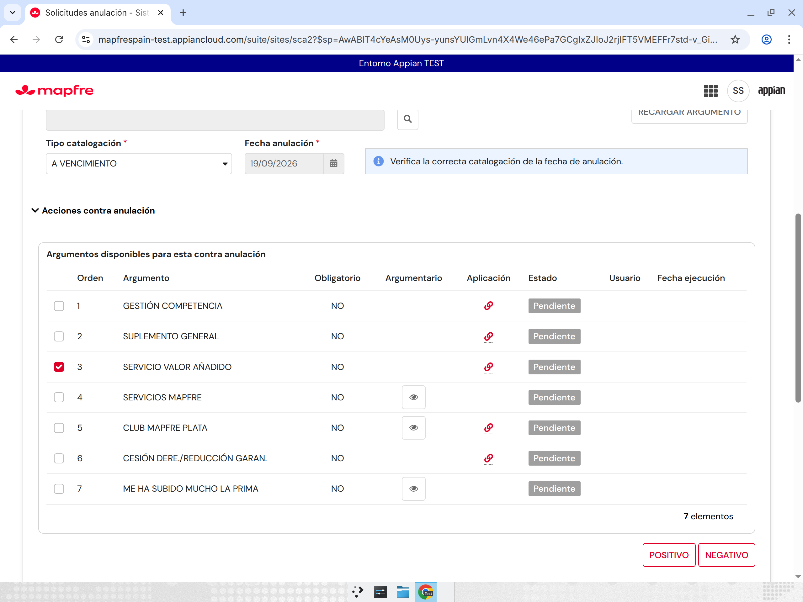

# R46-D — Argumentario, tréboles, Aurora y caché de cabecera (ronda 46, 10/11/2026)

Origen: «Analisis SCA2.docx» (segunda entrega, respuestas a las dudas 32, 33, 34, 36 y 38 de `../63-dudas-analista-pendientes.md`). Entorno: **Appian TEST** (`mapfrespain-test`), MCP `appian-dev-mcp-c90b` (plugin 26.9.15). Usuarios de prueba: JJGONZ2 (Red Mapfre / Oficina) y SISANS (Si24). Nunca PRO. Solo objetos SCA2. Sin tocar solicitudes ni instancias históricas.

Leyenda: **[Observado]** visto en TEST (pantalla, export o respuesta de servicio) · **[Inferido]** deducido del código o del comportamiento · **[Pendiente]** no verificado.

## Resumen

| # | Petición del analista | Estado |
|---|---|---|
| 1 | RECARGAR deja el argumento marcado con los datos antiguos (como SCA) | Hecho y probado OK [Observado] |
| 2 | Tréboles en Club y TTQ al ACEPTAR la enhorabuena; CANCELAR vuelve sin aplicarlos | Hecho [Observado en export]; prueba en pantalla pendiente: ninguna póliza nueva ofrece TU TE QUEDAS [Pendiente] |
| 3 | Entrega parcial (Club OK + TTQ KO) → error relanzable en `/errores` | Hecho [Observado en export]; no probado: sin TTQ y sin acceso a `/errores` [Pendiente] |
| 4 | Observaciones de más de 999 caracteres → se truncan | Hecho [Observado en export]; prueba en pantalla pendiente [Pendiente] |
| 5 | Catálogo Aurora se actualiza al crear, editar o dar de baja un argumento | Hecho [Observado en export]; la carga se ejecuta sin error (346 filas, 1,5 s) [Observado]; sin acceso al mantenimiento [Pendiente] |
| 6 | Observación de aplicación extendida a SVA (con el SVA aplicado) y reserva de prima | SVA ya existía desde R37-A; añadida la reserva de prima [Observado en export]; no probado en pantalla (el cliente de la prueba SVA no es socio Club) [Pendiente] |
| 6b | **Hallazgo:** el desplegable «SVA a aplicar» fallaba al abrir | Corregido en `SCA2_ContraAnulacionOpciones` v74 y probado OK [Observado] |
| 7 | Ampliar `POLIZA_FECHAULTIMOSINIESTRO` | Tabla exclusiva de SCA2 [Observado]; **DDL bloqueado en TEST**; script en `../sql/63-r46d-ampliar-poliza-fechaultimosiniestro.sql` |

## Resultados

| ID | Caso | Esperado | Real | OK/KO | Solicitud | Instancia | Pasos realizados | Posible causa/solución |
|---|---|---|---|---|---|---|---|---|
| D1 | RECARGAR en el argumentario | El argumento sigue marcado con los datos anteriores | [Observado] `INCREMENTO PRIMA SINIESTROS` sigue marcado después de cambiar la compañía a ABANCA 1808 y pulsar RECARGAR ARGUMENTO | OK | 15788852 (póliza 2002400441598, Autos, DECISIÓN DE CLIENTE / PRECIO / ME HA SUBIDO MUCHO LA PRIMA, A VENCIMIENTO, 03/08/2027) | TEST (la UI no muestra el id de instancia) | Alta nueva → contra anulación → marcar argumento → compañía contraria ABANCA 1808 → RECARGAR ARGUMENTO | `SCA2_ContraAnulacionCompaniaCatalogacion` v8 ya no pone a null `argumentoSeleccionado` ni `indiceArgumentoSeleccionado` |
| D2 | Enhorabuena tras tréboles TTQ: CANCELAR / ACEPTAR | CANCELAR: vuelve a la contra anulación sin aplicar tréboles. ACEPTAR: Club + TTQ y fin positivo | [Pendiente] Ninguna de las 3 solicitudes nuevas ofrece TU TE QUEDAS (8, 9 y 7 argumentos). [Observado en export] la pantalla de tréboles ya no llama a ningún servicio y la enhorabuena llama a Club y después a TTQ | PENDIENTE | 15788852, 15788854 (póliza 2002300094099, Autos), 15788856 (póliza 0731600130561, Hogar) | TEST | Revisar el argumentario de las 3 solicitudes nuevas | Se necesita una póliza nueva con campaña TTQ vigente (en R35-B y R37-A tampoco la había) |
| D3 | Entrega parcial (Club OK + TTQ KO) | Registro «SCA2 TTQ GrabarTreboles» pendiente en `/errores`, con Relanzar que graba en TTQ | [Pendiente] No se pudo provocar el KO de TTQ. `/errores` responde «La página no existe o no tiene permiso para verla» con JJGONZ2 y con SISANS [Observado] | PENDIENTE | — | — | Acceso a `/errores` con los 2 usuarios. No se crearon errores artificiales | Se necesita un usuario del grupo administrador SCA2 y un caso de TTQ KO |
| D4 | Fallo de asignación por cliente NO CLUB | Mensaje y argumento pendiente | [Observado] Con el SVA: «No se han podido asignar tréboles al cliente porque no está dado de alta en Club Mapfre…». Al aceptar, SERVICIO VALOR AÑADIDO queda Pendiente, sin usuario ni fecha | OK (rama de fallo SVA / NO CLUB) | 15788856 | TEST | SVA → POSITIVO → «Cheque carburante Península 10 euros» → ACEPTAR → correo de prueba → ACEPTAR → aviso → ACEPTAR | El cliente no es socio Club. Falta probar la rama NO CLUB con tréboles TTQ [Pendiente] |
| D5 | Catálogo Aurora tras mantener argumentos | Al guardar el alta, la modificación o la baja, se recarga «SCA2 Cat Tipo Argumento» | [Observado] `SCA2_catConstruirCarga("TIPO_ARGUMENTO")`: 346 filas de CORE, 0 manuales, 0 bajas, 1,5 s y sin error. `/gestiones-mantenimiento` responde «no tiene permiso» con los 2 usuarios | PENDIENTE (en pantalla) | — | — | `testRule` de la carga y acceso al mantenimiento | Probar con un administrador: dar de alta un argumento de prueba y comprobar que aparece en la contra anulación sin pulsar «Recargar desde CORE» |
| D6a | Desplegable «SVA a aplicar» (hallazgo) | Se ven los SVA disponibles | Antes [Observado]: error «choiceLabels longitud 0 frente a choiceValues longitud 2» (evaluación 40ff3:6bfde). Después [Observado]: se ven «Cheque carburante Canarias 10 euros» y «Cheque carburante Península 10 euros» | OK | 15788856 | TEST | Recargar la tarea → SERVICIO VALOR AÑADIDO → POSITIVO → abrir el desplegable | `local!SVADisponibles` aplicaba `index(…,"sva")` dos veces: `SCA2_obtenerSVADisponibles` ya devuelve la lista. Corregido en Opciones v74 |
| D6b | Observación SVA / reserva de prima / tréboles en el positivo | «Se ha asignado al cliente el SVA X con el correo Y», «Se ha aplicado la reserva de prima del argumento X», «Se han aplicado N tréboles al cliente», unidas a las del gestor con « - » | [Pendiente] El cliente de la prueba SVA no es socio Club y no se llegó al positivo. [Observado en export] lógica en `SCA2_ContraAnulacionModalRecuperacionPoliza` v16 (`validateExpression` sin errores) | PENDIENTE | 15788856 | TEST | — | Repetir con un cliente socio Club y con un argumento económico |
| D7 | Observaciones de más de 999 | Se truncan y no bloquean | [Observado en export] Se ha quitado el bloqueo «El campo de observaciones ha sobrepasado el límite de 999 caracteres» de la enhorabuena. Se aplica `left(…, 999)` a las observaciones del argumento y a las de la contra anulación | PENDIENTE (en pantalla) | — | — | — | El campo de texto de observaciones del gestor (Opciones) sigue validando 999 al escribir, igual que SCA [Inferido] |
| D8 | Caché de cabecera: `POLIZA_FECHAULTIMOSINIESTRO` | Columna ampliada, sin recortar GESVIDA | [Observado] `updateRecordTypeField(length=1000, updateTable=true)` crea la versión v12 del record type, pero la columna sigue en `VARCHAR(255)` (`listDatabaseTableColumns`). El MCP no puede ejecutar SQL | BLOQUEADO | — | — | Comprobar quién usa la tabla, intentar el DDL desde el record type y volver a leer las columnas | La tabla no la gestiona Appian. Un DBA o un despliegue con script de BBDD debe ejecutar `../sql/63-r46d-ampliar-poliza-fechaultimosiniestro.sql`. Mientras tanto se mantiene el recorte de R38-A |

**Solicitudes de prueba abiertas (nuevas):** 15788852 (2002400441598), 15788854 (2002300094099) y 15788856 (0731600130561). Las tres quedan pendientes en la contra anulación. Las candidatas 2002400441596 y 0731380063613 tenían una solicitud en curso y no se tocaron.

## Capturas (antes / después)

| Caso | Antes | Después |
|---|---|---|
| D1 RECARGAR |  |  |
| D6a Desplegable SVA |  |  |
| D4 NO CLUB (SVA) |  |  |

Otras capturas: `evidencias/r46-d/d2-argumentos-sin-ttq-15788854.png`, `d3-errores-*-sin-acceso.png`, `d5-mantenimiento-*-sin-acceso.png`, `d*-solicitud-*-pendiente.png` y `disponibilidad-*-en-curso.png`.

## Objetos modificados (TEST)

Copias de las versiones anteriores en `backups-r46/R46-D_*`. Después de cada importación se reexportó el objeto y es idéntico a lo subido [Observado].

| Objeto | UUID | Versión | Cambio |
|---|---|---|---|
| IF `SCA2_ContraAnulacionCompaniaCatalogacion` | `_a-0000f069-4f37-8000-9cc8-011c48011c48_20060061` | v7 → v8 | RECARGAR ya no desmarca el argumento |
| IF `SCA2_ContraAnulacionSGO` | `…_20060093` | v4 → v5 | El ACEPTAR de la pantalla de tréboles TTQ solo cierra la pantalla (sin Club ni TTQ). `tipoArgumentoVariable` queda en 1 |
| IF `SCA2_ContraAnulacionOpciones` | `…_20056435` | v70 → v72 → v73 → v74 | v73: `aplicarTreboles` en `local!dataRecuperacion` (rehecha sobre la v71 de R46-C, ver incidencia). v74: corrección de `local!SVADisponibles` |
| IF `SCA2_ContraAnulacionModalRecuperacionPoliza` (enhorabuena) | `…_20052951` | v15 → v16 | ACEPTAR: Club (`SCA2_executeAsignarIntegracion`) → TTQ (`SCA2_gestionarTTQRESTIntegracion`). Si Club da KO: mensaje y argumento pendiente. Si TTQ da KO: `a!writeRecords` en `SCA2 Error` (comando «SCA2 TTQ GrabarTreboles», con los datos para relanzar) y aviso. Su ACEPTAR finaliza. Observaciones: reserva de prima y truncado a 999. Se quita el bloqueo de 999 |
| IF `SCA2_BandejaErrores` | `…_20055578` | v12 → v13 | «SCA2 TTQ GrabarTreboles» es relanzable: Relanzar llama a TTQ con los datos guardados y, si responde OK, marca el error como RELANZADO (intentos +1, resuelto por, fecha) |
| IF `SCA2_DetalleErrores` | `…_20055566` | v6 → v7 | El mismo relanzamiento TTQ |
| IF `SCA2_AltaGestionArgumento` | `…_20063439` | v8 → v9 | Al guardar (alta, modificación o baja por estado): `a!writeRecords(SCA2_catConstruirCarga("TIPO_ARGUMENTO"))`. Si hay documento, va en el `onSuccess` de `a!deleteDocument` (un smart service por clic) |
| CONS `SCA2_TXT_OBS_RESERVA_PRIMA_APLICADA` (nueva) | `_a-0000f0af-4eea-8000-9d50-011c48011c48_5690936` | v1 | «Se ha aplicado la reserva de prima del argumento {0}» |
| RT `SCA2 Datos Cabecera` | `04f597de-5acd-45b2-9ab3-277713cd00a6` | v11 → v12 | **Sin efecto**: el intento de ampliar la longitud no cambió el DDL (sigue en VARCHAR(255)) |

**Incidencia de coordinación [Observado]:** R46-D guardó Opciones v72 partiendo de la v70 sin ver la reserva de R46-C, y así pisó su v71 (aviso Si24 / FINALIZAR sin carta). Se restauró enseguida: la v73 es la v71 de R46-C más las 2 líneas de R46-D, comprobado por diff. Queda avisado en `coordinacion-ronda46.md`. R46-C y R46-B deben partir de la v74.

**Comparación con rondas anteriores:** R34-A movió la aplicación de tréboles, Retos y SVA al ACEPTAR de su pantalla. R46-D la mueve a la enhorabuena solo para los tréboles de Club + TTQ, que es lo que pide el analista. Retos y SVA siguen aplicándose al ACEPTAR de su pantalla (ver duda nueva 1). R38-A recortaba el enlace GESVIDA, y ese recorte se mantiene hasta que se ejecute el DDL.

## Respuestas para el analista

1. **RECARGAR (duda 32).** Hecho como en SCA. Al pulsar RECARGAR ARGUMENTO se recarga el argumentario con la nueva compañía, catalogación y fecha, y el argumento elegido sigue marcado con los datos que tenía antes. Ejemplo [Observado]: solicitud 15788852, póliza 2002400441598, DECISIÓN DE CLIENTE / PRECIO / ME HA SUBIDO MUCHO LA PRIMA, A VENCIMIENTO 03/08/2027: `INCREMENTO PRIMA SINIESTROS` sigue marcado después de cambiar a ABANCA 1808.
2. **CANCELAR en la enhorabuena (duda 33).** Hecho. La pantalla «Indique el número de tréboles» ya no entrega nada. Los tréboles se entregan al ACEPTAR la enhorabuena, primero en Club MAPFRE y después en TTQ. CANCELAR vuelve a la contra anulación sin entregarlos y deja el argumento pendiente [Observado en export]. No se ha podido probar en pantalla: no hay ninguna póliza nueva con TU TE QUEDAS en TEST [Pendiente].
3. **Entrega parcial (duda 33).** Hecho. Si Club va bien y TTQ falla, se registra un error en el listado de errores (comando «SCA2 TTQ GrabarTreboles», con póliza, campaña, número de tréboles, vencimiento y solicitud). El gestor ve un aviso y, al aceptarlo, la contra anulación se finaliza positiva porque los tréboles ya están en Club. Desde `/errores`, «Relanzar» graba en TTQ los tréboles que faltaban y marca el error como RELANZADO. Si TTQ vuelve a fallar, el error sigue pendiente [Observado en export]. Para probarlo hace falta un usuario administrador SCA2 [Pendiente].
4. **Más de 999 caracteres (duda 33).** Hecho. Se truncan a 999 y ya no bloquean el positivo [Observado en export].
5. **Fallo de SVA (duda 33).** Pendiente de negocio, como indicáis. Comportamiento actual [Observado]: en la solicitud 15788856 (póliza Hogar 0731600130561, DECISIÓN DE CLIENTE / PRECIO / ME HA SUBIDO MUCHO LA PRIMA, A VENCIMIENTO 19/09/2026, Si24), el SVA «Cheque carburante Península 10 euros» devuelve que el cliente no está dado de alta en Club Mapfre y el argumento se queda **pendiente** (abierto).
6. **Póliza NO CLUB (duda 33).** Quedamos a la espera de la vuestra. Con el SVA ya hemos visto el caso NO CLUB (punto 5). Falta verlo con los tréboles.
7. **Catálogo Aurora (duda 34).** Hecho. Al guardar el alta o la modificación de un argumento (la baja se hace cambiando su estado) se vuelve a cargar automáticamente el catálogo de tipos de argumento desde CORE. «Recargar desde CORE» sigue disponible como respaldo. La carga tarda unos 1,5 s (346 tipos) [Observado].
8. **Observación de tréboles (duda 36).** Ampliada. En el argumento positivo se añaden, detrás de las observaciones del gestor y separadas por « - »: «Se han aplicado N tréboles al cliente» (TTQ), «Se ha asignado al cliente el SVA <nombre del SVA> con el correo <correo>» (SVA, desde R37-A) y la nueva «Se ha aplicado la reserva de prima del argumento <argumento>». Todo se trunca a 999 [Observado en export].
9. **Caché de cabecera (duda 38).** La tabla `sca2_anulaciones.sca2_datos_cabecera` es exclusiva de SCA2: tiene 349 referencias y todas son objetos SCA2 [Observado]. En TEST no ha sido posible ampliar la columna, porque la tabla no la gestiona Appian y el MCP no ejecuta SQL. El script está en `../sql/63-r46d-ampliar-poliza-fechaultimosiniestro.sql` (VARCHAR(1000), idempotente). Mientras no se ejecute, se mantiene el recorte de R38-A.

## Dudas nuevas

1. **Retos y SVA:** ¿también deben aplicarse al ACEPTAR la enhorabuena, como los tréboles de TTQ? Hoy se aplican al ACEPTAR su propia pantalla.
2. **Reserva de prima:** la he interpretado como el *argumento económico* (inserción «Arg. Econ.» en A2139022_MES al finalizar positivo) [Inferido]. ¿Es eso, o es otra operación?
3. **Texto del fallo SVA:** dice «No se han podido asignar **tréboles**…» aunque lo que falla es el SVA. Es el literal heredado. ¿Lo cambiamos por «el SVA»?
4. **Entrega parcial:** ¿os parece bien finalizar positiva la contra anulación y dejar pendiente solo la grabación en TTQ?
5. **DDL:** ¿quién ejecuta el script de la columna en TEST, en PRE y en PRO (DBA o despliegue con script de BBDD)?
6. **Datos y permisos de prueba:** necesitamos una póliza con TU TE QUEDAS vigente, un cliente socio Club para el SVA y un usuario del grupo administrador SCA2 para `/errores` y `/gestiones-mantenimiento`.
