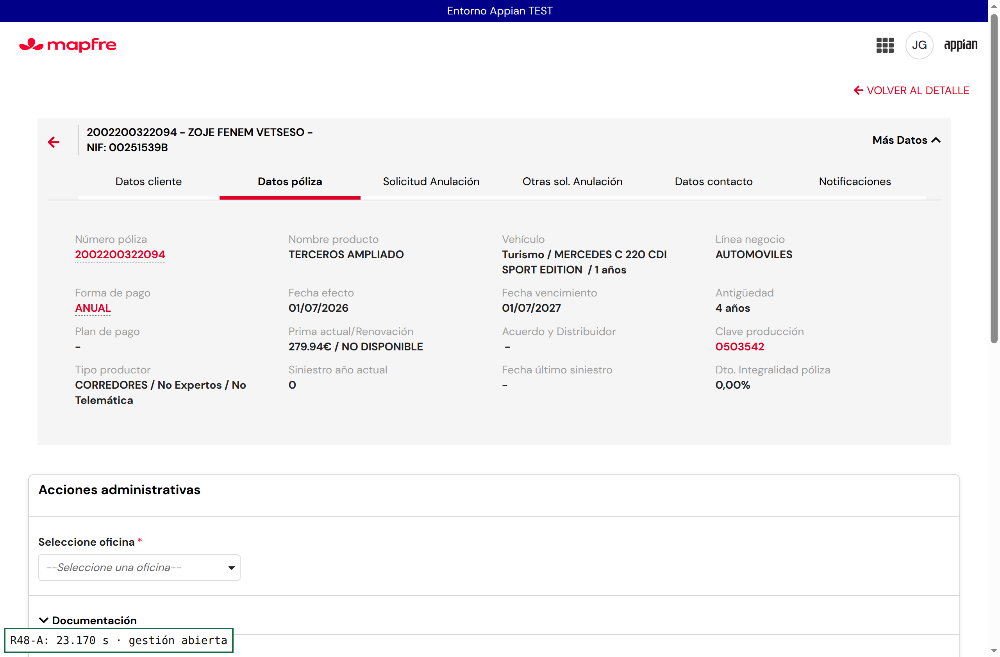

# R48-A — Espera tras GUARDAR en el alta y avisos entre el alta y la siguiente pantalla (SCA2, Appian TEST)

Sesión hija R48-A. Entorno: Appian TEST (mapfrespain-test), site `/suite/sites/sca2`. Solo objetos SCA2 (aplicación `_a-0000f069-4f37-8000-9cc8-011c48011c48_20050128`). Coordinación: `coordinacion-ronda48.md`; backups y diffs: `backups-r48/`.

## 1. Resumen

| Punto | Antes | Después |
|---|---|---|
| Espera tras GUARDAR | Sin tope: si la solicitud/tarea no llegaba, la tarjeta «Está tardando un poco más…» con COMPROBAR AHORA y ACEPTAR deshabilitado se quedaba para siempre (la descripción de las constantes decía literalmente «sin tope automático»). | Texto nuevo «el sistema está tardando en responder, espere»; a los 90 s (sondeo de 30 s → 90–120 s) mensaje claro con CONSULTAR SOLICITUD (si ya existe) y VOLVER AL BUSCADOR. |
| Avisos alta → siguiente pantalla | 2 avisos / 2 clics: popup de simulación (ACEPTAR/SI) + tarjeta «Su solicitud se ha generado correctamente. Acepte para abrir la gestión correspondiente.» (ACEPTAR). | 1 aviso / 1 clic: tras el popup se abre directamente la gestión (contra anulación, acción administrativa, autorización…). |

## 2. Causa

### 2.1 Espera tras GUARDAR que no sale

Mecánica (`SCA2_AltaSolicitudPage` v53): el popup lanza `SCA2 CMD Alta` con `a!startProcess(isSynchronous: true)` (Alta → Decidir → CrearAccion encadenados).
- Si termina dentro del límite síncrono de Appian (~30 s), `onSuccess` guarda `idSolicitud` y aparece la tarjeta «generada correctamente» con ACEPTAR.
- Si no termina (`onIncomplete`) se entra en la espera de respaldo: cada 30 s se relee la solicitud creada por detrás (por póliza y `createdAt ≥ lanzamiento − 1 min`), su tarea PENDIENTE y su estado; COMPROBAR AHORA fuerza la relectura.

**Defecto:** esa espera **no tenía tope**. ACEPTAR solo se habilitaba si había `idSolicitud` **y** (tarea PENDIENTE **o** estado distinto de ALTA/DECIDIDA/EN_ACCION). Si el proceso no llegaba a crear la solicitud, o la dejaba en ALTA/DECIDIDA/EN_ACCION sin tarea pendiente (decisión o CrearAccion lentos, en error o sin tarea), la tarjeta seguía mostrando «Está tardando un poco más…» y COMPROBAR AHORA de forma indefinida: no había ningún botón de salida en la tarjeta y CANCELAR del formulario estaba deshabilitado. La propia descripción de las constantes de espera lo decía: «sin tope automático». El sondeo **sí** refresca: el problema no es que deje de refrescar, sino que no hay salida cuando lo que espera no llega.

`SCA2_DetalleTareas` («Procesando la decisión de la solicitud…») sí tenía tope (`SCA2_VAL_ESPERA_AGOTADA_SEGUNDOS` = 90 s, `local!esperaAgotada`), pero al agotarse solo explicaba el caso de CA negativa sin mecanizar; en los demás casos se habilitaba ACEPTAR sin ningún texto.

**Reproducción:** en TEST no se ha podido forzar una alta de más de 30 s con solicitudes nuevas. Las tres altas de la prueba tardaron entre 10,6 y 12,5 s en proceso (ver §5), así que no se entró en la espera de respaldo. La causa se establece por lectura del código vivo y por los datos de TEST (solo lectura):
- 24 instancias retenidas de `SCA2 CMD Alta` (10/11 19:30 – 11/11 18:35): todas COMPLETED, p50 11,2 s, p90 15,7 s, máx 17,2 s, ninguna > 25 s; 0 en curso.
- 100 solicitudes SCA2 creadas desde el 01/11 (sin PDTE): latencia de la creación de la solicitud a la 1.ª tarea p50 4 s, p90 7 s, **máx 31 s y 32 s** (06/11: 15788822 AA, póliza 2002200051799; 15788807 CA, póliza 0732000131328). Son los casos en que el alta supera el límite síncrono y el usuario cae en la espera de respaldo; si además la tarea no llega, la pantalla se queda sin salida.
- 8 solicitudes `PDTE-…` (03–06/11, error del alta): esa rama ya mostraba el error y habilitaba ACEPTAR (no se bloquea).
- Hoy no hay ninguna solicitud reciente en ALTA/DECIDIDA/EN_ACCION sin tarea PENDIENTE.

**Duplicados:** no hay riesgo nuevo. Al pulsar GUARDAR, `rule!SCA2_consultarSolicitudEnCurso` detecta una solicitud en curso de la póliza y, en vez de lanzar otra alta, muestra «solicitud en curso» con acceso a ella; GUARDAR/ACEPTAR se deshabilitan tras el primer clic (R44-A). La solicitud creada por detrás se recupera por póliza y fecha.

### 2.2 Dos avisos

Entre GUARDAR y la siguiente pantalla había dos avisos:
1. **Popup de confirmación** (simulación): «Se han completado todas las validaciones para permitir generar la solicitud de anulación, se va a proceder a dar de alta la solicitud en el sistema» + «Advertencia: …» (avisos de acciones administrativas y documentación). Botón ACEPTAR/SI.
2. **Tarjeta INFO** al volver el alta: «Su solicitud se ha generado correctamente. Acepte para abrir la gestión correspondiente.» Botón ACEPTAR, que solo navegaba al Detalle con la tarea.

SCA legacy hace lo mismo (`SCA_AltaSolicitudAnulacionEstrategicas` v11 + `SCA_SimularAnulacionPopupEstrategicas` y luego `SCA_GenerarSolicitudPopupEstrategicas` v7 con botón OK). Sus textos están en `SCA_TEXTOS_GENERAR_SOLICITUD_POPUP_ESTRATEGICAS`: [5] «Su solicitud se ha generado correctamente. Se le va a redirigir a la acción correspondiente», [7] «Se va a redirigir a la anulación.», [6] «Sus acciones de contra anulación han terminado. La gestión ha sido derivada a otro usuario para su finalización.», [4] SI24, [1]/[8] errores. El segundo aviso solo informa y no aporta ningún dato de negocio: el número de solicitud y la gestión se ven en la pantalla siguiente. La información útil del primer aviso (validaciones y Advertencia documental) se mantiene.

## 3. Cambios (Appian TEST, solo SCA2)

| Objeto | UUID | Versión | Cambio |
|---|---|---|---|
| SCA2_AltaSolicitudPage | _a-0000f069-4f37-8000-9cc8-011c48011c48_20055716 | 53→54 | (a) En `onSuccess` del alta síncrona, si ya existe tarea PENDIENTE se navega directamente al Detalle con la gestión (`ri!idSolicitudSel`, `ri!tipoAccion`, `ri!idTarea`, `ri!vista = "DETALLE"`): sin tarjeta ni segundo ACEPTAR. (b) `local!esperaAgotada` = espera de respaldo > `SCA2_VAL_ESPERA_AGOTADA_SEGUNDOS` sin gestión lista → texto `SCA2_TXT_ESPERA_AGOTADA` (+ «Solicitud: N.» si se conoce), botón CONSULTAR SOLICITUD (si existe la solicitud) y VOLVER AL BUSCADOR. Se mantiene COMPROBAR AHORA. |
| SCA2_DetalleTareas | _a-0000f069-4f37-8000-9cc8-011c48011c48_20055554 | 43→44 | Al agotarse la espera de la decisión sin siguiente gestión ni cierre, muestra `SCA2_TXT_ESPERA_AGOTADA` + solicitud (ACEPTAR ya se habilitaba). |
| SCA2_TXT_ESPERA_DECISION_ADICIONAL | _a-0000f09f-42ed-8000-9d42-011c48011c48_5648821 | 1→2 | Texto «el sistema está tardando» (sirve para el alta y para «Procesando la decisión…»). |
| SCA2_TXT_ESPERA_AGOTADA (nueva) | _a-0000f0af-4eea-8000-9d50-011c48011c48_5705249 | —→1 | Texto de salida al agotar la espera. |

Reexportados y comparados: la versión viva coincide con el cambio aplicado (diffs en `backups-r48/*.diff`; antes/después en `backups-r48/`). Coordinación liberada en `coordinacion-ronda48.md`.

Si al volver el alta no hay tarea pendiente (por ejemplo, solicitud finalizada o derivada a otro usuario), sigue apareciendo la tarjeta con un único ACEPTAR, que pasa a ser el único aviso después del popup.

## 4. Textos (todos en constantes; negocio solo tiene que editar la constante)

| Constante | Antes | Después |
|---|---|---|
| SCA2_TXT_ESPERA_DECISION_ADICIONAL | Está tardando un poco más en generar la siguiente gestión, espere un momento. | **El sistema está tardando en responder más de lo habitual. Espere, por favor: su solicitud se está procesando. No vuelva a pulsar GUARDAR ni cierre la pantalla.** |
| SCA2_TXT_ESPERA_AGOTADA | (no existía; la espera no acababa) | **El sistema no ha respondido en el tiempo previsto. No vuelva a dar de alta la solicitud: consulte su estado en el Detalle de la solicitud o vuelva al buscador y búsquela por la póliza dentro de unos minutos.** (+ « Solicitud: N.») |
| SCA2_TXT_ESPERA_DECISION_LISTA | Su solicitud se ha generado correctamente. Acepte para abrir la gestión correspondiente. | Sin cambio (solo aparece cuando no hay gestión que abrir directamente o en la espera de respaldo). |
| SCA2_TXT_ESPERA_DECISION_INICIAL | Su solicitud se está generando… el botón ACEPTAR se habilitará cuando esté lista. | Sin cambio. |
| Popup de confirmación (literal en AltaSolicitudPage) | «Se han completado todas las validaciones… se va a proceder a dar de alta la solicitud en el sistema» + Advertencia | Sin cambio (es el único aviso). |

Los literales de botón nuevos son «CONSULTAR SOLICITUD» y «VOLVER AL BUSCADOR».

## 5. Valores de 30 s y 90 s

- **30 s**: no se puede tocar. Es el límite síncrono de `a!startProcess` en Appian y el intervalo mínimo de `refreshInterval` (0,5 min). El proceso tarda 10–17 s (p90 15,7 s), con margen de unos 13 s.
- **90 s** (`SCA2_VAL_ESPERA_AGOTADA_SEGUNDOS`): se mantiene. El peor caso observado de solicitud → 1.ª tarea es 32 s, así que 90 s lo cubre casi 3 veces. Como el sondeo es de 30 s, la salida aparece entre 90 y 120 s. Bajarlo a 60 s dejaría poco margen sobre el caso de 32 s más la cadencia de 30 s.
- El tiempo que ve el usuario entre ACEPTAR del popup y la gestión abierta (23–32 s, §6) es el proceso (10,6–12,5 s) más la carga de la pantalla de la gestión (Detalle + Contra anulación / AA). Esa carga no cuenta para el límite síncrono.

## 6. Pruebas (TEST, usuario analista, solicitudes nuevas del 11/11/2026)

Tiempo medido desde ACEPTAR del popup hasta ver la gestión abierta (muestreo de 100 ms). Los clics incluyen el ACEPTAR del popup.

| # | Solicitud | Póliza | Ramo | Esperado | Real | OK/KO | Tiempo | Clics |
|---|---|---|---|---|---|---|---:|---:|
| 1 | 15788897 | 2002400321576 | Autos | Contra anulación directa, sin tarjeta ni 2.º ACEPTAR | CA abierta directamente (CMD Alta 12,5 s) | OK | 32,354 s | 1 |
| 2 | 15788898 | 0732200072626 | Hogar | Gestión directa | CA abierta directamente (CMD Alta 10,6 s) | OK | 28,012 s | 1 |
| 3 | 15788899 | 2002200322094 | Autos (DECISION CLIENTE / VENTA VEHICULO / NO VOY A COMPRARME OTRO COCHE) | Acción Administrativa directa | Popup con Advertencia documental → AA directa | OK | 23,170 s | 1 |
| 4 | — | 0002729372785 | Autos (Autemis) | Autorización | GUARDAR devolvió Autemis 916 (vencimiento 16/05/2028, fuera del margen de 18 meses) antes del popup; no se crea solicitud | Sin probar | — | — |
| 5 | 15788897 | 2002400321576 | Autos | Completar CA POSITIVO | Vuelve al buscador; FINALIZADA_POSITIVO (tarea 831 COMPLETADA 17:43:25). La vista abierta mostraba «Incompleta» hasta recargar | OK | 2,955 s | 1 |
| 6 | 1–3 | — | — | Sin duplicados; GUARDAR/ACEPTAR bloqueados mientras procesa | 1 sola solicitud por póliza; doble clic en GUARDAR sin segunda alta | OK | — | — |
| 7 | — | — | — | Espera de respaldo / agotada (alta y decisión) | No se presentó (todas las altas < 30 s) | Sin probar | — | — |

Evidencias en `capturas-r48/`: `r48a-1-popup.png`, `r48a-1-siguiente-contra-anulacion.png`, `r48a-1-guardar-bloqueado.png`, `r48a-1-buscador-sin-duplicados.png`, `r48a-2-*`, `r48a-3-siguiente-accion-administrativa.png`, `r48a-4-autorizacion-bloqueada-autemis-916.png`, `r48a-5-contra-anulacion-finalizada-positiva.png`… La grabación de la sesión se entrega aparte en el mensaje de cierre de R48-A (no se sube al repositorio por su tamaño).

## 7. Dudas para el analista

1. **Textos**: validar los de `SCA2_TXT_ESPERA_DECISION_ADICIONAL` y `SCA2_TXT_ESPERA_AGOTADA` (§4) y los botones CONSULTAR SOLICITUD / VOLVER AL BUSCADOR.
2. **Salida automática en la espera de respaldo**: Appian no permite navegar sin una acción del usuario cuando la gestión llega por sondeo (después de 30 s). En ese caso el texto pasa a «generada correctamente» y basta un ACEPTAR. ¿Es aceptable?
3. **Autorización**: no hemos encontrado una póliza/combinación libre en TEST que lleve a Autorización (0002729372785 → Autemis 916). ¿Nos podéis pasar una?
4. **Caso real «no sale»**: si tenéis el número de solicitud/póliza y la hora del caso de negocio, confirmamos en datos si fue proceso lento, tarea no creada o error.
5. Tras completar la CA POSITIVO, la vista de la gestión mostró «Incompleta» hasta recargar, aunque la solicitud ya estaba finalizada. ¿Lo habéis visto? Queda fuera de R48-A.
