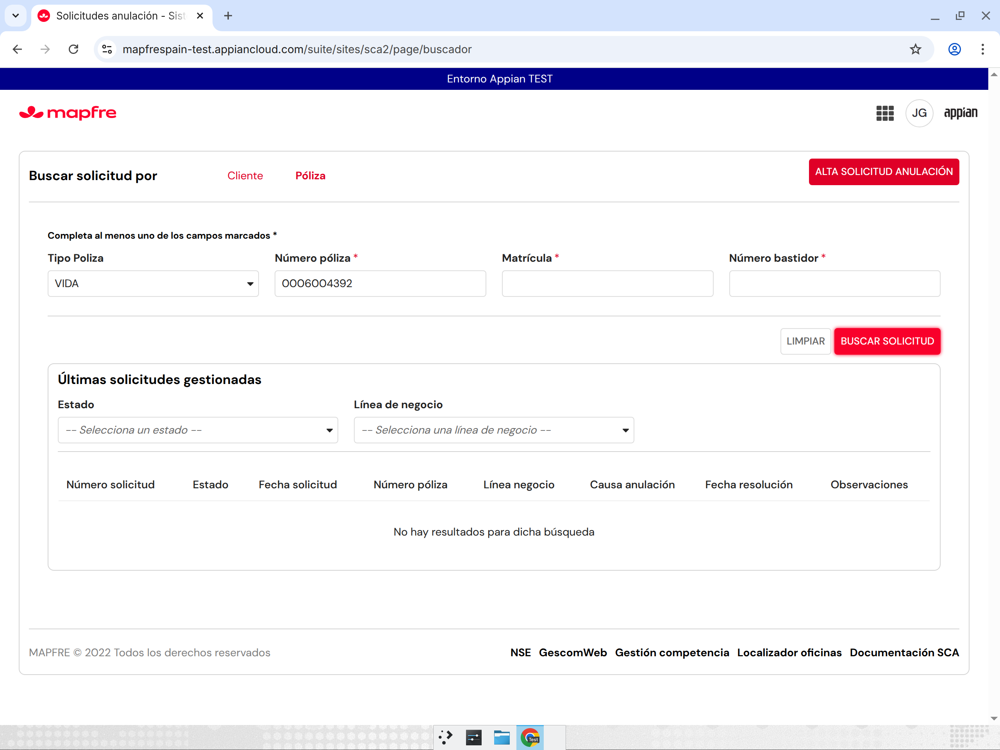
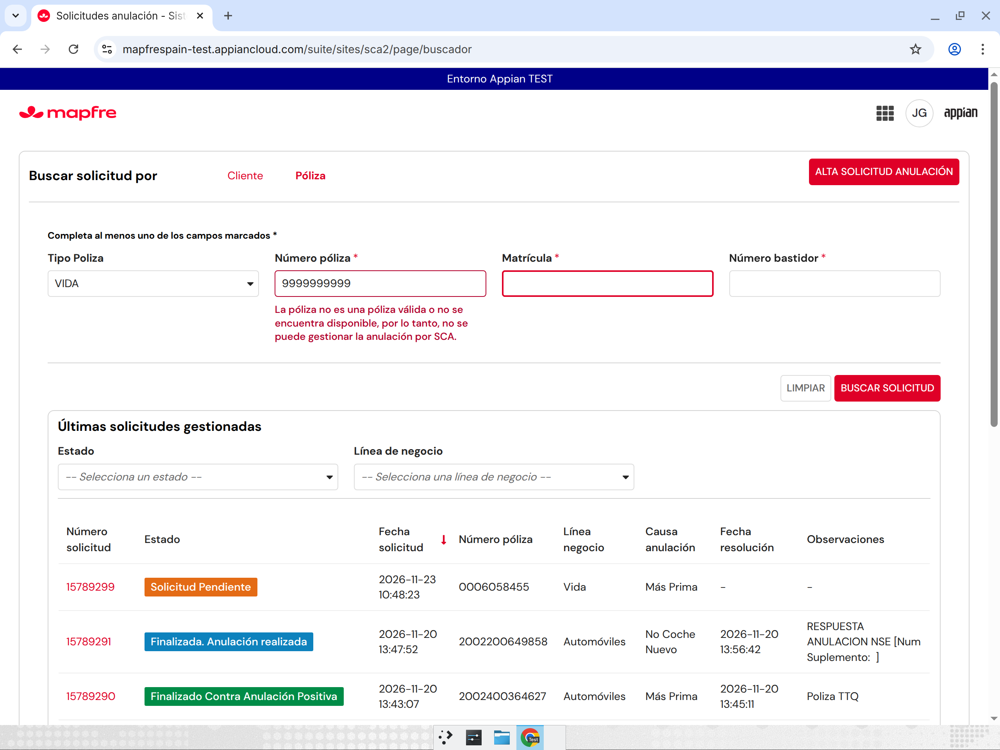
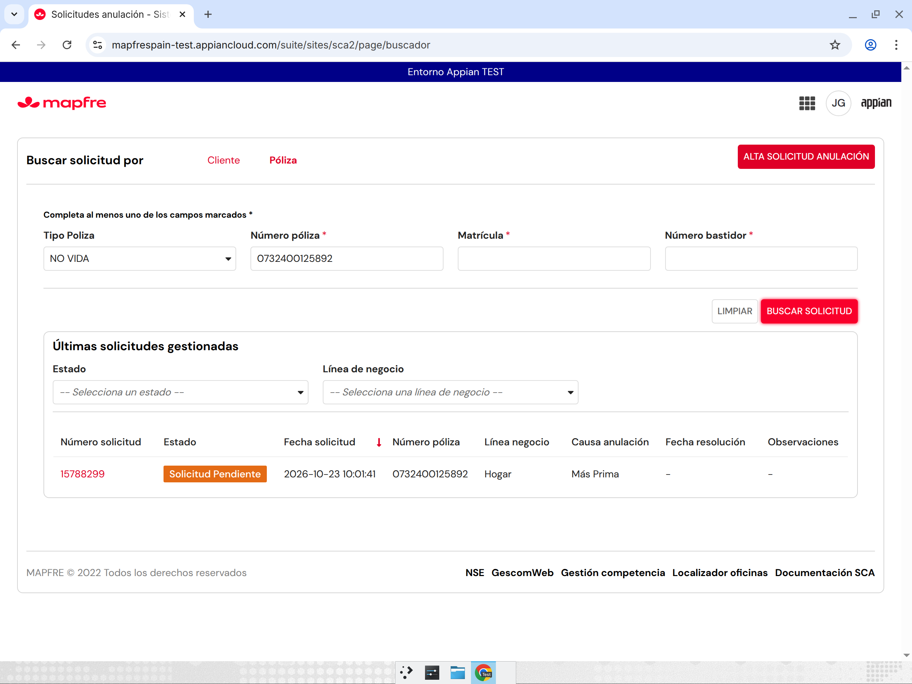

# Vida — alta, Decidir, buscador y relanzamiento

Entorno: Appian TEST, aplicación SCA2. Fecha: 23/11/2026. Herramientas: MCP Appian (lectura, testRule, updates autorizados y un testProcessModel del relanzamiento). Sin cambios de objetos SCA/SCAC/CORE ni escrituras manuales de records.

## 1. Resumen y versiones

| Objeto | Antes → después | Resultado |
|---|---|---|
| `SCA2_construirContextoAlta` | v19 → v20 | `numApli=0` en Vida; alta real de la póliza `0006000495` (18/11) → CORE `15789249` sin el 4004 |
| `SCA2_construirEntradaReglas` | v4 → v5 | Añadida Vida a orígenes soportados y selección de `datosPolizaVida`; DTO completo y fecha ISO |
| `SCA2_Buscador` | v39 → v40 | Resolver tipo antes de consultar detalles; Vida consulta su servicio y valida `contractData.policyId`; Autos/Hogar conservan su consulta y criterios |
| `SCA2_consultarServiciosReglas` | v1 → v2 | Si falla integración, `error` conserva statusCode, body crudo y title/message/detail de conexión; accion/grupo/subgrupo siguen ERROR. Rama de éxito intacta |

Los versionId se leyeron antes de cada update y se usaron como guard de concurrencia. Los números del contexto de alta proceden del antecedente indicado por el solicitante; no se modificó ese objeto aquí.

## 2. Causa y pruebas de Decidir

El nodo Cargar usa `SCA2_cargarSolicitud(idSolicitud)` (Solicitud y records relacionados). Consultar reglas llama a `SCA2_mapearDatosDecidirAccion` con la carga, origen de `estado.origenPoliza` y nivel de `estado.nivelIntervencion` (defecto 1). Delega en `SCA2_construirEntradaReglas`. Después llama a `SCA2_consultarServiciosReglas` con el primer DTO, póliza de datosBasicosSolicitud, compañía de datosPerfilesPca y regla por defecto accion.

La v4 solo soportaba Hogar/Autos. Vida devolvía un CDT no nulo pero con numeroAplicacion, canalEntrada, perfiles y resto de campos nulos. Por ello no actuaba el guard de DTO nulo. La integración QUERY `SCA2_scaServiciosReglas` sí se ejecutaba: la ausencia de fila de observabilidad no demostraba ausencia de llamada.

Reproducción anterior con los datos de 15789299:

```text
HTTP/1.1 400 Bad Request
Alguno de los campos de entrada no tiene el formato adecuado
'canalEntrada' no puede ser nulo
'numeroAplicacion' no puede ser nulo
```

La envolvente descartaba el body al ser success=false y devolvía error=null, accion/grupo/subgrupo=ERROR. La respuesta HTTP histórica de las 09:48 no se recuperó: el 400 es reproducción, no un log histórico.

Con v5, testRule del mapeador usando la carga completa de 15789299, origen Vida y nivel 1:

```json
{"numeroAplicacion":"0","canalEntrada":1,"perfilEjecucion":"CE_RM","subperfilEjecucion":"CE_RM_OFICINA","lineaNegocio":"3","claveProduccion":"5264083","codigoCatalogacion":2,"codigoMotivoAnulacion":1,"codigoCausaAnulacion":1,"nivelDecidirAccion":1,"fechaAnulacion":"2027-06-22","codigoDetalleAnulacion":1,"codigoSCA":"15789299","estadoUltimaGestion":2,"anulaTecnico":false,"anulaExperto":false,"nuuma":"JJGONZ2","mecanizada":false}
```

Integración QUERY (POST), compañía 3, póliza 0006058455, regla accion: `success=true`, `HTTP/1.1 200 OK`, body `{"accion":"CONTRAANULAR"}`. Autos 15787842 conserva exactamente su DTO anterior (línea 1, clave 5295882, fecha 2027-06-01, código SCA 15787842).

## 3. Relanzamiento desde bandeja

`SCA2_BandejaErrores` v17 solo ofrece Relanzar si estado=PENDIENTE y, para Decidir, la solicitud sigue ERROR_DECISION. Por ello se eligió 313, no 314 BLOQUEADO. La constante `SCA2_PM_CMD_MARCAR_ERROR_RELANZADO` apunta a `0000f073-49f2-8000-d0e7-7f0000014e7a`.

Una única invocación manual, equivalente al botón:

```json
{"idError":313,"idSolicitud":"15789299","comando":"SCA2 CMD Decidir"}
```

```json
{"processId":17625308,"status":"COMPLETED","processVariables":{"idError":313,"idSolicitud":"15789299","comando":"SCA2 CMD Decidir","comandoBase":"SCA2 CMD Decidir"}}
```

El proceso despacha Decidir asíncronamente: no basta con COMPLETED del lanzador. Primera instancia Decidir 12390428 falló; el reintento 16585620 terminó con `decision={error:null,accion:CONTRAANULAR,grupo:null,subgrupo:null}`. No se hizo un segundo relanzamiento manual. En una lectura intermedia apareció el error 315 PENDIENTE y aún ERROR_DECISION; la lectura final muestra los tres errores RELANZADO y la tarea creada.

Filas finales de records (columnas recortadas):

```csv
id,idSolicitud,comando,codigo,estado,resueltoPor,fechaResolucion
313,15789299,SCA2 CMD Decidir,DECISION_ERROR,RELANZADO,devin,2026-11-23 11:19:35
314,15789299,SCA2 CMD Decidir,DECISION_ERROR,RELANZADO,devin,2026-11-23 11:19:51
315,15789299,SCA2 CMD Decidir,DECISION_ERROR,RELANZADO,devin,2026-11-23 11:19:51

id,idSolicitud,numPoliza,estadoSolicitud,interfazActiva,procesoActivo,estadoTarea,version,modifiedAt
601,15789299,0006058455,EN_ACCION,CONTRA_ANULAR,CONTRAANULAR,PENDIENTE,4,2026-11-23 11:19:53

id,idSolicitud,numPoliza,nombreTarea,tipo,estado,proceso,grupo,fechaCreacion
976,15789299,0006058455,CONTRAANULAR,CONTRAANULAR,PENDIENTE,SCA2 CMD CrearAccion,CE_RM,2026-11-23 11:19:53
```

No quedan errores nuevos pendientes/bloqueados para esta solicitud en la lectura final, pero sí hubo un error transitorio 315. La respuesta HTTP de ese intento no está registrada: no se atribuye una causa concreta sin evidencia.

## 4. Diagnóstico de errores de reglas v2

Se conserva el body sin parsearlo en la rama de fallo, para no perder también respuestas no JSON. Se concatena con statusCode y title/message/detail del error de integración. No cambia la rama de éxito ni las tres salidas ERROR.

testRule forzando DTO no nulo con numeroAplicacion y canalEntrada nulos:

```json
{"error":"400 | {\"code\":\"400\",\"message\":\"Alguno de los campos de entrada no tiene el formato adecuado\",...\"errors\":[{\"code\":\"400\",\"message\":\"'canalEntrada' no puede ser nulo\"},{\"code\":\"400\",\"message\":\"'numeroAplicacion' no puede ser nulo\"}]} | The external system did not understand the request | The request was missing required details or was improperly formatted | HTTP/1.1 400 Bad Request","accion":"ERROR","grupo":"ERROR","subgrupo":"ERROR"}
```

testRule con DTO completo recién calculado de 15789299 (y también de Autos 15787842):

```json
{"error":null,"accion":"CONTRAANULAR","grupo":null,"subgrupo":null}
```

Una prueba auxiliar con DTO reducido reconstruido manualmente devolvió HTTP 500 / 1107: CODE005 «El identificador del canal del agente es nulo» y CODE011 «El identificador del subcanal de la clase productora es nulo»; v2 conservó el texto completo. No se equipara esa entrada reducida al DTO completo ni se atribuye este 500 al intento histórico. Un DTO literalmente null falla antes, en a!toJson_17r1 («El parámetro value no debe ser nulo»): no hay respuesta de integración que capturar en ese caso. No se amplió el alcance para cambiarlo.

## 5. Buscador

Tipo de póliza no acredita existencia: tanto 0006004392 como 9999999999 devuelven Vida. La consulta Vida devuelve contractData.policyId=0006004392 / ramo 101 para la válida y contractData=null para la inexistente. Por ello v40 comprueba policyId, no solo si el CDT está vacío. Vacío/alfabético mantiene las protecciones previas.

Antes de actualizar, testRule con pólizas reales de SCA2 Solicitud: Hogar 15788299 / 0732400125892 → NSE-Hogar; Autos 15787863 / 0000253500328 → wAutemis. No se desvían a la rama Vida.

Prueba en pantalla del buscador: probado en TEST con JJGONZ2, con entrada por SSO Mapfre NO PRO. «Acceso Básico» rechazó la credencial guardada.

| Caso | Resultado en pantalla |
|---|---|
| VIDA `0006004392` | Sin aviso rojo, botón BUSCAR habilitado; listado «No hay resultados para dicha búsqueda» |
| VIDA `9999999999` | Aviso rojo «La póliza no es una póliza válida o no se encuentra disponible, por lo tanto, no se puede gestionar la anulación por SCA.» |
| Regresión NO VIDA/Hogar `0732400125892` | Sin aviso; devuelve la solicitud `15788299` |

[Recording](https://mapfre.devinenterprise.com/sessions/f5cc1abcc59b4671b48177f5dabd76d4?testRecording=18ac2d9c-ac59-40c1-a558-caa55053d7c0).







## 6. Límites

La prueba visual posterior del buscador queda documentada en el apartado 5 con la grabación y las capturas aportadas. Las advertencias de guardado señalan casos de prueba guardados incompletos y local!dummy no leído en Buscador; no se tocaron. La mejora del diagnóstico no prueba por sí sola recuperación de todos los fallos externos: el servicio puede seguir devolviendo errores de negocio/técnicos. No se alteraron PMs ni se editaron datos a mano.
